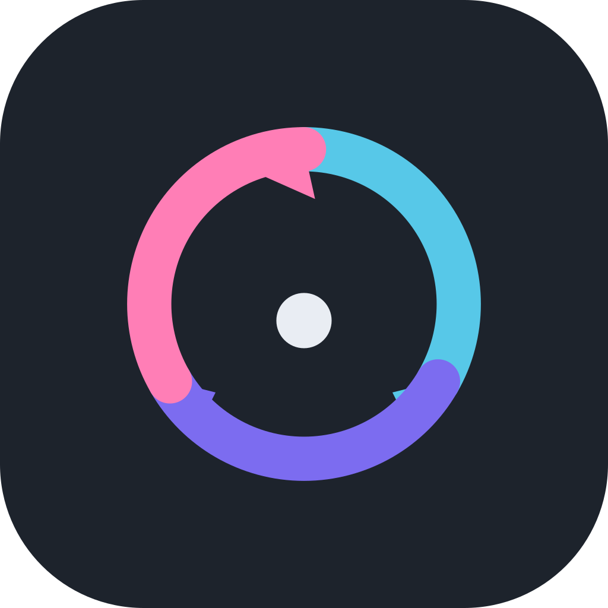

# LZSync

**One beatmap library across every osu! client on your machine.**

**English** | [简体中文](./README.zh-CN.md)

---

## Stop importing the same beatmaps five times

Running official osu!lazer alongside DeltaLazer, Ez2Lazer, g0v0, and classic osu!stable splits your beatmaps and settings across separate folders. Importing a 30 GB song folder into five clients eats 150 GB of disk space. Copying `client.realm` by hand strips custom fork columns, mixes private server IDs with Bancho IDs, or triggers a database reset when schema versions differ.

LZSync connects all your installed osu! clients to a single local hub. Download a beatmap, build a collection, or change your key bindings in one client, click **Sync**, and play in every other client with zero duplicate files on disk.

## Why players use LZSync

- **Five clients, one disk footprint.** LZSync stores every audio track, background image, `.osu` chart, skin element, and `.osr` replay once in a SHA-256 content-addressed store. Each client holds native hardlinks or symlinks to that store, so five clients use the disk space of one.
- **Sync across lazer forks and osu!stable.** Move beatmap sets, collections, and skins both ways between Realm-based lazer clients and classic osu!stable `Songs/`, `Skins/`, and `collection.db` folders in the same run.
- **Eight data categories.** Sync beatmap sets with all difficulties, collections, user skins, local scores with replays, key bindings, ruleset settings, mod presets, and shared `game.ini` options. Toggle each category on or off on the home screen.
- **Three-way change tracking.** LZSync remembers what each client had at the end of the last sync. If you add maps to a collection or rebind a key in one client, that update propagates to the others. If two clients change the same item in different ways, LZSync pauses that item and lets you choose which client wins or keep both versions separate.
- **Deletions stay deleted.** Removing a beatmap inside a client records a per-client deletion marker. Future syncs will not bring deleted beatmaps back unless you restore them from the Deleted view.
- **Client-aware translation.** LZSync adapts records for each target client before writing. It keeps Ez2Lazer's 10 custom columns intact, isolates `g0v0.top` private server IDs from Bancho, warns before DeltaLazer gimmick charts go to editors that drop gimmick sections, and filters out unsupported rulesets or mods.
- **Built-in database protection.** LZSync never alters a client's `client.realm` schema version and never writes to `osu!.db`. Before every write, it verifies that the game is closed, saves a timestamped database backup that you can restore in two clicks, and checks the database structure before committing.

## Supported clients

| Client | Synced categories | Storage format | Client-specific handling |
|---|---|---|---|
| **osu!lazer** | All 8 categories | `client.realm` v52 | Official Bancho baseline |
| **DeltaLazer** | All 8 categories | `client.realm` v51 | Detects gimmick chart sections and filters editor key ranges |
| **Ez2Lazer** | All 8 categories | `client_52011.realm` v52011 | Preserves 10 custom columns and skips BMS or external sets on export |
| **g0v0** | All 8 categories | `client.realm` v52 | Isolates `g0v0.top` online IDs and skips market rulesets |
| **osu!stable** | Beatmap sets, collections, skins | `osu!.db`, `collection.db`, `Songs/`, `Skins/` | Links song folders and updates `collection.db` via temp-file rename without touching `osu!.db` |

## How a sync run works

1. **Connect your clients once.** Launch LZSync to scan default data folders on Windows, macOS, and Linux, or drag any client folder into the window. Each client connects to the hub through a **Pull** track on top and a **Write** track on the bottom.
2. **Click Sync.** LZSync reads changes from your enabled clients, displays exact item counts on each client's write track, and switches the main button to **Write N items**. Click a second time to write.
3. **Decide only when needed.** Unambiguous additions and edits flow on their own. When two clients edit the same setting or a beatmap has a newer version, a card appears under **Pending** so you can pick a client's version, update to the new beatmap version, or click **Keep difference**.
4. **Browse your unified library.** Open Beatmap Sets, Collections, Skins, or Scores in the sidebar to search across every client at once. Colored dots on each row show which clients have the item, which will receive it on the next sync, and where conflicts exist.

## Download

Get the latest prebuilt release for your platform on the [GitHub Releases](https://github.com/ShineBreaker/LZSync/releases) page:

| Platform | Packages | Notes |
|---|---|---|
| **Windows x64** | `LZSync Setup *.exe`, portable `.zip` | Includes required runtime libraries |
| **macOS Universal** | `.dmg` for Apple Silicon and Intel | Ad-hoc signed; right-click and choose Open on first launch |
| **Linux x86_64** | `.deb`, `.rpm`, `.AppImage`, `.tar.gz` + `install.sh` | Requires GTK 3 and WebKitGTK 4.1 or 4.0 |

LZSync includes full English and Simplified Chinese interfaces. It matches your system language on first launch, and you can switch languages at any time in **Settings**.

## Technical documentation

Architecture details, sync decision rules, database safety invariants, and source build instructions live in separate docs:

- [Technical & build guide](./docs/technical.md)
- [Product behavior model & system design](./docs/design.md)
- [UI & interaction specification](./docs/DESIGN.md)
- [Native `librealm-ffi` build guide](./docs/dev-native.md)
- [Architecture Decision Records](./docs/adr/)
- [Client fork research notes](./docs/research/)

## License

[MIT](./LICENSE)
