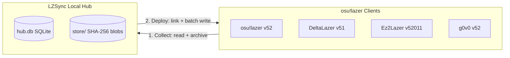

# LZSync

**English** | [简体中文](./README.zh-CN.md)

Sync beatmaps, collections, skins, scores, and settings across multiple osu!lazer forks on one machine without duplicating gigabytes of files or breaking your databases.

---

## Why LZSync?

Running official **osu!lazer** alongside forks like **DeltaLazer**, **Ez2Lazer**, and **g0v0** means maintaining separate data directories. Each client keeps its own `client.realm` database and its own multi-gigabyte `files/` directory. Manually re-importing `.osz` archives across clients wastes disk space, fragments your collections, and risks schema corruption if you copy database files directly.

**LZSync** solves this with a hub-and-spoke architecture. It collects data from any registered fork into a local SQLite hub, `hub.db`, and a single SHA-256 content-addressed file store, then deploys your chosen items to any target fork using native file links.



## Key capabilities

**Zero duplicate storage.** During collection, LZSync moves raw beatmap, skin, and replay files into its central `store/` and replaces the originals with symlinks or hardlinks. Deploying to another fork creates links to the same store, so four clients share one physical copy of every audio track, background, and `.osu` file.

**Full-fidelity sync across 8 data types.** Sync Beatmap Sets with all difficulties and metadata, Collections, Skins, Scores with `.osr` replays, Key Bindings, Ruleset Settings, Mod Presets, and shared `game.ini` preferences.

**Cross-fork compatibility engine.** Each fork has its own schema version, custom columns, and custom rulesets. LZSync adapts data automatically before writing to the target client:
- **Ez2Lazer `client_52011.realm`.** Decodes version `52011` as upstream 52 plus Ez revision 11, preserves Ez2Lazer's 10 custom columns on in-place updates, and filters out BMS ruleset items, external-hosted sets, and custom judgement scores when deploying to other clients.
- **g0v0.** Isolates server-specific `OnlineID` values on `g0v0.top` so private-server IDs never overwrite official Bancho IDs, and filters out custom market rulesets with `OnlineID >= 10`.
- **DeltaLazer.** Detects `.osu` files containing `[BeatmapSectionGimmicks]` or `[BeatmapHitObjectGimmicks]` and warns you before deploying to non-Delta clients where saving in the editor would strip gimmick data.
- **Key binding & mod filtering.** Filters `ActionInt` key bindings to the intersection of source and target enum ranges, drops unknown `StatisticsJson` hit result keys, and validates mod acronyms against the target fork's whitelist.

**Beatmap version chain & deletion tracking.** When a beatmap set updates, LZSync pairs the old and new versions by `OnlineID` or by title, artist, and mapper metadata with your confirmation. It deploys only the latest version, marks the superseded set with `DeletePending = true`, and unbinds old local scores cleanly. Items you delete in a client are recorded as per-fork tombstones so future syncs never resurrect deleted beatmaps unless you explicitly check them under the *Deleted* filter.

**Database safety guards.** Official osu!lazer resets `client.realm` from scratch if it detects corruption or an unknown schema version. LZSync protects your data at every step:
- **Never migrates schema versions.** Opens `client.realm` in `realm-core` dynamic mode, pinned to `realm-core 20.1.1` and file format v24, leaving the disk schema version untouched.
- **Process guard & lock detection.** Blocks sync while any osu!lazer fork is running.
- **Automatic timestamped backups.** Backs up the target `client.realm` before every deploy, with one-click restore in the UI.
- **Batch transactions with DriftGuard.** Snapshots the database schema before and after every batch transaction and rolls back immediately if any structural drift occurs.
- **Container export fallback.** Exports any beatmap set, skin, or score directly from the Compare view as `.osz`, `.osk`, or `.osr` and opens it with your system's default handler without touching the target `.realm` file.

## Supported clients

| Client | Data directory | Database file | Schema version | Notes |
|---|---|---|---|---|
| **osu!lazer** | `osu` | `client.realm` | `52` | Official upstream baseline |
| **DeltaLazer** | `deltalazer` | `client.realm` | `51` | Gimmick section detection & editor warning |
| **Ez2Lazer** | `osu-Ez2Lazer` | `client_52011.realm` | `52011` | Preserves 10 custom columns; filters BMS & external sets |
| **g0v0** | `g0v0` | `client.realm` | `52` | `g0v0.top` `OnlineID` isolation; filters market rulesets |

## How it works in 4 steps

1. **Libraries.** Click **Auto Scan** to discover installed forks in your platform data root: `~/.local/share`, `%APPDATA%`, or `~/Library/Application Support`. You can also add a custom `client.realm` path manually.
2. **Collect.** On the **Sync** page, click **Collect** for each fork you want to read into the Hub. LZSync projects all entities into `hub.db` and archives their files into `store/`.
3. **Compare.** Open **Compare**, pick **Deploy Preview: Hub to Target** or **Fork Diff: Source vs Target**, inspect changes by category, and click **Create Plan**.
4. **Deploy.** Return to **Sync**, review the pre-flight check, and click **Deploy**.

## Download

Prebuilt packages are published on the [Releases](https://github.com/ShineBreaker/LZSync/releases) page:

| Platform | Packages |
|---|---|
| **Windows** (x64) | `LZSync Setup *.exe` installer, portable `.zip` |
| **macOS** (Apple Silicon + Intel) | universal `.dmg` (ad-hoc signed: right-click → Open on first launch) |
| **Linux** (x86_64) | `.deb`, `.rpm`, `.AppImage`, `.tar.gz` + `install.sh` |

Linux packages depend on GTK 3 and WebKitGTK 4.1/4.0 (`libwebkit2gtk-4.1-0` on Debian/Ubuntu, `webkit2gtk4.1` on Fedora). The `.deb` and `.rpm` declare them; `.AppImage` and `install.sh` assume them present.

## Quick start & build

LZSync uses a Go backend with `purego` FFI bindings to the `realm-core` C API and a TypeScript + Vite desktop UI built on [MyGo](https://github.com/egoist/mygo).

### Prerequisites

- Go 1.24+, Bun, and WebKitGTK, declared in `manifest.scm` for GNU Guix + `direnv`.
- `librealm-ffi.so` from `realm-core 20.1.1`, fetched and built reproducibly via `./scripts/fetch-librealm.sh`.

### Build and run

```bash
# 1. Fetch and build realm-core 20.1.1 C API shared library
./scripts/fetch-librealm.sh

# 2. Run all verification gates: Go build/vet, integration tests, TypeScript check, bundle
just gates

# 3. Launch LZSync desktop app
just run
```

To try the UI without `librealm-ffi.so` or real game libraries, launch in demo mode with sample forks and diffs:

```bash
LZSYNC_MOCK=1 just dev
```

### Language support

LZSync includes full English and Simplified Chinese interfaces. It detects your system language on first launch, and you can switch languages anytime under **Settings → Language**.

## License

MIT
