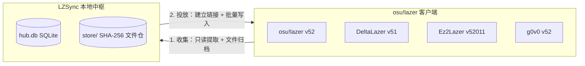

# LZSync

[English](./README.md) | **简体中文**

在同一台设备上同步多个 osu!lazer 客户端的谱面、收藏夹、皮肤、成绩与设置，支持官方 lazer、DeltaLazer、Ez2Lazer 与 g0v0，零重复磁盘占用，不破坏数据库结构。

---

## 为什么需要 LZSync？

同时游玩官方 **osu!lazer** 与 **DeltaLazer**、**Ez2Lazer**、**g0v0** 等衍生客户端时，每个客户端都维护着独立的数据目录、`client.realm` 数据库与动辄数十 GB 的 `files/` 资源目录。跨端重复导入 `.osz` 会成倍消耗硬盘空间；直接拷贝数据库文件则会因各端 schema 版本、自定义列与私服 ID 差异导致客户端无法启动甚至清空建库。

**LZSync** 采用中枢辐射架构，将各端数据收集至本地 SQLite 中枢 `hub.db` 与单一的 SHA-256 内容寻址文件仓 `store/`，再通过符号链接或硬链接按需投放到任意目标客户端。



## 核心特性

**多端共享单份文件，零重复占用。** 收集时，LZSync 将客户端新导入的音频、背景与 `.osu`/`.osr` 文件归档至中枢 `store/`，并在原位置替换为指向文件仓的链接；向其他客户端投放时直接建立链接，四个客户端共享同一份物理字节。

**覆盖 8 类核心数据。** 支持同步谱面集与全部难度及元数据、收藏夹、用户皮肤、本地成绩与 `.osr` 回放、键位绑定、规则集设置、Mod 预设，以及跨端通用的 `game.ini` 配置项。

**针对各端差异的自动兼容适配。** 不同客户端拥有各自的数据库列、专属规则集与服务器命名空间，LZSync 在写入前自动完成转换与过滤：
- **Ez2Lazer `client_52011.realm`。** 自动将版本号 `52011` 解码为官方基线 52 加 Ez 修订 11，就地更新时完整保留 Ez 专属的 10 个扩展列；向非 Ez 端投放时自动跳过 BMS 规则集、外部托管谱面与专属判定成绩。
- **g0v0。** 严格隔离 `g0v0.top` 私服与官方服务器的 `OnlineID` 命名空间，防止私服 ID 污染官方端；自动过滤 `OnlineID >= 10` 的服务器市场规则集数据。
- **DeltaLazer。** 自动检测含 `[BeatmapSectionGimmicks]` 或 `[BeatmapHitObjectGimmicks]` 的谱面并在投放报告中发出醒目提示，防止在非 Delta 端编辑器中保存时丢失专属数据。
- **键位与 Mod 白名单。** 按源端与目标端枚举范围交集过滤键位 `ActionInt`，自动剔除目标端不支持的 `StatisticsJson` 判定键，并校验成绩与预设中的 Mod 缩写。

**谱面版本链与防复活删除追踪。** 谱面更新后，LZSync 通过 `OnlineID` 或曲名、曲师、谱师元数据匹配识别同谱面的新旧版本，投放时只写入最新版、将旧版标记为 `DeletePending = true` 并安全解绑旧难度上的本地成绩。您在任一客户端内删除的条目会记录为该端的删除标记，后续同步默认不再重新投放，除非您在对比页的「已删除」筛选下主动勾选恢复。

**多重数据库安全防线。** 官方 osu!lazer 一旦遇到损坏或版本不匹配的 `client.realm` 会直接删库重建，LZSync 在每一步提供保护：
- **绝不篡改数据库版本。** 基于 `realm-core 20.1.1` 与文件格式 v24 动态模式读写，保持磁盘 schema 版本号原封不动。
- **进程监控与占用拦截。** 检测到任一客户端运行或持有数据库锁时立即拒绝读写。
- **写前自动备份与一键还原。** 每次投放前自动在 `backups/` 生成带时间戳的数据库备份，支持随时在界面内还原。
- **批次事务与结构防漂移。** 按批次开启事务，提交前比对写前与写后表结构快照，任何异常立即整批回滚。
- **容器导出兜底。** 支持在「差异对比」页将任意谱面集、皮肤或成绩直接打包导出为标准的 `.osz` / `.osk` / `.osr` 文件并调用默认程序打开，无需写入 `.realm` 数据库。

## 支持的客户端

| 客户端 | 默认数据目录 | 数据库文件 | Schema 版本 | 适配说明 |
|---|---|---|---|---|
| **osu!lazer** | `osu` | `client.realm` | `52` | 官方上游基线 |
| **DeltaLazer** | `deltalazer` | `client.realm` | `51` | Gimmick 段落检测与跨端编辑提醒 |
| **Ez2Lazer** | `osu-Ez2Lazer` | `client_52011.realm` | `52011` | 保留 10 个扩展列；过滤 BMS 与外部托管谱面 |
| **g0v0** | `g0v0` | `client.realm` | `52` | `g0v0.top` 在线 ID 隔离；过滤市场规则集 |

## 四步使用流程

1. **客户端库。** 点击**自动扫描**发现系统数据目录下的客户端库，或手动输入 `client.realm` 路径添加。
2. **收集。** 在**收集与投放**页点击对应客户端右侧的**收集**，将最新数据读取至中枢并将实体文件归档入仓。
3. **差异对比。** 进入**差异对比**页，选择「投放预览：中枢到目标库」或「跨端对比：源库与目标库」，按分类审视并勾选条目，点击**生成投放计划**。
4. **投放。** 返回**收集与投放**页，确认进程检查与备份路径无误后点击**开始投放**。

## 快速开始与构建

LZSync 后端采用 Go 编写并通过 `purego` 绑定 `realm-core` C API，前端采用基于 [MyGo](https://github.com/egoist/mygo) 的 TypeScript + Vite 桌面界面。

### 环境依赖

- Go 1.24+、Bun 与 WebKitGTK，使用 GNU Guix + `direnv` 时由仓库内的 `manifest.scm` 自动声明加载。
- `librealm-ffi.so`，钉死 `realm-core 20.1.1`，通过 `./scripts/fetch-librealm.sh` 自动拉取并构建。

### 构建与运行

```bash
# 1. 获取并构建 realm-core 20.1.1 动态库
./scripts/fetch-librealm.sh

# 2. 运行四道门禁：Go 编译与静态检查、全量集成测试、TypeScript 检查、应用打包
just gates

# 3. 启动 LZSync 桌面端
just run
```

若当前环境未准备游戏数据或 native 库，可使用内置演示模式启动并体验完整交互：

```bash
LZSYNC_MOCK=1 just dev
```

### 语言切换

内置**简体中文**与 **English** 双语界面。首次启动自动匹配系统语言，也可随时在**设置 → 界面语言 / Language** 中一键切换。

## 许可证

MIT
