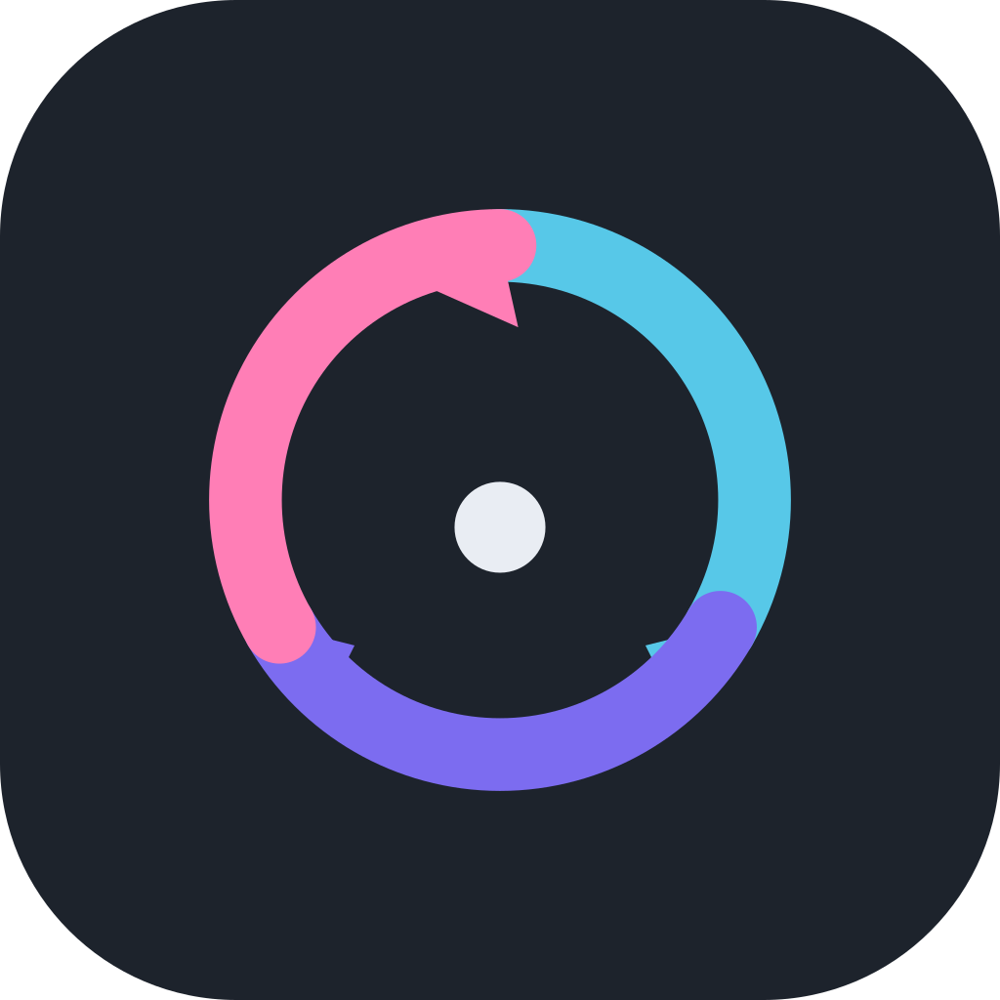

# LZSync

**一台设备，五个 osu! 客户端，共用同一套曲库与配置。**

[English](./README.md) | **简体中文**

---

## 告别一份谱面导入五遍

同时游玩官方 osu!lazer、DeltaLazer、Ez2Lazer、g0v0 与旧版 osu!stable 时，每个客户端都维护着独立的数据目录。把 30 GB 的曲库分别导入五个客户端会占用 150 GB 磁盘空间；手动拷贝 `client.realm` 数据库又会丢失衍生端专属列、混入私服在线 ID，甚至因数据库版本号不同触发客户端删库重建。

LZSync 将本机所有 osu! 客户端连接到同一个本地资料库。在任意客户端下载新谱面、整理收藏夹或修改键位后，点击一次「同步」，即可将其余客户端更新到位，且磁盘上只占一份文件空间。

## 核心亮点

- **五端共用一份磁盘空间。** 音频、背景图、`.osu` 谱面、皮肤与 `.osr` 回放文件全部按 SHA-256 哈希存入本地文件仓，各客户端通过系统原生的硬链接或符号链接挂载读取，五个客户端只占一份硬盘容量。
- **打通 lazer 衍生端与旧版 osu!stable。** 同一次同步即可在基于 Realm 数据库的四个 lazer 客户端与基于 `Songs/`、`Skins/`、`collection.db` 的 osu!stable 之间双向同步谱面集、收藏夹与皮肤。
- **覆盖 8 类游戏数据。** 支持谱面集与全部难度、收藏夹、用户皮肤、本地成绩与回放、键位绑定、规则集设置、Mod 预设及通用 `game.ini` 选项，可在主界面按板块独立开关。
- **三方基线变更识别。** LZSync 记录每个客户端上次同步后的状态。单端新增收藏或修改键位会传播至其他客户端；若两个客户端把同一项改成了不同内容，LZSync 会暂停该项并交由你选择以哪一端为准，或保留两端差异。
- **删除操作不复活。** 在某个客户端内删除的谱面会记入该端的删除记录，后续同步不会将其重新写回，需要时可在资料库的「已删除」筛选下恢复。
- **跨端差异自动转换。** 写入前按目标客户端规则完成适配：保留 Ez2Lazer 的 10 个扩展列，为 g0v0 排行榜保留 Bancho 谱面 id，并隔离 g0v0 的成绩与账号 id，对含 Gimmick 段落的 DeltaLazer 谱面给出跨端编辑提醒，并跳过目标端不支持的规则集与 Mod。
- **多重数据库安全保护。** 永不改动任何客户端的 `client.realm` 磁盘版本号，也永不写入 `osu!.db`。每次写入前检查游戏进程是否关闭、生成带时间戳的数据库备份供随时还原，并在事务提交前校验表结构完整性。

## 支持的客户端

| 客户端 | 同步数据范围 | 存储格式 | 专属适配策略 |
|---|---|---|---|
| **osu!lazer** | 全部 8 类数据 | `client.realm` v52 | 官方 Bancho 基线 |
| **DeltaLazer** | 全部 8 类数据 | `client.realm` v51 | 检测 Gimmick 谱面段落，按版本范围过滤编辑器键位 |
| **Ez2Lazer** | 全部 8 类数据 | `client_52011.realm` v52011 | 保留 10 个扩展列，向其他客户端导出时跳过 BMS 与外部托管谱面 |
| **g0v0** | 全部 8 类数据 | `client.realm` v52 | 保留 Bancho 谱面 id，使私服排行榜仍能加载；隔离 g0v0 成绩与账号 id，并过滤市场规则集 |
| **osu!stable** | 谱面集、收藏夹、皮肤 | `osu!.db`、`collection.db`、`Songs/`、`Skins/` | 链接式生成 `Songs/` 曲目目录并原子更新 `collection.db`，不触碰 `osu!.db` |

## 如何使用

1. **连接客户端。** 启动后自动扫描系统默认数据目录，也可将客户端文件夹拖入窗口。每个客户端通过上下两条轨道连接资料库，点击上轨切换「拉取」，点击下轨切换「写入」。
2. **点击同步。** 点击主按钮后，LZSync 读取各端变动并在轨道上显示待写入数量，主按钮变为「写入 N 项」，再次点击即完成写入。
3. **按需拍板分歧。** 无歧义的新增与改动自动流转；遇到两端同时修改同一配置或发现同名谱面新版本时，主界面下方会浮现「待处理」卡片，点选任一客户端取值、更新为新版本或点击「保留差异」即可。
4. **全局浏览与管理。** 在侧栏切换谱面集、收藏、皮肤或成绩，即时搜索全部库存。每行右侧的彩色圆点展示哪些客户端已拥有该条目、哪些将在下次同步时写入，并支持勾选单条记录单独同步或恢复已删曲目。

## 界面截图

**同步台。** 全部客户端一屏尽览：每个客户端经同一条本地中枢拉取与写入，类别开关与同步按钮各就各位。

**设置。** 语言、基线 fork、存储路径、链接模式，以及客户端运行期间拦住写入的进程守卫。

## 下载安装

前往 [GitHub Releases](https://github.com/ShineBreaker/LZSync/releases) 页面获取对应平台的预编译安装包：

| 平台 | 安装包类型 | 说明 |
|---|---|---|
| **Windows x64** | `LZSync Setup *.exe` 安装包、便携版 `.zip` | 已内置所需运行库 |
| **macOS Universal** | Apple Silicon 与 Intel 通用 `.dmg` | 采用 ad-hoc 签名，首次启动请右键点击应用并选择「打开」 |
| **Linux x86_64** | `.deb`、`.rpm`、`.AppImage`、`.tar.gz` + `install.sh` | 依赖 GTK 3 与 WebKitGTK 4.1 或 4.0 |

软件内置简体中文与英文界面，首次启动自动匹配系统语言，也可随时在「设置」中切换。

## 技术与开发文档

存储架构、三方判定细节、各端兼容规则、安全约束与源码构建流程已拆分为独立文档：

- [技术与构建说明](./docs/technical.zh-CN.md)
- [产品行为模型与同步体系设计](./docs/design.md)
- [界面与交互设计准则](./docs/ui-spec.md)
- [Native 动态库构建手册](./docs/dev-native.md)
- [架构决策记录](./docs/adr/)
- [各客户端差异调研笔记](./docs/research/)

## 许可证

[MIT](./LICENSE)
