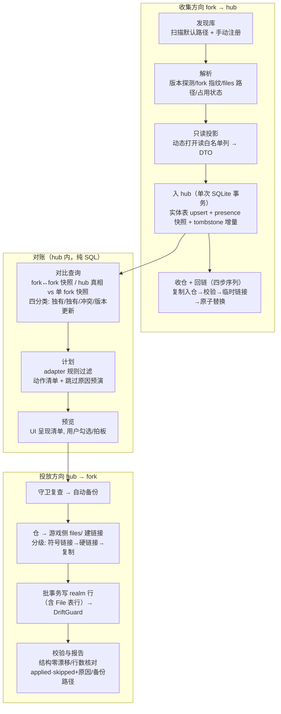

# LZSync 同步与适配体系设计

> 定位：LZSync = 管理同一台机器上多个 osu!lazer fork（官方 lazer、DeltaLazer、Ez2Lazer、g0v0）数据目录的同步工具（Go 后端 + mygo Web UI），尽量同步所有可同步内容（曲库、收藏、皮肤、成绩、设置）。
> **架构基线（用户拍板，PoC 通过后确立）**：hub-and-spoke——LZSync 以自有数据目录内的 **SQLite 中枢（hub）为单一真相源**存储全部相关数据，自有**内容寻址仓**存放实体文件；各 fork 的 realm 库与 files/ 降级为**投影/挂载点**（投放 = 写 realm 行 + 向游戏侧 files/ 建链接）。动机：realm 生态已停更（realm-dotnet 维护停摆，go-realm-options §1.3-5），把真相收敛在 LZSync 自有格式中，未来上游从 realm 切换走时只需重写投放器、hub 与仓不动。
> 本文是施工蓝图：约束先于方案，每个决定标注依据。事实引用简写 `lazer-baseline` / `fork-delta` / `fork-ez2lazer` / `fork-g0v0` / `ezrealmsync-design` / `fork-comparison` / `go-realm-options`，均指 `docs/research/` 下同名调研文档（2026-10-24 完成，自包含，不依赖 `reference/` 存活）；PoC 实测结论标注「PoC 实证」。
> 四端事实速览（fork-comparison §0/§1）：官方 lazer（schema 52，`client.realm`，目录 `osu`）、DeltaLazer（51，`client.realm`，`deltalazer`，Realm 与官方完全同构）、Ez2Lazer（**52011** = 52×1000+11，**`client_52011.realm`**，`osu-Ez2Lazer`，官方列全保留 + 10 规范列 + 7 张技能表）、g0v0（52，`client.realm`，`g0v0`，schema 零结构改动，连独立服务器 g0v0.top）。

---

## 0. 产品行为模型（用户拍板 2026-10-26，优先级最高）

> 本节是「LZSync 同步该做什么」的唯一权威定义。§1–§8 是施工细节：与本节冲突时以本节为准，冲突处已就地标注「→ §0」。修改本节须用户拍板并同步 ADR-0004。

### 0.1 一句话

LZSync 本体是一座**收全的仓库**（hub），每个 fork 都是它的导入导出源：收进来时 hub 没有的才入库、已有的不覆盖、各端不同的分别存；导出时只导**全部目标端都能接受**的部分（全局交集），且只做**能判定该同步**的改动——判不准就不动，保留差异。

### 0.2 行为约束

| # | 约束 | 落法要点 |
|---|------|---------|
| B1 | **Hub 收全** | 凡可存的数据都进 hub，含只有某一端支持、导不出去的数据（导不出去 ≠ 不收）。投影跳过集只允许三类：无实体字节（Ez 外部托管集）、各端自备的内置项（Protected 系统集与内置皮肤）、S10 红灯数据 |
| B2 | **收集只增不改** | hub 没有的才入库；已有实体的规范载荷**首见即定**，后续收集不覆盖（废止 HB3「整行覆盖」）；各端对同一身份的不同取值作为该端的**变体**分别存（presence 按端快照），绝不以一端的值抹掉另一端的值 |
| B3 | **导出取全局交集** | 一轮同步的导出域 = 能被**设置中全部目标端**接受的数据：对每个目标端跑兼容规则（§5.4），任一端拒绝即不向任何端导出。需按端裁剪的形态（写入列、StatisticsJson 键、ActionInt 枚举域、game.ini 键）取全部目标端的交集，所有目标拿到同一形态。交集按配置的目标端集合计算，**含本轮因运行中被跳过的端**。被排除项计数并给原因（「〈端〉不支持」）。例外：S8 OnlineID 命名空间是安全规则而非兼容规则，仍逐端判定 |
| B4 | **只做可判定的同步** | 同一身份各端取值不同时，按**基线三方判定**（§0.3）：只有能确定「谁改了、改成什么」的改动才传播；判不准（多端各改各的、无基线的分歧）= 冲突，各端原样保留、不写任何一端 |
| B5 | **补缺** | 某身份 hub 有、目标端没有 → 新建；前提：在全局交集内、未命中该端 tombstone、取值无歧义（§0.3 的决定值唯一） |
| B6 | **删除不传播、不复活** | 沿用 §5.4：某端删除整条实体只记该端 tombstone，不撤回其他端，也不被下一轮补回；恢复需用户显式操作。注意区分：收藏成员增删、版本替换旧版软删属于**取值变化**，走 B4 |
| B7 | **端本地字段永不同步** | 语义按端各异或由客户端派生的字段（DateAdded、LastPlayed、StatusInt、StarRating、PP、Hidden、UserSettings.Offset、EditorTimestamp、LastModified 等）不参与判定、不写目标端已有值；新建行时取同 ServerRealm 来源端的值，无则取默认。清单数据化于 forks/adapter 包数据 |
| B8 | **数据板块开关** | 设置按板块（谱面集〔含难度〕/ 收藏 / 皮肤 / 成绩 / 键位 / 规则集设置 / Mod 预设 / game.ini）开关；关闭的板块不收集、不投放、不推进基线。依赖照常按硬约束兑现（如谱面集关闭时成绩仍只挂到目标已有的谱面，缺谱面即 S7 跳过计数） |
| B9 | **端角色分开勾** | 每端两个开关：**来源**（其数据与改动进入 hub、可传播）与**目标**（接受投放）。仅来源端**绝不被写**：只读投影 + 复制入仓，不回链（§5.3 收仓的原位替换也是写）；仅目标端：每轮只读快照用于对账与基线，其本地改动不作为来源传播，但同样受 B4 保护不被覆盖；两者皆关 = 完全不碰。新发现的端默认两者皆开 |
| B10 | **一切同步入口遵循设置** | 主界面「同步」按钮 = 对全部参与端执行一轮同步（§0.4）；数据页「同步所选」= 同一流程限定到所选条目。没有绕过板块开关、端角色、全局交集的同步路径 |
| B11 | **一轮内逐端独立** | 运行中的端本轮跳过（不读不写，基线不推进）；某目标端投放失败不影响其他端；写入安全约束（S1–S12：备份、批事务、DriftGuard、占用拒写）对每个目标端照常逐一兑现 |
| B12 | **判不准的交给人** | 冲突、弱键疑似版本、恢复候选、交集外项本轮一律不动，汇总进报告并在数据页标注；用户处置方式：选定某端变体推向全部目标端 / 接受差异 / 显式恢复。处置后基线随之推进（§0.3） |

不做（本模型下仍成立）：后台监听、定时调度、游戏退出自动触发——一轮同步只由用户点击触发；删除传播；跨服务器 OnlineID 对拷（S8）。

### 0.3 基线三方判定（B4 细则）

**同步身份与同步值**（「是不是同一个东西」与「它现在是什么」分开）：

| 板块 | 同步身份 | 同步值 | 判定粒度 |
|------|---------|--------|---------|
| 谱面集 | 谱面身份键（§4.2 第二层；OnlineID 强键，元数据弱键须用户确认配对） | 该端持有的版本（集内容哈希） | 整值；替换按 §5.4 整集原子替换 |
| 收藏 | Name | BeatmapMD5Hashes 成员集合 | **逐成员**：每个成员独立判定，不同端各自加图可合并、不冲突 |
| 皮肤 | Hash | —（内容寻址，不可变） | 仅补缺（B5） |
| 成绩 | (BeatmapHash, Hash) | —（不可变） | 仅补缺（B5） |
| 键位 | (RulesetName, Variant, ActionInt) | 该 action 的 KeyCombination 集合 | 整值 |
| 规则集设置 | (RulesetName, Variant, Key) | Value | 整值 |
| Mod 预设 | (RulesetShortName, Name) | Mods + Description | 整值 |
| game.ini | 白名单键名 | 值 | 整值 |

**基线** `b(f, I)`：端 f 上身份 I 在**上一轮同步结束时**的取值（LZSync 重读该端得到的最终值）。当前值 `v(f, I)` 来自本轮快照。

**判定**（对每个身份 I，在本轮全部快照完成后）：

1. **变更来源** Δ = 有基线、且 `v ≠ b`、且 `v` 非缺席的来源端（整条消失是删除，走 B6，不算变更）。
2. **候选值**：若有任一端持有 I 的基线（I 有同步史）→ 候选 = Δ 的新值；若无任何基线（I 首次出现）→ 候选 = 全部持有 I 的来源端的值。
3. 候选为空 → 无动作（已有差异原样保留）。候选多值 → **冲突**，所有端不动。候选唯一 → 决定值 `v*`。
4. 对每个目标端 t 写入 `v*` 的前提：t 未自行改动（有基线时 `v(t) = b(t)`；无基线时 `v(t)` 缺席或等于 `v*`），且 `v*` 在全局交集内、t 未命中 tombstone。t 自行改动且 `≠ v*` → 该端受保护跳过并计冲突。
5. 有同步史的 I 上出现无基线的不同取值（如新加入的端带着默认设置）→ 计冲突，不拿新端的值覆盖既有各端，也不覆盖新端。

**基线推进**：一轮结束时，对本轮成功快照（及写入后重读）的每个端 f、每个**非冲突**身份 I：`b(f, I) := 该端最终值`。冲突身份基线不动、持续标记，直到用户处置——选定变体推向全部目标端后推进；接受差异则各端基线推进为各自当前值（此后视为既定差异，任一端再改动照常判定）。跳过/失败的端基线不动。

**谱面集补充**：弱键疑似配对在用户确认前，涉及的版本不参与自动同步（不补缺、不替换），列入待处理——否则会给持有另一版本的端造出同谱面双版本。确认配对后按上述判定执行。`superseded_by` 版本链退为历史记录，「当前版本」由本节判定给出，不再由收集先后决定。

### 0.4 一轮同步流程（B10）

1. 读设置：开启的板块、来源端集合 S、目标端集合 T（交集与判定都基于配置，不随本轮跳过而变）。
2. 逐端守卫：S ∪ T 中运行中的端本轮跳过并提示；其余端继续。
3. 快照：S 中各端完整收集（只读投影入 hub + 收仓；仅来源端不回链，B9）；T \ S 的端只刷新快照（presence），不入实体、不收仓。
4. 判定：对每个目标端，按 B5 补缺 + §0.3 三方判定 + B3 全局交集 + B6 tombstone 生成本端计划；冲突/待确认/交集外项不入计划。
5. 执行前确认：展示「将写入的端 × 条目数、将跳过的端」，二次点击确认（不可误触）。
6. 逐目标端投放：守卫复查 → 备份 → 批事务 → DriftGuard（§3.3 原样）；端间独立，一端失败不中止其他端。
7. 收尾：重读已写入的目标端快照，按 §0.3 推进基线；报告按端列出 applied / skipped+原因 / 冲突 / 待确认 / 交集外 / 备份路径。

### 0.5 现状差距（程序对齐清单）

2026-10-26 盘点：下列为现有实现与本节的差距，后续施工按此逐项消除，完成即在此标注。

| # | 差距 | 现状 |
|---|------|------|
| G1 | 设置持久化：注册表、端角色（B9）、板块开关（B8）落 `config.json`，设置页可编辑 | ✅ 2026-10-26 已落地（`appsvc/config.go`）；原状：注册表为内存态（appsvc `registry`），设置页只读 |
| G2 | 一轮同步编排（§0.4）+ 顶栏同步按钮 | ✅ 2026-10-26 已落地（`appsvc/run.go` PrepareRun/PrepareSelected/CommitRun + 顶栏按钮）；过渡：自动计划只含补缺，版本更新计入「需确认」待 G7；原状：只有逐端手动拉取 + 单计划投放；`plan.json` 只容一份计划，数据页对各端并发 `BuildPlan` 互相覆盖且不执行 |
| G3 | 逐端守卫（B11） | ✅ 2026-10-26 已落地（`guard.EnsureClearFork`）；原状：`guardClear` 任一游戏运行即全局拒绝 |
| G4 | 收集只增不改（B2）；仅目标端只刷快照、仅来源端不回链（B9） | ✅ 2026-10-26 已落地（insert-if-absent、`collect.Mode`、`Snapshot.Kinds/PresenceOnly`）；原状：hub upsert 整行覆盖并改写 `origin_fork`（HB3） |
| G5 | 冲突默认不动（B4） | ✅ 2026-10-26 已落地（冲突默认不勾、`deploy.BuildPlan` 冲突→skip；数据页显式勾选 = 选定 hub 变体）；原状：冲突项默认勾选、动作 = hub 覆盖目标（`planItemFrom` conflict → update） |
| G6 | 全局交集（B3） | ✅ 2026-10-26 已落地（`Plan.Intersection`：成绩/Mod 预设/键位枚举域/game.ini 键）；原状：兼容规则按（源, 目标）逐对判定 |
| G7 | 基线表 + 三方判定（§0.3）；键位同步身份改三段键、值为组合集合；收藏逐成员；版本链退为历史 | ✅ 2026-10-26 已落地（hub schema v4 `baseline` 表 + 三方判定引擎接入一轮同步 37213ae/45bcf68）；原状：对账 = canonical vs 目标 presence；键位内容键含 KeyCombination；当前版本由收集先后决定 |
| G8 | game.ini 逐键三方 + 交集 | ✅ 2026-10-26 已落地（决定值载荷/来源端透传、ActionDelete 与逐键 ini b3c1616/45bcf68）；原状：源 = 快照最新的非目标端（LastWrite 近似） |
| G9 | S8 判据改为「同 ServerRealm 来源端的 presence 值」 | ✅ 2026-10-26 已落地（d02e2c0 按决定值来源端判域 + fbdbdde identity_version 注册表锚定）；原状：依赖 `origin_fork`，B2 后它只代表首见来源 |
| G10 | 端本地字段数据化、永不覆盖目标值（B7） | ✅ 2026-10-26 已落地（d02e2c0 B7 端本地字段不覆写）；原状：冲突字段含 StatusInt 等本地字段；设计曾留 LastWrite-wins 选项 |
| G11 | hub 收全（B1）：fork 专有皮肤等入 hub，由导出交集排除 | ✅ 2026-10-26 已落地（93c0789 hub 收全 + 出口全局交集）；原状：投影阶段即跳过 fork 专有皮肤 |
| G12 | 数据页状态与 x/y 改用三方判定结果（冲突/需确认/交集外） | ✅ 2026-10-26 已落地（93c0789 数据页三方判定行态）；原状：状态取各端预演的最差分类 |
| G13 | B12「接受差异」处置入口：选中单位各端基线推进为当前值 | ✅ 2026-10-27 `SyncService.KeepDifference`（UI：待处理取值卡「保留差异」）；原状：冲突只能选定变体推平，无法保留差异 |

---

## 1. 约束（先于一切）

以下为硬性约束。任何后续模块设计、实现与测试不得违背；与约束冲突的方案一律不作候选。

### 1.1 数据安全

| # | 约束 | 理由（一句） |
|---|------|------------|
| S1 | **永不写坏库**：只写目标库已有的列（写入集 = 白名单 ∩ 目标库实际 schema），全部写入走显式事务（事务边界 = 批，§3.3），事务末尾做写前/写后结构快照一致性校验（DriftGuard），任何漂移**整批回滚** | 官方客户端对无法打开的 `client.realm` 的处理是**删除重建**（lazer-baseline §1.3、§3.3），写坏库等于替用户清空数据 |
| S2 | **写前自动备份**：任何写入操作前自动生成时间戳备份（`client.realm` → 备份目录），未配置备份目录时退化为库同目录带时间戳副本；已存在同名备份绝不覆盖 | 覆盖不可逆；EZRealmSync 生产工具把「没配置目录也要留一份原件」定为不可省的退路（ezrealmsync-design §5.2） |
| S3 | **不改 schema 版本、绝不迁移**：动态模式打开（不传 schema）钉死磁盘版本；磁盘版本号只读不写；要让库升版本，引导用户用对应 fork 的客户端打开一次 | 版本号是客户端迁移的输入，擅自改写会让下一个客户端按错误路径迁移或直接拒开（ezrealmsync-design §3.2；fork-comparison R4：把 Ez 号写进官方库，官方客户端立刻 SchemaMismatch） |
| S4 | **软删优先**：删除 BeatmapSet/Score/Skin/ModPreset 一律写 `DeletePending = true`，由目标客户端下次开库时 `cleanupPendingDeletions` 兑现；唯一例外是收藏夹（无软删语义，整行 Remove，与官方一致） | 官方数据模型即软删（lazer-baseline §7.3-4；go-realm-options §1.2），物理删除绕过游戏侧清理与引用处理，风险不可控（ezrealmsync-design §5.1） |
| S5 | **目标库被占用时拒绝写入**：写入前做进程守卫（检测各 fork 可执行进程，全平台）+ 占用探测，失败即拒绝并把「请先关闭游戏」作为一等公民提示，不做等待重试写入。占用探测的**跨平台语义**：Windows 用独占打开探测（等价 EZRealmSync 的 `FileShare.None` 开-即-释，ezrealmsync-design §5.5）；**Unix 不把 `flock(client.realm)` 当防线**（无进程持该锁、恒成功=假阴性），以「尝试 realm-core 打开写入会话」为准——realm 自身的 `.management` 内部锁协调会拒绝并发打开（报 "Realm file is currently open in another process"，go-realm-options §1.3-7），即**写会话打开本身就是最强占用探测**，进程名扫描只负责提前给出友好提示 | Realm 跨进程共享同一库要求同架构且 core 版本兼容，写窗口 = 游戏进程关闭时（go-realm-options §1.3-7；ezrealmsync-design §5.5） |
| S5a | **file format 版本防线**：LZSync 携带的 librealm 钉死 20.1.x，与四端精确对齐（四端 Realm NuGet 全部 20.1.0，本仓库核验：`reference/{lazer,delta,Ez2Lazer,g0v0}/osu.Game/osu.Game.csproj` 依次 :40/:42/:44/:66 → 内置 core 20.1.1 / file format v24）；对打开失败的库（文件格式比自带 core 更新，未来某端升级 SDK 后的场景）一律拒绝读写并提示升级 LZSync，绝不尝试用更高版本 core 触碰用户库 | realm 文件格式 v10+ 的自动升级**不可逆**（无法被旧 SDK 打开，go-realm-options §1.3-2）——S1–S10 只防 schema 版本，此处补 file format 版本；同代对齐下无风险，防线针对未来分叉 |
| S6 | **File 表行与模型引用必须同一事务成对写入**；files/ 磁盘文件（链接或副本，§5.3）先于 Realm 行落地 | lazer 的 `Cleanup()` 会物理删除所有引用计数为零的 RealmFile 及其磁盘文件（lazer-baseline §1.4；fork-comparison R3）；先写行后落文件则产生读流失败的坏引用（fork-ez2lazer §6 外部托管行即此后果） |
| S7 | **绝不写悬空行**：成绩在目标库找不到 `BeatmapHash` 对应难度即跳过并计数，绝不落地无谱面成绩；单独同步难度而目标缺父谱面集时报错阻止 | ScoreInfo.BeatmapInfo 官方允许为 null 但那是「谱面事后变化」的暂态；工具写入悬空行即制造坏数据（ezrealmsync-design §2.7、§2.8） |
| S8 | **在线 ID 不跨服务器对拷**：`Score.OnlineID/LegacyOnlineID`、`BeatmapSet.OnlineID`、`RealmUser.OnlineID` 只在两端连接同一服务器时可携带；任何端与 g0v0 之间绝不互拷（新行置 -1，更新行不触碰该列） | OnlineID 分属不同服务器的命名空间，对拷即张冠李戴（fork-g0v0 §7.5；fork-comparison R1） |
| S9 | **全库级覆盖永远是最后一步**：任何重建整库/整目录的操作先产临时产物、自检（版本号、结构、行数三查）通过后再原子替换原文件 | 前面任何失败原文件一字未动（ezrealmsync-design §4.2 的收窄链路先例） |
| S10 | **凭据与机器绑定数据绝不同步**：`game.ini` 的 `Token`/`Username`、`framework.ini`、`storage.ini`、`client.realm.lock/.management/.note`、`rulesets/`、`online.db`、各 fork 私有文件（`EzSkinSettings.ini`、`rulesets.json` 等）一律排除 | OAuth 凭据敏感且跨服务器错位、framework.ini 绑定显示器/音频设备、伴生文件是进程锁（fork-comparison §5.3 红灯清单） |
| S12 | **ini 类文件原子写**：game.ini 的任何写入走「写前备份原件 → 临时文件 → rename 原子替换」，绝不就地覆写 | ini 无事务概念，游戏关闭的写入窗口内 LZSync 崩溃会留半份文件；EZRealmSync 不做 ini，无先例可搬，须自补此纪律 |

### 1.2 自包含

- **C-1 代码与文档不得依赖 `reference/` 存在**：`reference/`（各 fork 与 EZRealmSync 的源码镜像）将来会被整体删除；全部 fork 知识已摘录进 `docs/research/`（各调研文档头部声明自包含）。落法：代码内 fork 知识（列白名单、目录名、版本编码）以 `docs/research/` 摘录为准写成内部数据/fixture；运行时结构信息以「从真实库采集的结构档案」为准（见 §4.3），不从 `reference/` 读取任何东西。

### 1.3 平台与分发

- **P-1 分发形态 = 每平台产物目录 = Go 二进制 + 1 个 realm-core 共享库（`librealm.so`/`.dylib`/`realm.dll`）+ 资源**，不做「严格单二进制」承诺。理由：purego 只能 Dlopen 动态库，realm-core 无官方预编译产物，必须自建三平台构建 CI 并把版本钉在与客户端对齐的 20.1.x（go-realm-options §3、§7-1）；仓库产物已是 `build/linux-amd64/` 目录形态（go-realm-options §1.1）。目标平台：linux-amd64、windows-x64、macos-universal。
- **P-2 native 库加载失败时应用可启动**（进入降级模式，只显示诊断与只读探测不可用），不闪退。理由：sidecar 缺失/架构不符是真实分发场景（go-realm-options §8-3 对 mygo sidecar 机制标注未确认）。
- **P-3 数据目录按平台规则解析**：Linux `$XDG_DATA_HOME`（默认 `~/.local/share`）、Windows `%APPDATA%`、macOS `~/Library/Application Support`（lazer-baseline §1.1；Windows/macOS 的确切顺序未实证，运行时以「目录存在 + 库文件存在」探测兜底，见 §3.2）。

### 1.4 mygo 架构

- **M-1 Go 后端承载全部系统能力**（hub 存储、Realm 读写、仓与链接、进程守卫、备份），Web 前端只经 typed bindings 调用、不直接触碰文件系统或 native 库。理由：现有骨架即此形态（main.go:39 `mygo.Bind(Greeter{})`；mygo.config.ts:13 `bindings: "src/mygo.ts"`；`mygo generate` 把 Go 方法生成为 src/mygo.ts 中的类型化函数——main.go:11-12 注释、src/mygo.ts:1）。
- **M-2 长任务进度经 mygo 事件推送**（`mygo.NewEvent` 模式，main.go:36 的 `Tick` 即先例），同步执行不阻塞 UI 线程。
- **M-3 前端为 vanilla TypeScript + Vite**（src/main.ts 直接 DOM 操作，无框架依赖；tsconfig.json strict + noUncheckedIndexedAccess），不引入重框架。
- **M-4 UI 服务接口做成「真实后端 / Mock 后端」可切换**。理由：EZRealmSync 的 `--ui-test` Mock 后端结构让 UI 可在没有 native 库的环境开发与冒烟（ezrealmsync-design §1.1、§6.1-9）。

### 1.5 范围

**做**（按 fork-comparison §5 绿灯/黄灯清单收敛）：

1. 四端数据目录发现、注册、身份识别（fork 指纹 + 磁盘 schema 版本探测，含 Ez 的 `official×1000+ez` 编码解码）。
2. 收集与对比预览：各 fork 状态快照收进 hub（收集方向），此后对比 = hub 内 SQL 查询（源独有 / 目标独有 / 冲突 / 版本更新）。
3. 投放（hub → 目标 fork；一轮同步对设置中的全部目标端逐端投放 → §0.4；计划切批执行，事务边界 = 批，§3.3）：谱面集与难度（含仓→游戏侧链接投放）、收藏夹、用户皮肤、本地成绩、键位（RealmKeyBinding）、规则集设置（RealmRulesetSetting）、ModPreset、game.ini 白名单键。
4. 差异适配：Ez 追加列保护与丢弃、Ez 7 张技能表/外部托管谱面集/BMS 规则集过滤、g0v0 市场规则集行过滤、成绩 mod 白名单与 StatisticsJson 未知键过滤、OnlineID 命名空间规则、delta gimmick 谱面检测告警——**每一条被丢弃/跳过的数据必须计数并给出原因，不静默吞掉**（ezrealmsync-design §4.4 的核心承诺）。
5. 写前备份、软删、进程守卫、执行报告与备份恢复入口。

**明确不做**（及理由）：

| 不做 | 理由 |
|------|------|
| schema 迁移 / 版本升降 | 各 fork 客户端自己的职责；工具做迁移必然与客户端竞速（S3；ezrealmsync-design §3.2） |
| 后台监听、定时调度、游戏退出自动触发 | 同步窗口要求游戏关闭（S5）；一轮同步只由用户点击触发（→ §0.2 B10）。多端双向由基线三方判定承担冲突语义（→ §0.3），不再因「会来回覆盖」而排除 |
| 服务器间数据对拷（在线 ID、排行榜） | 命名空间隔离（S8） |
| 改写 `.osu` 文件内容（含 gimmick section 的注入/剥离） | 文件内容是哈希体系的根，改写即破坏内容寻址与成绩锚点；delta gimmick 只做检测与告警（fork-delta §7.2：以 delta 侧为权威源） |
| stable 数据库（scores.db/collection.db）导入导出、`.osr` 批量导出 | EZRealmSync 的周边功能，与同步内核解耦（ezrealmsync-design §6.3）；需要时后续单列 |
| 库修复（非法字符修复、僵尸文件扫描） | 同上，周边功能 |
| 字段级自动合并 / 多源仲裁（取最新、取多数等启发式） | 只做基线三方判定可确定的传播（→ §0.3）；判不准即冲突、保留差异、交给用户（B12），绝不用启发式替用户选值 |
| 网络/远程同步 | 单机工具（任务定义） |

---

## 2. Realm 技术选型

**结论：读 + 写都走 purego 绑定 realm-core C API 的动态模式**（go-realm-options §0/§6.2 推荐路线②），复刻 EZRealmSync 已在生产验证的手法：动态打开（不传 schema）→ 钉死磁盘 schema → 只写目标库已有列 → 事务写入 + 结构漂移校验。

选型依据（go-realm-options §6.1 总表）：

| 维度 | 评估 |
|------|------|
| 读写能力 | 动态模式读写俱全，与 EZRealmSync 的 `IsDynamic = true` 打开一一对应（go-realm-options §3） |
| 上游健康度 | realm-core 是全生态公共基座且仍活跃（v20.1.5，2026-06）；realm-dotnet 停摆恰反证直连引擎层的抗风险性（go-realm-options §1.3-5、§6.2） |
| 工程先例 | EZRealmSync 把「动态模式安全读写 lazer 系 .realm」完整方法论跑通在生产工具（ezrealmsync-design 全文）；realm-dart 是 FFI 消费 realm-core C API 的官方先例（go-realm-options §1.3-6） |
| 基建成本 | purego v0.11.1 已在 LZSync 依赖树（go.mod:8，mygo 带入），零新增；绑定子集约 30–60 个函数（go-realm-options §3 工作量估计）。**工作量修正**：30–60 函数只是核心标量读写面；完整写路径还需动态 list 操作（`Beatmaps`/`Files`/`BeatmapMD5Hashes`/`Pauses` 全是列表列）、embedded 对象创建（`BeatmapDifficulty`/`BeatmapUserSettings`/`RealmUser`/`RealmNamedFileUsage`）、对象链接写入、以及成绩挂接所需的目标库按 `BeatmapHash` 查询（C API 查询语言或全表扫描 + 自建哈希索引）——排期按核心面的 1.5–2 倍留余量（macos-universal 的 CI 构建机成本另见待定 T9） |
| 许可 | realm-core Apache 2.0，允许随产物再分发，仅需归属声明（go-realm-options §3） |

**被否方案**：

1. **纯 Go 解析 .realm 二进制**（路线①）——`.realm` 无公开格式规范（realm-core issue #3691：格式「只应经 realm-core 操作」）；公开纯解析器全部停在 v9/v9.9，而 lazer 系在 file format v24，隔 15 个格式版本；写路径基本不可行且做错即产出客户端打不开的库（go-realm-options §2）。
2. **.NET 子进程助手**（路线③）——realm-dotnet 主仓库一年多无提交、CI 损坏（issue #3729），且官方不支持 NativeAOT 而工具场景必需的 Dynamic API 恰是被建议避免的（issue #3417）；分发变为双运行时（go-realm-options §4）。
3. **完全不碰 .realm**（路线④）——读不了库内现状、做不了对比与差异同步，能力天花板是「推送导入」（go-realm-options §5）。**保留为降级路径**：生成 `.osz/.osk/.osr` 容器拉起客户端导入（lazer 支持启动参数导入，`OsuGame.Import(ImportTask[])`，go-realm-options §5-1），在用户环境无法部署 native 库或只需推送谱面/皮肤时使用（M3 实现）。

**必须处理的事实约束**（go-realm-options §3）：

- 打开库需在库旁创建 `.lock`/`.management/`/`.note`，「只读」也只是逻辑只读 → 打开必配可写临时目录（FallbackPipePath 对应配置）；伴生文件不同步（S10）。
- 写窗口与游戏进程互斥 → 进程守卫（S5）。
- 句柄生命周期纪律：所有 `realm_*_new` 返回物必须 `realm_release`；事务一律 `begin_write → 操作 → commit/cancel`；打开必带显式只读/读写意图。
- 避开 C 回调：动态读写字集不需要 sync/migration/notification 回调，绕开 purego 函数指针的薄冰区。

**PoC 结论：两道验收线均已通过（PoC 实证，2026-10）**——只读链路（打开真实 `client.realm` → 枚举 class → 读行 → 安全关闭、文件头不变）与显式 schema 建库链路（按 schema 镜像 fixture 以 `realm_config_t` schema 字段 + `realm_schema_t` 构造建库写行）全部打通，路线②定案不再附带回落条件。原「回落评估」条款就此归档：若未来出现纯 Go 层无法克服的 realm-core 障碍，降级序仍为「砍写保读 / 回落路线④（容器导入）」，路线③（.NET 子进程）维持被否。

**PoC 实测失败模式与解法（绑定层必须固化的三条纪律，PoC 实证）**：

1. **Linux 下 `realm_open` 无平台默认 scheduler 会 SIGABRT**——必须先用 `realm_scheduler_new` 注入纯 Go 实现的 DummyScheduler（经 `purego.NewCallback` 注册单个回调函数、`can_invoke = false`），任何 `realm_open` 前完成注入；
2. **`realm_schema_new` 对 C 结构体的 NULL 字符串字段（`public_name`、`link_target` 等）会 `strlen(NULL)` SIGSEGV**——构造 `realm_class_info_t`/`realm_property_info_t` 等结构体时，**全部字符串字段一律以空字符串填充**，绝不允许零值（Go 零值 string 恰是 nil 指针，正是雷区）；
3. **ABI 布局不得凭记忆手写**——结构体大小与字段偏移必须以 `unsafe.Sizeof`/`unsafe.Offsetof` 断言与 realm.h 逐项对齐，此纪律已固化为 `TestPoCABILayout` 测试，绑定层任何结构体改动都必须过该测试。

---

## 3. 总体架构

### 3.1 模块划分（Go 包 + 前端）

| 模块 | 职责 |
|------|------|
| `internal/realmc` | purego 绑定子集与动态会话：`OpenForRead/OpenForWrite`（不传 schema、钉死磁盘版本）、class/property 枚举、动态属性读写、事务、磁盘版本探测、结构档案采集、句柄生命周期、last_error 解码；**固化 §2 的 PoC 三纪律**（DummyScheduler 注入、空字符串填充、TestPoCABILayout） |
| `internal/hub` | **SQLite 中枢（单一真相源）**：hub.db 的 schema 与迁移、实体表（中立模型落库，§4.4）、presence 快照表（fork × 内容键）、仓清单表、跨版本对账缓存；hub 目录布局管理（§3.4） |
| `internal/forks` | ForkProfile 注册表（四端元数据：数据目录名、库文件名模式、进程名、版本编码、扩展列/表、专有规则集/皮肤、服务器指纹）+ 库身份识别（指纹判定）+ 结构档案仓库（落 hub 目录 `snapshots/{fork}-{diskVersion}.json`，从真实库顺手采集、同版本只留首份、坏文件按不存在处理——ezrealmsync-design §4.1） |
| `internal/neutral` | 中立数据模型（DTO）+ 读取投影（realm → DTO，跳过软删行/Hidden/Protected 等）+ 写入器（DTO → realm：就地更新或新建、列白名单交集、fork 专有列捕获回写、软删、成绩解绑）；读取半边供收集、写入半边供投放 |
| `internal/store` | **实体文件仓 + 链接引擎**：仓内内容寻址布局（SHA-256 两级哈希，与官方 files/ 同构）、投放建链接的分级策略（符号链接→硬链接（同卷）→复制兜底）与能力探测、收仓+回链（游戏侧实体文件移入仓、原位留链接）、哈希校验 |
| `internal/collect` | **收集方向编排**（fork → hub）：只读投影 → hub 实体 upsert + presence 快照（单次 hub SQLite 事务）→ 收仓+回链；幂等可重跑 |
| `internal/publish` | **投放方向编排**（hub → fork）：计划 → 守卫 → 备份 → 建链接先行 → 批事务写 realm 行（File 表行与模型行同事务）→ DriftGuard → 结果报告（applied/skipped+原因/备份路径）；批模型见 §3.3 |
| `internal/diff` | **hub 内对账查询**：跨 fork 对比（fork↔fork presence 快照）与 hub 真相对单 fork 的差异（SQL 查询），按 §4.2 两层键产出四分类 + 冲突摘要 + 对账缓存读写 |
| `internal/adapter` | 目标端兼容适配：按 (hub 真相, 目标 fork) 生成过滤/转换规则（丢弃集、mod 白名单、StatisticsJson 键过滤、OnlineID 规则、gimmick 检测），产出「计划项 = 动作 + 跳过原因」 |
| `internal/guard` | 进程守卫（进程名 + 占用探测，§1.1-S5 语义）、时间戳备份与目录管理、写入后 mtime 戳（mmap 写入不更新 mtime 的坑，ezrealmsync-design §5.6） |
| `internal/inisettings` | game.ini 白名单键同步（共有键拷贝、剔除红灯键、S12 原子写）；投放方向的一部分 |
| `internal/appsvc` | mygo Bind 的 UI 服务层（LibraryService / CollectService / CompareService / PublishService / SettingsService）+ 进度事件；可切换 Mock 实现（M-4） |
| `src/`（Web UI） | 四页前端（§6），经 src/mygo.ts typed bindings 调用 |
| `tools/build-librealm`（CI） | realm-core 三平台构建流水线，产物钉 20.1.x，作为受管资产随版本发布（go-realm-options §7-1） |

依赖方向：`appsvc → {collect, publish, diff} → {hub, store, adapter, neutral, guard} → {realmc, forks}`；`collect`/`publish`/`diff` 三个编排层互不依赖（收集与投放可独立执行，对账只读 hub）；`realmc` 不 import 任何领域包（纯绑定层）。原「库对库直接同步」语义等价拆为「收集（源 fork）+ 投放（目标 fork）」两段，两段之间 hub 是唯一交接面。

### 3.2 数据流：收集 → 对账 → 投放



- **发现/解析**（不变）：按 ForkProfile 内置目录名扫描平台数据根（§1.3 P-3），Ez 侧额外识别 `client_52011.realm` 及其前驱搜索链（fork-ez2lazer §2.2）；用户可手动注册自定义路径（storage.ini 场景，lazer-baseline §1.3）。版本探测降级链：开库读 handle →（游戏运行时开库失败，go-realm-options §1.3-7）→ 文件名推断（仅 Ez 版本化文件名可退，ezrealmsync-design §3.1-3）→ 结构档案缓存 → 「未知（运行中）」。`≥1000` 解码 `upstream = v/1000, ez = v%1000`（fork-ez2lazer §2.1）。fork 身份 = 版本编码 + 结构指纹（ezrealmsync-design §6.2-2 泛化）。
- **收集**（fork → hub）：① 只读投影（动态只读打开，跳过规则见 §4.1）；② **单次 hub SQLite 事务**写入实体表 insert-if-absent（首见即定、不覆盖既有载荷，→ §0.2 B2；各端取值差异留在该端 presence）、presence 快照（fork × 内容键 + fork 侧本地字段值 + 收集时间戳）与快照增量产生的 tombstone（§4.4）——三者要么完整生效要么整体不生效，收集**幂等可重跑**；③ **收仓 + 回链**：扫描该 fork 的 files/，凡**非链接的实体文件**（游戏侧新导入产生）按「复制入仓 → 校验 → 临时链接 → 同目录原子替换」四步收仓（§5.3，游戏侧原文件在任何步骤失败时都不受影响）；**前置条件**：收仓前先做链接能力探测与首个文件试探，探测/试探失败（如 Windows 无符号链接特权且跨卷、磁盘空间不足）→ 该 fork 整体跳过收仓（文件留原地 + 计数「收仓跳过」），投影快照不受影响。收集要求游戏关闭（守卫）；**只读投影本身在游戏运行时也会因 Realm 进程锁失败**（打开需建伴生文件，go-realm-options §1.3-7）——收集整段在游戏运行时只呈现缓存快照并提示。
- **对账**（hub 内，纯查询）：各 fork 快照收进 hub 后，对比 = SQL 查询（fork↔fork presence 差异、hub 真相 vs 单 fork 差异），按 §4.2 两层键产出四分类；**跨版本对账结果落缓存表**（谱面身份键配对计算一次、后续增量维护），大库二次对比不再全量重算。计划 = adapter 规则（§5.4）过滤 SQL 结果；预览数据全部来自 hub，UI 不再直接触碰任何 fork 库。
- **投放**（hub → fork）：守卫复查 → 自动备份 → **建链接先行**（S6 语义的链接形态：先保证游戏侧 files/ 有对应哈希的链接/副本，再写行）→ 批事务写 realm 行（File 表行与模型行同事务）→ DriftGuard → 报告。批模型、取消与部分失败语义见 §3.3。
- **等价性**：原「库对库直接同步」= 收集（源 fork）+ 投放（目标 fork）两段串联；两段可独立执行（先收全部 fork 再统一投放），hub 中的实体在两段之间持久存在。

### 3.3 执行模型：事务边界 = 批；错误与回滚

EZRealmSync 的单事务 upsert 先例（ezrealmsync-design §2.4）是 GUI 勾选行的小批量；LZSync 面对整曲库（千级谱面集 / 万级行 + File 行），巨事务的 mmap 写时复制内存不可控、commit 时长长、且任一写入异常整笔回滚会让几千谱面因一行坏数据全失败。因此：

- **一次同步（计划）→ 切批执行；一个批 = 一个事务**。批是原子单位（S1 的回滚承诺按**批**兑现）、进度单位、取消单位。
- **批切分策略（按对象类型，默认值可在设置页高级项调整，M2 以构造库实测校准后固化）**：谱面集 ≤ 50 集/批（含难度、Metadata、RealmNamedFileUsage 与对应 File 行）；成绩 / 收藏 / 皮肤 / 键位 / 规则集设置 / ModPreset ≤ 500 行/批。按行数而非字节计——Realm 事务内存 ≈ 修改集大小，千行级可控。
- **批内顺序**（S5→S2→S6 纪律）：守卫在投放启动时一次通过 → **备份在首批前一次性生成**（全计划共用同一份备份，作为「恢复到投放前」的基准）→ 每批先按分级策略为该批涉及的 files/ 哈希建链接/副本（§5.3）→ 再开写事务（File 表行与模型行同事务，S6）→ DriftGuard → commit。
- **批间是取消点**：用户取消 → 停止后续批，已提交批保留，报告部分完成；批事务进行中不可打断（保证批原子性）。
- **部分失败语义**：批 N 失败（写入异常 / DriftGuard / files 复制不符）→ 批 N 整体回滚并停止；**批 1..N-1 已提交的结果保留**（部分完成是合法终态，不强制整体撤销）；报告口径区分「已提交批（applied 计数）/ 失败批（整批回滚 + 原因）/ 未执行批（清单）」，并提供**从失败处重续**入口——计划项按内容键幂等（§4.2），重跑已提交项自然判为「已存在 → 跳过」，重续安全。
- **执行期现场复核**：预览与执行之间目标库可能漂移（用户搁置后开过游戏、跑过别的同步）。每个计划项在执行时**以目标库现场状态重跑身份匹配与 adapter 判定**（EZRealmSync 的 upsert 是执行时 Find 的同款纪律，ezrealmsync-design §2.4）；现场判定与计划不符 → 按现场判定执行并计入报告「执行期改判」分类（如目标已出现同键行 → 由「新建」改判「就地更新」或「跳过」），绝不按计划快照盲目写入。

| 层级 | 策略 |
|------|------|
| 批事务内 | 任何对象写入异常 → `cancel` 回滚**整批**；DriftGuard 发现写前/写后结构差异 → 回滚 + 上报「工具缺陷，请报告」（该错误只可能是 LZSync bug，ezrealmsync-design §3.2） |
| files 阶段（批内先行） | 复制失败/哈希复核不符 → 本批与后续全部中止（多余的已复制文件无害：未引用文件会被目标客户端 Cleanup 清理，fork-ez2lazer §7-F） |
| 备份 | 先于首批生成（S2）；报告页提供「从备份还原」入口（校验后覆盖，还原前可再做安全备份，ezrealmsync-design §5.2） |
| 用户可解错误 | 收敛为四值枚举：`FileInUse`（占用）/ `PathConflict` / `NativeLibMissing` / `SchemaModelMismatch`，每个带用户动作指引（ezrealmsync-design §5.5 三值枚举 + P-2 的 native 缺失） |
| 崩溃面 | Realm 事务原子性保证崩溃不留半批；恢复语义同「部分失败」——已提交批保留、崩溃批与未执行批可重续；最坏情况用备份人工恢复 |

**收集方向的原子性**（与投放不同构，无 realm 事务参与）：投影入 hub 是 **hub.db 单次 SQLite 事务**（实体 upsert + presence 快照 + tombstone 增量要么完整生效要么整体不生效；**部分失败/中断的收集不产生 tombstone**，防误标删除，§4.4）；收仓的**文件级原子单位 = 「游戏侧最终保有链接或有效副本」才算完成**（HB4）——四步序列为「复制入仓 → 哈希校验 → 临时名建链接 → 同目录原子 rename 替换原文件」，**游戏侧原文件从不离开原位**（不是移动）：复制/校验失败 → 清理仓内半成品，原位未动；建链接失败 → 按分级策略降级（硬链接/复制回填），全部失败 → 删临时链接、原位仍完好，计数上报——**不存在「实体已在仓、游戏侧缺失」的中间态**（该状态会让仍引用此哈希的 realm 行读流失败，谱面不可用）。收集幂等——重跑 = 重写快照 + 补收文件，无部分完成风险。**S2 的收仓落实形式**：四步序列中「先复制入仓并校验」即替换前的安全副本（仓副本），原子替换失败原文件不动——满足 S2「写前备份」意图，不另做双份备份。

### 3.4 hub 目录布局（LZSync 自有数据目录）

位置约定按平台派生（与游戏目录同规则，lazer-baseline §1.1）：Linux `$XDG_DATA_HOME/lzsync`（默认 `~/.local/share/lzsync`）、Windows `%APPDATA%\lzsync`、macOS `~/Library/Application Support/lzsync`。

```text
lzsync/
├── hub.db          # SQLite 中枢（WAL 模式）：实体表 / presence 快照 / 仓清单 / 对账缓存
├── config.json     # 应用配置：注册的端、端角色（来源/目标）、数据板块开关（§0.2 B8/B9）等（独立于 hub.db：库损坏时配置可存活、可人工检查与重置）
├── store/          # 实体文件仓：<hash[0]>/<hash[0:2]>/<hash>（两级哈希，与官方 files/ 同构）
├── backups/        # 写前时间戳备份（集中管理，S2）
├── snapshots/      # 结构档案（forks 模块落盘）
├── logs/           # 运行日志
└── tmp/            # 收仓 / 原子替换（S12/S9）的中转目录
```

- hub.db 单写者（LZSync 自身），WAL 模式即可，无跨进程共享需求；schema 迁移由 `internal/hub` 版本化自管（与游戏库 schema 无关，S3 不受影响——hub 是 LZSync 自有格式）。
- 仓内布局与官方 files/ 同构（`GetStoragePath` 两级哈希，lazer-baseline §1.4）：哈希 ↔ 路径零换算，直拷/校验工具通用。
- **仓迁移必须经 LZSync 的「迁移仓」操作**：游戏侧链接指向仓内绝对路径，迁移操作负责扫各 fork files/ 中 LZSync 建立的链接并重建指向；文档与 UI 双处提示「勿手工移动 `store/`」——手工移动会使全部游戏侧符号链接悬空（风险边界见 §5.3）。

---

## 4. 通用数据模型

### 4.1 中立表示（跨 fork 公共投影）

**中立模型 = 官方 v51 基线列集合上的强类型 DTO**。依据：四端共有列的权威定义即 EZRealmSync 官方基线白名单（与官方 schema V51 对齐，ezrealmsync-design §2.3 全文摘录），且 fork-comparison C2 判定「官方 v51 列集合是四端都完整具备的最大公共列集」（delta 停在 51 无 v52 的 `RealmOnlineAsset`；Ez 在 52 之上只加不删；g0v0 与 52 全等）。

DTO 清单（字段 = C2 白名单逐列，结构定义见 lazer-baseline §2）：

```
NeutralBeatmapSet    { ID: Guid, OnlineID, DateAdded, DateSubmitted?, DateRanked?,
                       StatusInt, DeletePending, Hash, Protected,
                       Beatmaps: []NeutralBeatmap, Files: []NeutralNamedFile }
NeutralBeatmap       { ID, DifficultyName, RulesetShortName, StatusInt, OnlineID,
                       Length, BPM, Hash, StarRating, MD5Hash, OnlineMD5Hash,
                       LastLocalUpdate?, LastOnlineUpdate?, Hidden,
                       EndTimeObjectCount, TotalObjectCount, LastPlayed?,
                       BeatDivisor, EditorTimestamp?,
                       Difficulty: NeutralBeatmapDifficulty, Metadata: NeutralMetadata,
                       UserSettingsOffset }
NeutralMetadata      { Title, TitleUnicode, Artist, ArtistUnicode,
                       Author{OnlineID, Username, CountryString}, Source, Tags,
                       UserTags, PreviewTime, AudioFile, BackgroundFile }
NeutralCollection    { ID, Name, BeatmapMD5Hashes: []string, LastModified }
NeutralSkin          { ID, Name, Creator, InstantiationInfo, Hash, Protected, DeletePending, Files }
NeutralScore         { ID, BeatmapHash, RulesetShortName, ClientVersion, Hash, DeletePending,
                       TotalScore, TotalScoreWithoutMods, TotalScoreVersion, LegacyTotalScore?,
                       BackgroundReprocessingFailed, MaxCombo, Accuracy, Date, PP?, OnlineID,
                       LegacyOnlineID, User{...}, ModsJson, StatisticsJson, MaximumStatisticsJson,
                       Pauses, RankInt, Combo, IsLegacyScore, Files }
NeutralRulesetRef    { ShortName, OnlineID, Name, InstantiationInfo, Available }  // 仅解析引用，不做同步载体（见 §5.1）
NeutralNamedFile     { Hash, Filename }
```

投影规则（读取端，ezrealmsync-design §2.2 的跳过集）：

- 跳过 `DeletePending == true` 的 BeatmapSet/Skin/Score、`Hidden == true` 的难度、父集已软删的难度；
- 跳过 `Protected == true` 的系统谱面集（系统保护集不可删、多为端自备，同步无收益——lazer-baseline §2.4）与 `Protected == true` 的内置皮肤行（内置六皮肤固定 Guid 四端自备、天然幂等，lazer-baseline §2.10 / fork-comparison C6——同步它们无收益）；
- ~~跳过 fork 专有皮肤（ForkProfile 声明）~~ → §0.2 B1：fork 专有数据照收入 hub，由导出全局交集排除（G11）；
- 跳过 Ez 外部托管谱面集（`Hash` 以 `ext:set:` 前缀或 `HostingKind == External` 判定，fork-ez2lazer §5.1）；
- 目标库缺某列（版本更老）时该列不进 DTO（列缺失自然降级，ezrealmsync-design §3.3）。

### 4.2 身份与对账：分层键，不以 Guid 为身份

EZRealmSync 按 `(EntityKind, Guid)` diff 成立的前提是 A/B 同属一个库系；**LZSync 跨 fork 独立安装库，同一 `.osz` 各端导入产生不同随机 Guid**（lazer-baseline §6.3「ID 是随机 Guid，每台机器不同」；fork-comparison R5）。内容哈希键还有一个内生性质必须显式处理：**BeatmapSet/Beatmap 的 Hash 是内容哈希，谱面更新后必变**（lazer-baseline §6.1）——只用内容键对账，会把「同一谱面的新版本」拆成互不相干的两个条目、永远进不了冲突分支。因此对账分两层：

**第一层：内容键（判定「同一版本」）**

| 实体 | 内容键 | 依据 |
|------|--------|------|
| BeatmapSet | `Hash`（集内全部 .osu 拼接 SHA-256）——语义是**版本指纹**而非谱面身份 | lazer-baseline §6.1 |
| Beatmap | `Hash`（归一化 .osu SHA-256）——版本指纹 | 同上 |
| Score | `(BeatmapHash, Hash)`（.osr 内容），`Date` 消歧 | lazer-baseline §7.3-6 的跨库去重组合 |
| Collection | `Name`（用户心智名）；`BeatmapMD5Hashes` 排序指纹作冲突判据 | 官方收藏即设计为跨库可移植（lazer-baseline §2.8；ezrealmsync-design §2.2 的 CollectionHashFingerprint） |
| Skin | `Hash`（非空时）；为空的行跳过（无法判定身份） | lazer-baseline §6.1 |
| KeyBinding | `(RulesetName, Variant, ActionInt)` | lazer-baseline §2.12 逻辑键 |
| RulesetSetting | `(RulesetName, Variant, Key)` | lazer-baseline §2.13 逻辑键 |
| ModPreset | `(RulesetShortName, Name)` | lazer-baseline §2.11 无内容哈希，取业务键 |

内容键相等 → 同一版本，进入「一致/冲突」判定。**冲突字段只取内容键之外的字段**（BeatmapSet 比 `OnlineID`/`DateAdded`/`StatusInt`/`Title`；Beatmap 比 `DifficultyName`/`RulesetShortName`/`StarRating`；Score 比 `Date`/`TotalScore`/`RankInt`；Skin 比 `Name`/`Creator`）——**内容键本身（如 Hash）不作冲突字段：键匹配时它必相等，比它是死代码**；字段清单数据化于 adapter，随 fork 演进维护（ezrealmsync-design §6.2-4）。

**第二层：谱面身份键（判定「同一谱面的不同版本」）**

对内容键不等的 BeatmapSet，用次级键识别「同谱面新版本」；识别成立的对进入 diff 的第四类**版本更新**（而非「源独有 + 目标独有」两个孤立条目）：

| 适用范围 | 谱面身份键 | 可靠性与默认动作 |
|---------|-----------|----------------|
| 同服务器两端（lazer↔delta↔Ez，`ServerRealm` 相同） | 集级 `OnlineID > 0` 且相等 | 强键：同一 beatmapset 在官方服务器的稳定 id（lazer-baseline §2.4），且 S8 本就允许同服务器同步 OnlineID → 默认按版本更新执行 |
| 跨服务器（任一端为 g0v0），或两端任一 `OnlineID = -1`（本地谱面） | 元数据键 `(Artist, Title, Author.Username)`（取首难度 Metadata）相等 → **疑似**同谱面 | 弱键：同名同作者不同谱面存在误判可能 → 归入「需用户确认」组、默认不勾选（ask 策略，fork-comparison §3），用户拍板后方可按版本更新执行 |

难度层不做独立版本对账：集级身份成立后**整集按一个新版本处理**——BeatmapInfo 无软删列、无独立清理通道（软删仅在 Set/Score/Skin/ModPreset，lazer-baseline §2.5、fork-comparison C8），难度行的生命周期必须挂在可软删的父集上管理（处置语义见 §5.4）。

**diff 四分类**（在 EZRealmSync 三分类上加第四类，ezrealmsync-design §2.2）：**源独有 / 目标独有 / 冲突**（内容键相等、非键字段不同）/**版本更新**（内容键不等、谱面身份键相等）。

**Guid 与行复用原则（写入器）**：

- 内容键相等（同版本）→ **就地更新目标行白名单列**（保目标 Guid 与目标端本地引用）；同 Hash 的谱面集不替换 `Beatmaps` 列表（内容等价，集 Hash = 全部 .osu 拼接，同 Hash 必同难度内容集合）。
- 目标缺该实体 → 以源 Guid 新建行（保持目标库内跨表引用一致）。
- **绝不删除目标端可能被本地引用的行**；跨表关系（Beatmap↔Set、Score→Beatmap、Files）在目标库内现场解析重建，不搬源库 Guid 引用（ezrealmsync-design §4.2 Copier 的 `targetBySource` 映射思想）。
- **BeatmapMetadata 是独立 RealmObject 表（每难度一行），非 EmbeddedObject**（lazer-baseline §2.5）：新建难度时新建 Metadata 行；就地更新难度时**复用其既有 Metadata 行就地更新**——lazer 的 Cleanup 只清 RealmFile、不清孤儿 Metadata（lazer-baseline §1.4），不复用会无限积累垃圾行。
- ModPreset 的 `Ruleset` 是关系列（lazer-baseline §2.11）：写入前走目标端规则集解析（同 §5.2-4 逻辑：目标已有同名行则复用；官方四规则集缺行可新建；fork 专有规则集 → 该 ModPreset 跳过并计数）。KeyBinding 的 `RulesetName` 是字符串列非关系列（lazer-baseline §2.12），无需解析，仅 ActionInt 枚举域过滤（§5.4）。

### 4.3 ForkProfile：差异适配层（N 个 fork 的泛化）

EZRealmSync 的 `KnownProperties`/`EzOnlyPropertyNames`/`ez_only_rulesets`/`IsEzOnlySkin` 全是硬编码的 1→1 假设（ezrealmsync-design §6.2-1）；LZSync 泛化为「每 fork 一份声明 + 运行时结构档案求交」：

```go
type ForkProfile struct {
    ID            string        // "lazer" | "delta" | "ez2lazer" | "g0v0"
    DataDirName   string        // osu / deltalazer / osu-Ez2Lazer / g0v0（fork-comparison §1.1）
    RealmFilePat  string        // client.realm；Ez 为 client_<diskVersion>.realm + 前驱链
    ProcessNames  []string      // 进程守卫名单（lazer/ez 已知，delta/g0v0 待定 §8）
    DecodeVersion func(uint64) (upstream int, forkRev int)  // Ez: v>=1000 ? v/1000,v%1000 : v,0
    ServerRealm   string        // 服务器命名空间指纹（"ppy" vs "g0v0.top"），S8 判定用
    ExtColumns    map[string][]string  // 本 fork 在官方基线之外追加的列（Ez 的 10 列，fork-ez2lazer §2.4）
    ExtTables     []string      // 本 fork 专有表（Ez 7 张，fork-ez2lazer §2.5）
    OwnRulesets   []string      // 专有规则集 ShortName（Ez: bms[、diva 待定]；g0v0: OnlineID>=10 市场）
    OwnSkins      []SkinFingerprint // 专有皮肤指纹
    IniKeys       IniKeyPolicy  // game.ini 键策略（共有白名单 + 本端专有键，fork-comparison D12/D14/D15）
}
```

两个运行时数据源叠加在静态 Profile 之上：

1. **结构档案（schema 快照）**：对每个碰过的 (fork, diskVersion) 从真实库采集 class/列/类型清单，落 `结构档案/` 目录；同版本只留首份、采集失败只记日志（ezrealmsync-design §4.1 整套机制）。用途：① 写入集 = 官方 v51 白名单 ∩ 源库实际列 ∩ 目标库实际列；② fork 专有列 = 目标库实际列 − 同代官方基线档案（权威，优先于静态 `ExtColumns` 名单——EZRealmSync 用官方快照 diff 判定 Ez 加列的理由：权威且不用手维护，ezrealmsync-design §2.5）；③ fork 身份指纹识别。
2. **目标端兼容规则（adapter 输入）**：见 §5.4。

设计原则：**内核不知道任何具体 fork**；所有「Ez 怎样、g0v0 怎样」的知识只存在于 ForkProfile 与 adapter 规则数据中（ezrealmsync-design §6.3：「Ez 特有丢弃规则只应进 fork 元数据包，不进内核」）。新增第五个 fork = 新增一份 Profile + 规则，不改内核。

### 4.4 Hub 落库模型（中立模型 → SQLite 表）

§4.1 的中立 DTO 落为 hub.db 表结构（`internal/hub` 拥有 schema 与版本化迁移；hub 是 LZSync 自有格式，与游戏库 schema 完全无关，S3 不受影响）：

| 表族 | 表 | 键与要点 |
|------|----|---------|
| **实体表（canonical，单一真相源）** | `beatmap_set`、`beatmap`、`collection(+collection_item)`、`skin(+skin_file)`、`score`、`key_binding`、`ruleset_setting`、`mod_preset` | 内容键（§4.2 第一层）为主键；字段 = DTO 白名单列 + `origin_guid`（首次收集该实体时的源 fork Guid，投放新建行时沿用，§4.2）+ **`origin_fork`（首见该实体的来源 fork；B2 后载荷首见即定，它只代表首见来源，S8 判据改取同 ServerRealm 来源端的 presence 值 → §0.5 G9）** + **`superseded_by`（版本链指针，HB1）** + 审计列（first_seen/updated_at）。列表列拆关联表，不做魔字符串。**Metadata 内联为 beatmap 行列**（hub 侧一对一，DTO 本就内联）；投放时写入器再拆写回 realm 的独立 Metadata 行并遵守复用规则（§4.2） |
| **版本链（谱面集专属语义，列于 beatmap_set）** | `superseded_by: 内容键?` | 收集时维护：新收集的版本 v2 与既有 v1 经 `identity_map` 谱面身份键（§4.2 第二层）配对成功 → v1.superseded_by = v2。**→ §0.3：版本链退为历史记录**，「该谱面当前应同步成哪个版本」由基线三方判定给出（某来源端相对基线换了版本 → 传播该版本；各端各换各的 → 冲突保留），不用 DateAdded（按端语义各异）也不用收集序（取决于哪端先被收集）；历史版本行永久保留（回滚/审计/手动恢复用），**永不进入投放计划**（见对账语义） |
| **仓清单** | `file(hash PK, size, first_seen, in_store)` | store/ 是否持有该哈希；收集/投放后更新 |
| **presence 快照表** | `presence(fork_id, 实体类型, 内容键, fork 本地字段值 JSON, collected_at)` | 「该 fork 库当前有这行」+ fork 侧本地字段（DateAdded、LastPlayed、StatusInt 等按端值）；收集时按 fork 整段重写（快照语义，天然幂等）——**重写前与上次快照做增量对比，差集生成 tombstone（下行）** |
| **删除标记（tombstone，HB2）** | `tombstone(fork_id, 实体类型, 内容键, deleted_at)` | fork 端删除记录：上次 presence 有、本次完整投影无 → 写入；同键重新出现 → 清除。**生成前置条件与排除规则**：仅当本次投影完整成功（部分失败/中断的收集不产生 tombstone，防误标）；**版本更新不算删除**——消失键若已被版本链取代（其 `superseded_by` 指向的当前版本仍在该 fork presence 中）则不生成 tombstone。per-fork 生效：A 删 X 不影响 B/C 对 X 的状态 |
| **对账缓存** | `identity_map(谱面身份键配对, 证据 strong\|weak, 用户确认状态)` | §4.2 第二层对账结果持久化：OnlineID 强键自动配对一次即缓存；元数据弱键配对记录用户拍板结果，二次对比不重算不重问；**版本链维护的配对依据亦来自此表** |
| **同步基线（→ §0.3，G7）** | `baseline(fork_id, 板块, 同步身份, 值指纹, synced_at)` | 每端每身份在上一轮同步结束时的取值指纹；三方判定的「旧值」。一轮结束按 §0.3 推进，冲突身份不推进；收藏按成员粒度存 |

对账语义（全部 SQL，§3.2）：

- **投放计划**（→ §0.3/§0.4 为准：补缺 + 三方判定 + 全局交集 − tombstone；下述为过渡实现口径）= **当前版本集合**（`superseded_by IS NULL` 的实体行）vs 目标 fork 的 presence 差集，再**减去目标 fork 的 tombstone 命中项**——历史版本（superseded 行）与「目标已删除」项都不落入默认计划；tombstone 命中项单独归入「恢复（已删除）」组，需用户显式勾选方可投放（§5.4、§6.2）。目标 presence 中的版本 ≠ hub 当前版本 → 版本更新动作（§5.4）；
- **hub 不删除实体**：收集永不删实体行（含历史版本）；「从 hub 彻底移除某实体」是用户在 UI 的显式手动操作（连版本链、presence 引用一并排除出计划）——防止任何一次收集把用户数据从真相源中抹掉；
- **origin_fork 维护（HB3，已被 §0.2 B2 废止整行覆盖部分）**：~~实体 upsert 为整行覆盖、`origin_fork` 随行更新~~ → 实体载荷与 `origin_fork` 首见即定，各端差异留在 presence；以下 S8 判定口径在 G9 落地前沿用：S8（跨服务器 OnlineID 不对拷）在投放时按 `(origin_realm, 目标 fork 的 ServerRealm)` 判定：同域 → OnlineID 随行携带；异域 → 新行置 -1、更新行不触碰该列（§5.4）。g0v0 与官方的 OnlineID 数值域重叠、无法从值判域（fork-g0v0 §7.5），origin_realm 是唯一可靠判定依据；
- **fork↔fork 对比** = 两份 presence 的差集（谱面集按身份键归并、取各自 presence 中实际存在的版本），字段取实体表规范值；
- **冲突呈现**（→ §0.3：冲突 = 三方判定候选多值或目标端自行改动）：逐端列出各端变体（presence 值）与收集时间戳，默认不动；用户可选定某端变体推向全部目标端或接受差异（B12）。端本地字段（B7）不构成冲突；
- 收集审计入 `collect_log`（时间、fork、行数、跳过原因汇总、tombstone 增量计数），报告页可查。

---

## 5. 同步引擎（收集 · 对账 · 投放）

### 5.1 参与收集与投放的实体类型（分阶段启用）

| 阶段 | 实体 | 说明 |
|------|------|----|
| M1 | `BeatmapCollection` | 最安全首投放路径：无 files、无跨表关系、无 Guid 依赖（纯 MD5 列表，官方设计即跨库可移植，C4） |
| M2 | `BeatmapSet` + `Beatmap`（含 File 表行 + 仓/链接）、`Skin`、`Score` | 与 EZRealmSync 的 SyncTables 一致（ezrealmsync-design §2.3）；Ruleset 行不做投放载体（官方四规则集由目标端 RulesetStore 首启播种，lazer-baseline §2.9），仅在成绩/难度投放时解析引用：目标已有同名行复用、缺行且属官方四规则集则新建（`Available=true`）、fork 专有规则集不凭空插（ezrealmsync-design §2.7-4） |
| M3 | `RealmKeyBinding`、`RealmRulesetSetting`、`ModPreset`、game.ini | EZRealmSync 未纳入的增量面（fork-comparison C10 指出）；键位 ActionInt 按两端枚举域交集过滤（D20，见 §5.4） |

排除在外（永不作为收集/投放载体）：`RealmOnlineAsset`（在线缓存，无业务数据，D18）、Ez 7 张技能表（派生分析缓存，可由 Ez 重算，D4）、各 fork 专有表。

### 5.2 成绩：按 BeatmapHash 挂载与跳过策略（投放方向）

官方契约：`ScoreInfo.BeatmapHash`（Indexed）是成绩与谱面的强锚点，关系列允许 null（lazer-baseline §6.3）。投放端策略（ezrealmsync-design §2.7 全套先例）：

1. 目标库无 Score 表（版本过旧）→ 跳过「目标库没有 Score 表」；
2. `BeatmapHash` 为空 → 跳过；
3. **目标库 BeatmapHash 索引查不到 → 跳过并计数**（「目标库缺少对应谱面 Hash xxxxx」）；索引按目标全部非隐藏难度的 `Hash` 构建，**惰性构建于谱面/难度写入之后**（`??=` 语义），本次刚同步进来的难度也能挂上；
4. 规则集解析失败（fork 专有规则集在目标端不可解析）→ 跳过；
5. 挂接成功：`BeatmapInfo` 关系链到查到的目标难度对象 + `BeatmapHash` 列存字符串，回放 `.osr` 经 linkFiles 随行复制。

同规则集重复成绩去重：目标已有同内容键 `(BeatmapHash, Hash)` 行 → 就地更新白名单列（OnlineID 列不触碰，S8）。谱面**版本更新**（§5.4）时，目标端挂在旧版本难度上的本地成绩按官方谱面更新语义解绑（关系置 null、`BeatmapHash` 保留）——解绑发生在版本替换的同一批事务内。

### 5.3 实体文件仓与链接引擎（files/ 的 hub 形态）

- **仓机制**：SHA-256 内容寻址、两级哈希布局，与四端 files/ 完全同构（fork-comparison C1）——哈希 ↔ 路径零换算，**文件层天然幂等无冲突**；仓是实体的唯一权威副本，游戏侧 files/ 只保有链接（或降级副本）。
- **投放链接分级策略**（仓 → 游戏侧 files/，每 fork 首次投放前探测能力并缓存结果，探测失败自动逐级降级）：
  1. **符号链接**（首选，跨卷可用）：Linux/macOS 无特权要求；**Windows 需管理员或开发者模式**（`SeCreateSymbolicLinkPrivilege`）；
  2. **硬链接**（仅同卷：探测仓与游戏数据目录所在卷号一致后以 `link(2)`/`CreateHardLink` 试建）：无特权要求；
  3. **复制兜底**（跨卷且无符号链接特权时）：纯字节复制。
  同哈希已在游戏侧存在（有效链接或哈希校验一致的实体）→ 跳过不覆盖；悬空链接或校验不符 → 重建并计数。
- **顺序铁律（S6 的链接形态）：先建链接/副本，后写 realm 行**；`RealmFile` 行与引用它的模型行同批事务（`Find(File, hash) ?? Create`，跨谱面共享 blob 行不重复建——ezrealmsync-design §2.6）；建链后读回校验（lazer 写入器即使文件已存在也重读校验，lazer-baseline §1.4，对齐该纪律）。
- **游戏侧 Cleanup 语义确认与风险边界**（落档）：lazer 的 `Cleanup()` 物理删除零引用 RealmFile 及其磁盘文件（lazer-baseline §1.4）。对链接形态，POSIX `unlink` 与 Win32 `DeleteFile` **都只删除链接目录项本身、不跟进目标**（符号链接与硬链接在两平台均为此语义）——游戏侧 Cleanup 删的是链接，**仓内源不受影响**，仓清单仍持有该哈希，可随时再投放。风险边界三条：
  1. **复制兜底形态**：Cleanup 删的是独立副本，同样不伤仓，但该哈希在游戏侧退化为「需再投放」状态——投放报告对降级形态提示；
  2. **仓迁移/删除**：游戏侧符号链接悬空（链接指向仓内绝对路径）；缓解：迁移必须走 LZSync「迁移仓」操作（§3.4，扫各 fork 的 LZSync 链接重建指向），UI 与文档双处警示勿手工移动 `store/`；
  3. **游戏侧原地改写**：内容寻址语义下内容变即哈希变（等于新文件），原地改写既有哈希文件的路径在四端调研中未发现（fork-comparison C1）；若未来发现此行为，收集的哈希复核会暴露（校验不符 → 计数上报）。
- **收仓 + 回链（收集方向，HB4 失败闭环）**：扫该 fork 的 files/，**非链接的实体文件**（游戏侧新导入产生）逐文件走四步——① **复制**入仓（仓已有同哈希则跳过复制）；② 哈希**校验**仓副本；③ 在原文件同目录以临时名**建链接**（按分级策略：符号链接失败降硬链接、再降复制回填）；④ 校验临时项可读后 **`rename` 原子替换**原文件（同目录 = 同卷 = 原子）。任何一步失败 → 清理临时产物，**游戏侧原文件完好无损**、计数上报，绝不产生「实体已在仓、游戏侧缺失」状态（该哈希仍被 realm 行引用，缺失即读流失败）。**前置跳过**：收仓前做链接能力探测 + 首个文件试探（覆盖「复制也失败」的降级环境，如磁盘满/权限缺失），失败则该 fork 整体跳过收仓、文件留原地 + 计数——收仓是纯增益操作，跳过只损失链接形态的磁盘节约，不损失数据。游戏关闭窗口内执行（守卫）；「移回原位」类回滚因原文件从不移动而无需存在。
- files/ 目录解析三级回退：库所在目录 `files/` → 所在目录名是 `data` 时取兄弟 `files/` → 父目录 `files/`（ezrealmsync-design §2.6）。
- 排除：Ez 外部托管 set 的路径哈希 `RealmFile` 行（files/ 无对应字节，带入即坏引用）不收仓、投放时随 set 连带丢弃（D5）。

### 5.4 冲突处理方向

- **方向模型（→ §0 为准）**：一轮同步 = 收集全部来源端 → 按 §0.3 判定 → 逐个投放到设置中的全部目标端（§0.4）。写入值来自三方判定的决定值 `v*`，而非「最近一次收集的 canonical」。冲突（候选多值 / 目标自行改动）默认**不动、保留差异**（B4/B12），由用户在数据页选定某端变体推向全部目标端或接受差异；不存在「hub 覆盖目标」的默认动作。
- **端本地字段永不同步（→ §0.2 B7）**：`LastPlayed`/`EditorTimestamp`/`UserSettings.Offset`/`Hidden`/`PP`/`StatusInt`/`DateAdded` 等不写目标端已有值、不构成冲突（多端同步会互相覆盖，D22；g0v0 回填的 PP 与官方端语义不同，D10）。原设计的 LastWrite-wins 选项废止。
- **删除的双向语义（hub 模式）**——软删行在读取投影中当作不存在（ezrealmsync-design §5.1），由此推出两条对偶规则，缺一不可：
  1. **删除不传播**（fork→其他端）：某 fork 在游戏内删除谱面 X，只产生该 fork 的 tombstone（§4.4），hub 实体与其他 fork 的 presence 不受影响——「A 删了 X」不会导致投放时从 B/C 撤回 X，也不会把 X 从 hub 真相源中抹掉（hub 不删实体，§4.4）；
  2. **删除不复活**（hub→该 fork）：对账时 X 命中目标 fork 的 tombstone → 不进默认投放计划，归入「恢复（已删除）」组（§6.2），需用户显式勾选并确认（确认动作同时清除该 tombstone）——否则用户的每次游戏内删除都会被下一次投放系统性对抗，「收集 → 投放」往返将收敛到「永远有 X」。
  **注意区分**：下述「版本更新的旧版本软删」不是删除——它是「同一谱面换新版本」这一原子动作的一半，目标行因**版本被替换**而软删；tombstone 生成规则已排除这种情形（§4.4：被版本链取代的消失键不生成 tombstone）。
- **版本更新的处置（§4.2 第四类的动作语义）**——先回答「hub 内同谱面多版本并存时投哪个」：**只投当前版本（版本链尾，`superseded_by IS NULL`，§4.4）**；历史版本行保留在 hub（回滚/审计/手动恢复用）但**永不进入投放计划**——否则已淘汰版本会落入对不存在它的 fork 的差集（新 fork 得到同谱面双版本），或落回刚被替换的 fork 的差集（复活刚软删的旧版）。目标 presence 中的版本 ≠ hub 当前版本即触发本动作，默认 = **整集原子替换**，单批事务内完成三步：
  1. **写入新版本整套**：新集行以 hub 实体的 `origin_guid` 新建（§4.4）+ 全部难度/Metadata/Files/RealmFile 行；未变难度的 blob 若已在目标 files/ 则链接步骤自然跳过（内容寻址幂等，§5.3）。
  2. **软删目标旧版本集**：`DeletePending = true`（BeatmapSetInfo 有软删列，lazer-baseline §2.4；fork-comparison C8）。
  3. **解绑旧难度上的本地成绩**：目标端 `BeatmapInfo` 关系指向旧集难度的 Score 行，关系列置 null（`BeatmapHash` 字符串列保留作历史锚点）——这是官方 `UpdateLocalScores`「谱面变化时先解绑全部成绩」的保守子集（lazer-baseline §6.3）；不解绑则客户端兑现软删、清理旧难度行时会撞上悬挂关系。
  - 旧难度行与旧文件引用的物理清理由目标客户端 `cleanupPendingDeletions` 兑现，级联是客户端职责——与 S4 同一委托模型（EZRealmSync 数据页删除谱面集即只写标记、不管子行，ezrealmsync-design §5.1）。
  - **为什么不「把新难度并入旧集行就地更新」**：BeatmapInfo 没有 DeletePending 列（lazer-baseline §2.5），从旧集 `Beatmaps` 列表移除旧难度关系只会制造无清理通道的孤儿行；整集替换让全部旧行的生命周期挂在可软删的父集上。
  - 目标旧版本上的目标端本地成绩：按官方谱面更新语义成为「谱面缺失」成绩（`BeatmapHash` 指向旧 Hash、关系为 null）——lazer 谱面更新的内生行为，非坏数据（lazer-baseline §6.3）；源端新版本的成绩随同步按新 `BeatmapHash` 挂上新难度（§5.2）。
  - 元数据键「疑似」版本更新（§4.2 弱键）：默认动作 = 跳过，预览呈现由用户三选一拍板：版本替换 / 双版本并存（不软删旧版本，提示目标端将见两套谱面）/ 忽略。
- **目标端兼容过滤（「能少不能错」，ezrealmsync-design §4.3）**：下表是逐端兼容规则；**导出域取全部目标端的交集（→ §0.2 B3）**——任一目标端拒绝即不向任何端导出，按端裁剪的形态取交集后统一下发。被拒的行**计数 + 人话原因**：

| 目标 | 过滤规则 |
|------|---------|
| 非 Ez 端 | Ez 专有规则集（bms 等）的 Ruleset 行与成绩；`JudgeMode/HealthMode ≠ 0` 的成绩（官方重算会算错，fork-comparison R7）；外部托管 set 连带行（D5）；Ez 专有皮肤（D21）；StatisticsJson/MaximumStatisticsJson 中目标端 HitResult 枚举解析不了的键（过滤后写，解析失败的 mod 名录外的成绩整条跳过，D7）；mods acronym 不在目标端名录的成绩（白名单制，宁拒勿杀，ezrealmsync-design §4.3） |
| 任意端 | g0v0 市场规则集行（OnlineID ≥ 10）及指向它的成绩（D8）；跨服务器 OnlineID（S8，判定依据 = 实体行 `origin_realm` vs 目标 fork 的 ServerRealm，§4.4——OnlineID 数值域跨服务器重叠、无法从值判域，fork-g0v0 §7.5）；键位 ActionInt 超出两端枚举域交集的行（D20）；ModPreset 的 ModsJson 过目标端 mod 白名录（D7） |
| delta 谱面流出 | 检测 `.osu` 内 `[BeatmapSectionGimmicks]`/`[BeatmapHitObjectGimmicks]` 头存在 → 预览页显著告警「此谱面经非 delta 端编辑保存会静默丢失 gimmick 数据」（R6），默认仍可同步（官方端只读不编辑则安全，fork-delta §5.2），双向回传链路（delta→官方→编辑→回 delta）由告警阻断 |

### 5.5 谱面状态语义（任务假设的核验结果）

任务背景称「私服常把所有铺面当 approved 以允许上传成绩」。**调研在四端客户端代码中均未发现任何强制 approval / 绕过在线状态检查的改动**：`BeatmapOnlineStatus` 枚举（-4…+4）在 delta/Ez/g0v0 三侧逐字节/零差异（fork-comparison C7；fork-delta §4.1、fork-ez2lazer §4.1、fork-g0v0 §5.1），成绩提交本身不受本地状态约束、由服务端裁决（lazer-baseline §5）。g0v0 的差异全在服务器侧（g0v0.top），**其服务器是否放宽谱面状态语义未确认**（fork-g0v0 §8、fork-comparison U9）。

因此设计采取保守立场，**不建立在「状态被篡改」的假设上**：

1. `StatusInt` 列随白名单原样搬运，LZSync 绝不解释、不改写状态值（同步工具没有裁决「这个谱面该是什么状态」的信息；Ez 外部托管 set 入库时标 `LocallyModified` 即是 fork 自己的语义，随行带走）；
2. 状态差异不作为同步过滤条件（不因「源端 Ranked、目标端 None」而改写或跳过——在线元数据由目标端客户端自行更新，lazer-baseline §2.5 `ResetOnlineInfo`）；
3. **待定**：若后续取得 g0v0-server 证据表明其谱面状态语义与官方不同（如全部标 Ranked/Approved 以计 PP），再评估是否在 g0v0↔其他端规则中加入状态列的处置策略。所需证据：g0v0-server 仓库的谱面元数据下发逻辑，或 g0v0 库中 `StatusInt` 分布的实测取样。

---

## 6. UI 规划（mygo 页面结构）

> 页面结构与视觉以 `docs/DESIGN.md` 为准（数据域导航：谱面集/收藏/皮肤/成绩/同步/客户端/设置）；本节保留各功能的交互语义。**→ §0**：顶栏「同步」按钮 = 一轮同步（§0.4）；数据页「同步所选」走同一流程；不再有「选目标 fork → 生成计划 → 投放」的单端手动链路作为主路径。

四页导航（左侧栏常驻：库状态灯 + 全局「游戏运行中」警示条）。每页核心交互：

### 6.1 库管理（Libraries）

- **自动发现**：一键扫描平台数据根 → 按 ForkProfile 识别四端，列出候选（目录、库文件、大小）。
- **库卡片**（每个注册库一张）：fork 身份与图标、数据根路径、磁盘 schema 版本（Ez 显示 `52011 = 官方 52 + Ez 11` 解码；**版本值带来源标注**——现场开库探测 / 文件名推断 / 结构档案缓存 / 「未知（运行中）」，游戏运行时开库探测会失败，降级链见 §3.2）、files/ 解析结果与体积、进程运行状态（实时）、上次备份时间、健康检查（可读性探测 / 伴生文件状态 / 剩余空间）。
- **手动注册/移除**：自定义路径（storage.ini 场景）；移除仅解除管理，不碰磁盘。
- 核心交互：**身份识别失败时**（未知 schema / 识别歧义）显示原始版本号并要求用户指认 fork，绝不猜。

### 6.2 对比预览（Compare）

- 顶部：对比模式选择（**fork ↔ fork 快照对比** / **hub 真相 → 单 fork 投放预演**）+ 涉及的 fork 选择器；每侧显示快照时间戳（「上次收集 10:32」），快照过期（该 fork 库 mtime 晚于收集时间）时提示一键收集——**全部查询走 hub，页面不触碰任何 fork 库**（§3.2）。
- 数据类型 Tab（谱面集 / 难度 / 收藏 / 皮肤 / 成绩 / 键位 / 规则集设置 / ModPreset）+ 集合运算筛选（默认 Difference=源独有；可切目标独有 / 全部 / 仅冲突 / **仅版本更新**——纯结果筛选，diff 是 hub SQL 查询，ezrealmsync-design §2.2 的集合运算语义不变）。
- **差异列表**：内容键、人类可读摘要（曲名/难度名/日期/分数）、差异分类徽标（新增 / 冲突 / **版本更新**（标明识别键：OnlineID 强键 / 元数据弱键「疑似」）/ **恢复（已删除，目标 tombstone 命中，HB2）** / 将被跳过）、**跳过原因预演**（adapter 规则在预览期即跑：如「Ez 判定语义，目标端会算错 PP」）。
- **默认勾选规则**（→ §0.3）：安全项 = 三方判定可传播项 + 补缺项（均在全局交集内）− 目标 tombstone 命中项 − 冲突 − 需用户确认项；「恢复（已删除）」组**默认不勾选**，展示删除时间（tombstone.deleted_at），勾选投放即同时清除该 tombstone（§5.4 删除的双向语义）。
- **「需用户确认」分组**：元数据弱键识别的疑似版本更新（默认不勾选，三选一拍板：替换 / 并存 / 忽略，§5.4）与字段级合并策略可选项集中在此呈现。
- 核心交互：行级勾选（默认全选安全项）；冲突行展开字段级对比；gimmick 谱面行显著告警（§5.4）；底部统计条（将同步 N 条 / 跳过 M 条·k 类原因）。
- 「全部」类型默认不含成绩（对齐 EZRealmSync 的 EntityKindFilter.All 语义，ezrealmsync-design §2.2——成绩量大且常需单独审视）。

### 6.3 收集与投放（Run）

- **一轮同步（→ §0.4）**：进度按「快照（逐端）→ 判定 → 投放（逐端）→ 收尾重读」分段呈现；执行前确认面板列出将写入的端 × 条目数与将跳过的端（运行中/未开目标角色）；报告按端分节，并汇总留给人的项（冲突 / 待确认 / 交集外 / 恢复候选）。下列分阶段面板是每端在一轮内的细节。
- **收集阶段**（可对多个 fork 顺序执行）：每 fork 两步进度——只读投影入 hub（对象计数）→ 收仓+回链（文件计数，含降级形态统计）；收集幂等可重跑（§3.3）；游戏运行中该 fork 直接提示并跳过。
- **投放执行前检查面板**：守卫状态（游戏进程/占用）、备份目标路径与预估空间、链接形态预演（该 fork 将采用的分级结果：符号链接 / 硬链接 / 复制及其原因）、计划摘要（来自预览的勾选结果）、最后确认按钮（需显式点击，不可误触）。
- **投放进度**：批级进度条（总批数 / 当前批 / 批内阶段：建链接文件计数 → 事务写入对象计数 → DriftGuard）；首批前的守卫与备份各是一次性阶段；经 mygo 事件实时推送（M-2）；**可取消，取消点在批间**（已提交批保留，批事务中不可打断，§3.3）。
- **结果报告**：按 §3.3 批口径——已提交批的 applied 计数（按类、按原因分组，原因去重展示——SkipCollector 模式，ezrealmsync-design §2.4）、失败批（整批回滚 + 原因）、未执行批清单、**执行期改判**计数（现场复核与计划不符的项，§3.3）、备份路径（一键打开目录）、校验结论；提供「从失败处重续」入口；失败的分类与用户动作指引（§3.3 四值枚举）。
- **恢复入口**：从备份目录选时间戳还原（还原前自动再备份当前库）。

### 6.4 设置（Settings）

- **同步范围（→ §0.2 B8/B9，置顶）**：数据板块开关（谱面集 / 收藏 / 皮肤 / 成绩 / 键位 / 规则集设置 / Mod 预设 / game.ini）；每端「来源」「目标」两个开关（新发现端默认皆开）。持久化于 `config.json`（§3.4）。
- 备份目录与保留策略；~~默认冲突方向与本地行为字段合并策略~~（→ §0：冲突一律保留差异、端本地字段永不同步，无此开关）；批大小高级项（§3.3 默认值）；**hub 数据目录位置**（默认 §3.4 约定，可迁移——迁移走「迁移仓」操作重建全部游戏侧链接）；**链接策略偏好**（默认自动分级 §5.3，可强制复制或强制链接并显示各级探测结果）；game.ini 同步键白名单管理（默认集 + 用户增删，红灯键硬锁定不可勾选）；进程守卫名单（内置 + 用户补充，应对 delta/g0v0 进程名待定——注意 g0v0 的进程名非常规：程序集名 `g0v0!` **带感叹号**（fork-g0v0 §1.1 `osu.Desktop.csproj` 的 `<AssemblyName>g0v0!</AssemblyName>`），名单与自定义提示须按实际进程名匹配、不可想当然去掉 `!`）；native 库路径与版本显示；日志查看器。
- 核心交互：一切影响写安全 defaults 的项（备份、守卫）不可被完全关闭——备份最多改位置不可禁用（S2）。

---

## 7. 里程碑

每个里程碑给出**可验证完成标准**（命令或行为级）。所有里程碑共用门禁：`go build ./...`、`go test ./...`、`bun run typecheck`、`bun run build` 全绿（package.json scripts 确认：`build:web = tsc --noEmit && vite build`、`typecheck = tsc --noEmit`、`build = mygo build`）。**排期注**：§2 工作量修正（动态 list/embedded/链接/查询面 + 1.5–2 倍余量）适用于 M1–M2 的绑定与写入器施工，里程碑时间估算按此留余，勿以「30–60 函数」核心面直估。

### M1 最小可用：hub 骨架 + 库管理 + 收集 + hub 对比 + 收藏夹投放

1. **PoC 成果合入**：两道验收线已通过（§2），M1 直接从铺开起步——`internal/realmc` 以 PoC 代码为基座，三条绑定纪律（DummyScheduler 注入、空字符串填充、ABI 断言）固化为该包的门禁测试（含 `TestPoCABILayout`），缺一即 `go test ./...` 红。
2. realm-core 三平台构建 CI 产出 librealm 并被应用 Dlopen 成功（至少 linux-amd64 实机验证）。
3. **hub 骨架**：hub.db schema v1（§4.4 实体表/presence/仓清单/对账缓存）与 hub 目录布局（§3.4）创建、版本化迁移自管；store/ 仓目录就位。
4. 库管理页：自动发现并正确识别四端（含 Ez 的 `client_52011.realm` 与 52011 解码显示、版本来源标注与运行中降级显示 §3.2）；识别不了的库显示原始版本并要求指认。
5. **收集落地（只读投影 → 入 hub）**：对构造库收集 → hub 实体表与 presence 逐字段断言相等；收集幂等（重跑结果一致）；游戏运行中收集被守卫拦截并给出提示（§3.2）。
6. **hub 内对比**：收集两个构造库后，SQL 查询产出四分类（源独有/目标独有/冲突/版本更新）+ 跳过原因预演；**版本变更夹具断言**：同 OnlineID 不同 Hash 的两个集 → 必须归入「版本更新」而非两个孤立条目；元数据弱键对 → 必须归入「需用户确认」组。**版本链断言（HB1）**：先后收集 v1、v2（同谱面身份）→ v1 行 `superseded_by` 指向 v2、对第三 fork 的投放计划**只含 v2**（历史版本不进差集）；**tombstone 断言（HB2）**：收集 → 在游戏侧删除谱面 X → 再收集 → X 命中 tombstone 并归入「恢复（已删除）」组且默认不勾选；被版本更新取代的旧版本消失**不**生成 tombstone。
7. **收藏夹投放落地**（最小写路径，无 files 依赖）：完整走过「守卫 → 自动备份 → 单批事务写入 → DriftGuard」；对构造库投放后重读投影与预期逐字段相等；目标库结构档案写前后零差异。
8. 真实库手工验收清单：对本机官方 lazer 库收集 → hub 对比正确 → 投放一个收藏夹 → 官方客户端正常打开且收藏夹出现（开发者手动执行，记录于验收单）。

### M2 核心写路径：仓与链接引擎 + 曲库 + 皮肤 + 成绩（基础过滤）

1. **链接引擎**：分级策略（符号链接→硬链接（同卷）→复制兜底）与能力探测落地；构造场景断言——同哈希已存在跳过、悬空链接重建、降级形态计数上报；**收仓+回链**断言：构造含游戏侧实体文件的 files/，收集后该文件按四步序列入仓、原位为链接、二次收集幂等（链接文件不再被收仓）；**失败闭环断言（HB4）**：注入建链失败与复制失败 → 游戏侧原文件字节完好且仍在原位、仓内无半成品、计数上报；能力探测失败环境（模拟无特权+跨卷）→ 该 fork 整体跳过收仓、文件全部留原地。
2. 谱面集/难度投放（官方列子集内、非 fork 专有数据）+ 仓→链接先行：构造库含 N 个合成谱面集，投放后目标库行数/内容键集合与预期一致、游戏侧 files/ 哈希链接齐全且读回校验通过。**版本更新场景断言（B1 修复的验收）**：构造「目标库有旧版本（挂本地成绩）、hub 有同 OnlineID 新版本」夹具 → 投放后目标库恰有一个未软删版本（新 Hash）、旧集 `DeletePending=true`、旧难度上的成绩关系为 null 且 `BeatmapHash` 保留、无孤儿难度行残留（除旧集软删行及其子行外行数符合预期）。
3. 皮肤投放（跳过 Protected 与 fork 专有皮肤）。
4. 成绩投放：BeatmapHash 惰性挂接；构造库覆盖全部跳过分支（无 Score 表 / 空 BeatmapHash / 缺难度 / 规则集不可解析）逐分支断言计数与原因。
5. 护栏全链验证：注入结构漂移 → DriftGuard 触发**整批**回滚；模拟占用（Windows 持独占锁 / Unix 由辅助进程持有 realm 会话使写会话打开失败，§1.1-S5 语义）→ 投放被拒并提示；备份文件生成且还原可用。
6. **批模型断言（B2 修复的验收）**：构造多批计划 + 中途批失败夹具 → 失败批整批回滚、已提交批保留、报告三段式（已提交/失败/未执行）；重续入口重跑 → 已提交项判「已存在→跳过」、原失败批成功补齐。
7. 真实库手工验收：官方 ↔ delta 各做一轮「收集 → 投放」，两端客户端均正常打开、内容可见、已有本地引用（成绩挂接）不丢；游戏侧 files/ 呈链接形态；在游戏内删除一个已同步谱面集（触发 Cleanup）→ 验证**删的是链接、仓内源仍在、可再投放**（§5.3 语义的实机确认）；另做一次谱面版本更新投放 → 目标端单一新版本、旧成绩仍在（谱面缺失态）。

### M3 差异适配与外围：全 fork 覆盖 + 设置 + 降级

1. Ez 库参与全类型同步：10 个 Ez 列在覆盖写入时原值保留（构造库断言）、7 张技能表/外部托管 set/BMS 规则集连带行全部按规则丢弃且计数告知、StatisticsJson 未知键过滤、mod 白名单拦截（构造含 Ez 判定档/未知键/非官方 mod 的成绩夹具逐条断言）。
2. g0v0 库参与：市场规则集行（OnlineID ≥ 10）过滤；OnlineID 命名空间规则生效（跨服务器方向新行置 -1、更新行不动该列，构造库断言）。
3. 键位（ActionInt 枚举域交集过滤）/规则集设置/ModPreset/game.ini 白名单键同步。
4. delta gimmick 检测告警在预览页呈现（构造含 gimmick section 的 .osu 夹具）。
5. 降级路径：无 native 库时应用可启动并提示；`(.osz/.osk/.osr 生成 + 拉起客户端导入)` 至少对 .osz 跑通。
6. 真实库手工验收：Ez ↔ 官方全类型双向一轮，双方客户端正常打开。

---

## 8. 测试与验收

### 8.1 门（每里程碑全跑）

| 门 | 命令 | 覆盖 |
|----|------|------|
| Go 构建 | `go build ./...` | 全部包编译 |
| Go 测试 | `go test ./...` | 单测 + 构造库集成测试（§8.2） |
| 前端类型 | `bun run typecheck` | `tsc --noEmit`（strict + noUncheckedIndexedAccess） |
| 前端构建 + 打包 | `bun run build` | `mygo build`（含 `build:web = tsc --noEmit && vite build` 与前端 embed） |

补充门（native 相关，M1 起）：purego 绑定层契约测试（`go test ./internal/realmc`）要求在持有 librealm 的环境执行，CI 缺库时跳过并显式标记 SKIP（不得静默绿）。

### 8.2 无真实用户库时的测试库构造方案

原则：**测试库是 LZSync 自产的合成产物，不是用户库**；构造路径可以显式传 schema 建库（对应 EZRealmSync 的 OfficialWrite 工程角色：「官方 schema 镜像与官方库写 Worker，只服务测试」，ezrealmsync-design §1.1），产品路径仍严格钉死动态打开（S3 不因测试而破例）。

1. **schema 镜像 fixture**：每 fork × 关键版本一份结构档案 JSON（官方 51/52、Ez 52011 = 官方 52 + 10 列 + 7 表、delta 51、g0v0 52），内容从调研的字段级摘录生成（C2 白名单、fork-ez2lazer §2.4/§2.5）。三重用途：建库模板、白名单数据源、golden 比对基准（防绑定层写错列名/类型）。
2. **建库**：经 realm-core C API 显式 schema + 版本号新建空库并播种行——**该能力已由 PoC 第二道验收线实证（§2，含 realm_schema_new 空字符串填充纪律）**，构造成测试基建的常规手段；此前「无法从调研判定 C API schema 构造面」的待定项就此关闭。
3. **种子数据自洽图**：任意字节充当 `.osu`/`.osr`/音频内容 → SHA-256/MD5 按官方算法定义现场计算（内容寻址不要求「能玩的谱面」，只要求哈希与行一致）；BeatmapSet.Files → RealmFile(hash) → files/<h0>/<h01>/<hash> 落盘；BeatmapInfo.Hash/MD5Hash、Score.BeatmapHash 按 lazer-baseline §6.1 哈希表构造一致关系；内置皮肤/官方四规则集行按固定 Guid/ShortName 播种（lazer-baseline §2.9/§2.10）。
4. **差异夹具**：Ez 库夹具含 JudgeMode≠0 成绩、未知 HitResult 键、非官方 mod、外部托管 set（`ext:set:` hash + 路径哈希 RealmFile 行）、7 张技能表行、Ez 专有皮肤；g0v0 夹具含 OnlineID ≥ 10 规则集行与指向它的成绩、带 PP 的成绩；delta 夹具含 gimmick section 的 .osu。每条对应 adapter 规则的断言用例。
5. **全链往返测试**：收集（构造库 → hub）→ hub 实体/presence 断言 → 投放（hub → 另一构造库）→ 重新只读投影 → 与预期 DTO 逐字段相等；结构档案写前/写后 `FindDifferences` 为空；hub 侧另以临时/内存 hub.db 独立跑 schema 迁移与对账缓存单测（SQLite 原生事务，无 realm 依赖，可高速并行）。
6. **破坏性场景**：DriftGuard 注入（写事务中篡改结构预期）、占用拦截（测试内持有排他锁再发起写入）、备份生成/同名冲突/还原、事务中途强制错误后目标库仍可打开且零变更。
7. **typed parity 的替代**：EZRealmSync 的 typed-vs-dynamic 对照（ezrealmsync-design §5.6）在 Go 无 typed Realm 可用；替代为「golden 结构档案 + 种子行 JSON 快照 + 往返相等」三层断言，另以 M1/M2/M3 的真实库手工验收（客户端能打开、内容可见）作为最终「目标客户端打得开」级验收（ezrealmsync-design §6.1-9 的 DllVerifier 精神；无法进程外自动化，列为人工项）。
8. **真实库可选集成**：本机 lazer 库（`~/.local/share/osu/`，lazer-baseline §1.2 已实证存在）的只读冒烟测试以 build tag（如 `localdb`）保护，默认不在 CI 运行。

### 8.3 待定项汇总（含所需证据）

| # | 待定 | 需要什么证据 | 当前缓解 |
|---|------|------------|---------|
| T1 | g0v0 服务器侧谱面状态语义（任务假设「私服强制 approved」未获证实，fork-comparison U9） | g0v0-server 仓库谱面元数据下发逻辑，或 g0v0 真实库 StatusInt 分布取样 | 不建立在该假设上；StatusInt 原样搬运（§5.5） |
| T2 | delta / g0v0 进程名（U13）。已知线索：g0v0 程序集名为 `g0v0!`（**带感叹号**，fork-g0v0 §1.1）；delta 可执行名未记录 | 目标机运行时进程枚举 | 守卫名单做成用户可扩展（§6.4，含 g0v0! 非常规名提示） |
| T3 | librealm 体积/符号面、mygo 对 sidecar 共享库的分发机制（U14）。（C API 显式 schema 建库能力已由 PoC 实证，本项就此收窄） | M1 构建实验 | P-2 降级模式；产物目录放置 |
| T10 | **链接分级策略的 Windows 实测**：无开发者模式/管理员时符号链接探测的确切行为、硬链接跨卷探测的边界、游戏（lazer .NET 运行时）读取符号链接指向文件的兼容性 | Windows 实机验证（M2 链接引擎落地时）；Linux 侧 symlink/hardlink 语义为 POSIX 确定行为无需待定 | 探测失败自动逐级降级到复制兜底（§5.3），功能不缺失、仅形态退化 |
| T8 | **file format 版本探测手段**（S5a 配套）：打开前能否不经 realm-core 裸读 `.realm` 文件头的格式版本号、或 C API 有无「禁止自动格式升级」的打开选项 | M1 PoC 附加观察项（realm.h 头文件审读 + 实验）；无公开规范佐证裸读布局（go-realm-options §8-2） | 当前四端同在 v24 无风险面；防线生效场景（未来某端升级 SDK）远后于 M1，届时再补探测 |
| T9 | macos-universal 的 realm-core 交叉构建 CI 成本（构建机/签名/产物体积，§2 工作量修正的配套） | M1 构建实验（linux-amd64 先行，macos 随后评估） | 平台清单保持三端，macos 可推迟到 M2 后而不阻塞 M1/M2 |
| T4 | lazer `.osu` 归一化编码是否随客户端版本变化（U1，影响跨代端 BeatmapInfo.Hash 锚点一致性） | 跨版本客户端导入同一 .osz 的对比实验 | 成绩挂接按 BeatmapHash 现场匹配，失配即跳过计数（不产生坏数据） |
| T5 | Ez 库实际自定义 StatisticsJson 键 / 独有 mod 集合（U7） | 真实 Ez 库取样 | 过滤机制按白名单建好，取样只影响名单内容 |
| T6 | catch 规则集 ShortName `fruits` vs `catch` 调研冲突（U15） | 目标库实际行探测 | 设计规避：不硬编码四规则集短名，运行时以目标库 Ruleset 行探测为准 |
| T7 | DIVA 规则集 ShortName/OnlineID（U6） | 目标机 `rulesets/` 目录验证 | 归入 ForkProfile.OwnRulesets 可配置项，未知规则集默认按「目标端不可解析即跳过」处理 |
