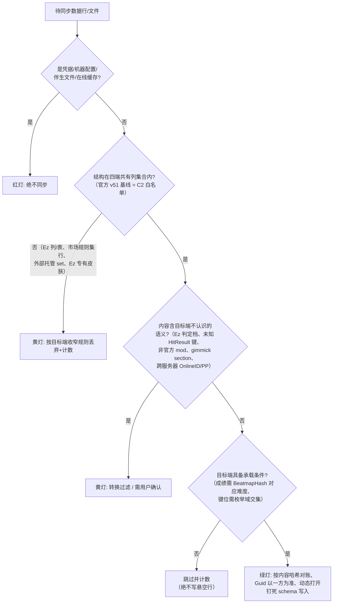

# 四端数据层对比矩阵：osu!lazer × DeltaLazer × Ez2Lazer × g0v0

> 用途：LZSync 多 fork 同步体系的设计基线——回答「四端哪些数据完全一致、可无损同步；哪些有差异、需要适配；哪些绝不该同步」。
> 事实来源：本文全部事实取自 `docs/research/` 下六份调研文档（lazer-baseline / fork-delta / fork-ez2lazer / fork-g0v0 / ezrealmsync-design / go-realm-options），每项事实以「（来源文档 §章节）」标注，不依赖 `reference/` 源码目录存活。
> 写作纪律：只汇总对比六份调研的既有事实；调研中标注「未确认」的结论在本文保留同样标注，不以推测填充；调研之间记录冲突处如实并列并标「未确认」。
> 六份调研均完成于 2026-10-24；官方 lazer 参照快照 HEAD `c752ffb`（2026-10-24，schema 52）。

---

## 0. 四端身份速览

| 端 | 一句话定位 | 关键调研结论 |
|---|---|---|
| **osu!lazer**（官方） | ppy 官方客户端，一切对比的基线 | 数据目录 `osu`；schema 52；Realm 12 RealmObject + 4 EmbeddedObject（lazer-baseline §1–§2） |
| **DeltaLazer**（delta） | 社区「自定义玩法试验场」fork；基线约 2026-07/08（落后官方约 3 个月）；仍连官方服务器但**禁用登录**，成绩全部只落本地 | Realm 数据层与官方**完全同构**（schema 51，仅缺官方 v52 缓存表）；玩法数据全在 `.osu` 文本扩展 section，不进数据库（fork-delta §0） |
| **Ez2Lazer**（Ez） | SK-la 的 mania/BMS 向 fork；schema 采用「上游×1000+Ez 修订」追加式扩展 | 磁盘 schema **52011**，主库文件名 **`client_52011.realm`**（release 也带版本后缀）；官方列全保留 + 10 规范列 + 7 张技能表（fork-ez2lazer §0–§2） |
| **g0v0!**（g0v0） | GooGuTeam fork + 自有服务端 `g0v0.top`；「保持 lazer 全部行为，只改与服务器对话的部分」 | Realm schema 与官方**完全一致**（52，零结构改动）；差异全在在线链路与规则集管理（fork-g0v0 §0–§2） |

同步设计的总前提（lazer-baseline §7.3）：四端同源于 osu!lazer 代码库，数据层均为 Realm + 内容寻址 `files/`。**同步的基石是内容哈希（跨机器、跨 fork 稳定），而非 Guid 主键（每台机器随机生成）**。

---

## 1. 总览矩阵

### 1.1 目录、库文件与 schema

| 维度 | 官方 lazer | DeltaLazer | Ez2Lazer | g0v0 |
|---|---|---|---|---|
| 数据目录（release，Linux） | `~/.local/share/osu` | `~/.local/share/deltalazer` | `~/.local/share/osu-Ez2Lazer` | `~/.local/share/g0v0` |
| 数据目录（debug 构建） | `osu-development` | `deltalazer-development` | `osu-Ez2Lazer-development` | `g0v0-development` |
| Windows / macOS 根 | `%APPDATA%` / `~/Library/Application Support` | 同左（机制一致） | 同左 | 同左 |
| Realm 主库文件名 | `client.realm`（release）；DEBUG 构建为 `client_52.realm` | `client.realm` | **`client_52011.realm`（任何构建，含 release）** | `client.realm` |
| 磁盘 schema 版本 | **52** | **51** | **52011**（= 52×1000+11） | **52** |
| schema 编码规则 | 裸上游版本号 | 裸上游版本号 | `schema_version * 1000 + EZ_REALM_SCHEMA_VERSION` | 裸上游版本号 |
| 客户端基线新旧 | 2026-10-24（net10.0 / Framework 2026.1019.0） | 约 2026-07/08（.NET 8.0 / Framework 2026.731.0，**落后约 3 个月**） | schema 与官方同代（52）；framework 为 fork 版 2026.1023.0-ez2lazer | 基点 2026-10-22（比官方快照旧 2 天） |

目录名常量原文（各调研摘录，四端机制相同、仅字符串不同）：

```csharp
// lazer:   base_game_name = @"osu"            / @"osu-development"
// delta:   base_game_name = @"deltalazer"     / @"deltalazer-development"
// Ez:      base_game_name = @"osu-Ez2Lazer"   / @"osu-Ez2Lazer-development"
// g0v0:    base_game_name = @"g0v0"           / @"g0v0-development"
```

- 四端 `OsuGameBase.CLIENT_DATABASE_FILENAME = @"client.realm"` 常量同值（fork-delta §1.2 / fork-ez2lazer §1.2 / fork-g0v0 §1.1）；Ez 磁盘文件名差异来自其 RealmAccess 的版本后缀机制，见 §3-D2。
- **四目录互不相同，同一台机器可同时安装运行，互不读写对方数据**（fork-delta §1.2 / fork-ez2lazer §1.1 / fork-g0v0 §1.2）。同步工具必须以四个独立数据根管理。

### 1.2 主矩阵（任务指定的七个维度 + 两个补充维度）

| 维度 | 官方 lazer | DeltaLazer | Ez2Lazer | g0v0 |
|---|---|---|---|---|
| **表差集**（相对官方 v52） | 基线：12 RealmObject + 4 EmbeddedObject（清单见 §2-C2） | **−1 张**：无 `RealmOnlineAsset`（官方 v52 新增的在线资源缓存表）；其余全部业务表零差（fork-delta §2.2–§2.3） | **+7 张**：Ez 技能系列表（§3-D4）；**0 删**（fork-ez2lazer §2.5） | **0 差**（全部模型文件清单与内容一致，fork-g0v0 §2） |
| **列差集**（相对官方 v52） | 基线 | **0**（10 个持久化模型类逐行 diff 零差异，fork-delta §2.3） | **+10 规范列 + 2 历史列**（BeatmapInfo×4、ScoreInfo×2、BeatmapSetInfo×2、RulesetInfo×2，另有旧列 ManiaHitMode/ManiaHealthMode，§3-D3）；另若干 `[Ignored]` 会话字段不持久化 | **0**（RulesetInfo 仅新增源码常量与非持久化方法，未动任何持久化字段，fork-g0v0 §2） |
| **设置差异**（game.ini / OsuSetting） | 基线：122 个枚举成员（lazer-baseline §4.2 全量清单） | 官方 −3（`SongSelectCollectionFilter`/`HitsoundVolume`/`PMFriendsOnly`）+6（`MenuCursorFromSkin` 系列）；另滚轮调音量行为差异（fork-delta §3） | 枚举成员与官方**一致**；9 个默认值不同（fork-ez2lazer §3.1）；Ez 专有 167 项设置走独立 `EzSkinSettings.ini`（§3-D17） | +11 个新键（`UseRulesetSkins`/`RulesetSkins`/`UseV2ResultsScreen`/`Torii*`×4/`UnslantedSongSelectUI`/`CustomApiUrl`/`DisableAutomaticUpdates`/`HitsoundVolume`）；`ReleaseStream` 默认 `G0V0`；规则集信任走 `rulesets.json`（fork-g0v0 §2.1、§3） |
| **谱面状态语义**（BeatmapOnlineStatus） | 枚举值域 −4…+4；仅 Ranked/Approved 给 PP；**提交成绩不受本地状态约束**（服务端裁决，lazer-baseline §5） | 枚举**逐字节一致**，无强制 approval/无绕过（fork-delta §4.1） | 枚举**零差异**，无强制 approval/无绕过；外部托管 set 入库时标 `LocallyModified`（fork-ez2lazer §4.1） | 枚举**无改动**；客户端无绕过；**服务器侧语义未确认**（fork-g0v0 §5.1、§8） |
| **files/ 兼容性** | `files/<hash[0]>/<hash[0:2]>/<hash>`，SHA-256 内容寻址（lazer-baseline §1.4） | 布局与寻址**逐字节一致**，可整目录复制/硬链（fork-delta §6） | 布局与寻址**逐字符一致**；**例外**：外部托管 set 的 RealmFile 行是路径哈希、files/ 无对应字节（fork-ez2lazer §6） | 布局与寻址**零改动**，可共享/复制（fork-g0v0 §4） |
| **fork 特有数据** | —（基线） | ① gimmick 体系（`.osu` 的 `[BeatmapSectionGimmicks]`/`[BeatmapHitObjectGimmicks]`，**不进 Realm**）；② 菜单光标自定义 6 设置；③ IPC `HitCountMessage`（fork-delta §5） | ① 10+2 追加列与 7 张技能表；② 外部托管谱面集（`ext:set:` hash）；③ BMS 规则集（`"bms"`）；④ `EzSkinSettings.ini` 167 项；⑤ `ez-analysis_v8.sqlite` + `EzData/`；⑥ `EzRulesetMapping.ini`（fork-ez2lazer §2、§5） | ① RX/AP 特殊规则集（`osurx`/`osuap`/`taikorx`/`fruitsrx`，OnlineID 4–7，**内存概念不落库**）；② 规则集市场（OnlineID ≥10 的 RulesetInfo 行落库）；③ `rulesets.json` 信任管理；④ 本地奖章系统（服务端成就）；⑤ ModScoreV1、Torii 界面、V2 成绩界面、PP 回填（fork-g0v0 §5–§6） |
| **成绩提交行为**（补充维度） | token 两段式（`CreateSoloScoreRequest` → `SubmitSoloScoreRequest`），服务端裁决（lazer-baseline §5） | **登录被禁**（按钮 `Action = null`；Bancho 封禁改版客户端上传）；成绩全落本地、无 OnlineID（fork-delta §4.2–§4.3） | **收紧而非绕过**：`EzOnlineScoreSubmissionPolicy` 把非 Lazer 判定/非零 offset/非默认门槛成绩挡在官方提交之外；非官方服务器时附带 judgeMode/healthMode 元数据（fork-ez2lazer §4.2） | 连 g0v0.top；`ruleset_hash` 请求头防改 dll；提交成功**回填 PP**（官方不回填）；赛前 PB 预取（fork-g0v0 §5.2） |
| **服务器端点 / 账号体系**（补充维度） | `osu.ppy.sh`（OAuth ClientID "5"） | **未改端点**（连官方服务器，但登录禁用）（fork-delta §1.3） | 默认官方服务器（同 ClientID "5"）；`ServerPreset` 枚举可切 `Official/Manual/g0v0`（fork-ez2lazer §4.4） | **全部换 `*.g0v0.top`**，独立 OAuth（ClientSecret 不同）；账号体系与官方互不相通（fork-g0v0 §1.3、§7.5） |

---

## 2. 共性核心：四端完全一致、可直接无损同步的数据维度

> 「完全一致」的判定口径：**四端结构定义逐字段一致，且数据行语义不依赖任何 fork 特有概念**。每项给出四端依据。四端共有列的**精确定义 = 官方 v51 基线列集合**（理由见 C2）。

### C1. files/ 内容寻址文件仓（机制与布局）

**事实**：文件以内容 SHA-256（小写 hex、64 字符）为键，两级目录布局；`RealmFile`（Realm 内表名 `File`）主键即哈希；写入时按哈希全局去重（`realm.Find<RealmFile>(hash)` 命中即复用），导入优先硬链接、失败回退复制。

```csharp
// 路径函数（四端逐字符一致；lazer-baseline §1.4 / fork-ez2lazer §6 摘录）
public static string GetStoragePath(this IFileInfo fileInfo)
    => Path.Combine(fileInfo.Hash.Remove(1), fileInfo.Hash.Remove(2), fileInfo.Hash);
// 即 files/<hash第1字符>/<hash前2字符>/<完整hash>
```

```csharp
// RealmFile（[MapTo("File")]，主键 = 内容哈希；lazer-baseline §2.1 摘录）
public class RealmFile : RealmObject, IFileInfo
{
    [PrimaryKey]
    public string Hash { get; set; } = string.Empty;
    [Backlink(nameof(RealmNamedFileUsage.File))]
    public IQueryable<RealmNamedFileUsage> Usages { get; } = null!;
}
```

- 四端依据：lazer-baseline §1.4（定义 + 本机实证 `files/8/8e/8e445…`）；fork-delta §6（`RealmFileStore.cs` 逐字节一致）；fork-ez2lazer §6（`GetStoragePath` 逐字符一致、`RealmFile` 零差异）；fork-g0v0 §4（`osu.Game/IO/` 全目录零 fork 改动）。
- 同步含义：**文件层天然幂等无冲突**——同一内容在四端同键，直接按文件名复制即可；行级例外（Ez 外部托管路径哈希行、delta gimmick 谱面哈希差异）见 §3-D5 / §3-D11。

### C2. 官方 v51 基线列集合内的全部业务表（四端共有列的权威定义）

**事实**：四端的全部核心业务表（`BeatmapSet` / `Beatmap` / `BeatmapMetadata` / `BeatmapDifficulty`（内嵌）/ `BeatmapUserSettings`（内嵌）/ `RealmUser`（内嵌）/ `RealmNamedFileUsage`（内嵌）/ `Score` / `BeatmapCollection` / `Skin` / `File` / `Ruleset`）在「官方 v51 列集合」上逐字段一致。该集合有现成的权威表述——EZRealmSync 的官方基线白名单（ezrealmsync-design §2.3，「与官方 schema V51 对齐」，全文摘录）：

```csharp
public static readonly IReadOnlyDictionary<string, IReadOnlySet<string>> KnownProperties =
{
    ["BeatmapSet"]        = {"ID","OnlineID","DateAdded","DateSubmitted","DateRanked","Beatmaps","Files",
                             "Status","DeletePending","Hash","Protected"},
    ["Beatmap"]           = {"ID","DifficultyName","Ruleset","Difficulty","Metadata","UserSettings","BeatmapSet",
                             "Status","OnlineID","Length","BPM","Hash","StarRating","MD5Hash","OnlineMD5Hash",
                             "LastLocalUpdate","LastOnlineUpdate","Hidden","EndTimeObjectCount","TotalObjectCount",
                             "LastPlayed","BeatDivisor","EditorTimestamp"},
    ["BeatmapMetadata"]   = {"Title","TitleUnicode","Artist","ArtistUnicode","Author","Source","Tags","UserTags",
                             "PreviewTime","AudioFile","BackgroundFile"},
    ["BeatmapDifficulty"] = {"DrainRate","CircleSize","OverallDifficulty","ApproachRate","SliderMultiplier","SliderTickRate"},
    ["BeatmapUserSettings"] = {"Offset"},
    ["RealmUser"]         = {"OnlineID","Username","CountryCode"},
    ["BeatmapCollection"] = {"ID","Name","BeatmapMD5Hashes","LastModified"},
    ["Skin"]              = {"ID","Name","Creator","InstantiationInfo","Hash","Protected","Files","DeletePending"},
    ["File"]              = {"Hash"},
    ["RealmNamedFileUsage"] = {"File","Filename"},
    ["Ruleset"]           = {"ShortName","OnlineID","Name","InstantiationInfo",
                             "LastAppliedDifficultyVersion","Available"},
    ["Score"]             = {"ID","BeatmapInfo","ClientVersion","BeatmapHash","Ruleset","Files","Hash","DeletePending",
                             "TotalScore","TotalScoreWithoutMods","TotalScoreVersion","LegacyTotalScore",
                             "BackgroundReprocessingFailed","MaxCombo","Accuracy","Date","PP","OnlineID","LegacyOnlineID",
                             "User","Mods","Statistics","MaximumStatistics","Pauses","Rank","Combo","IsLegacyScore"},
};
```

为什么交集是 v51 而不是 v52：delta 停在 schema 51（无 v52 新增的 `RealmOnlineAsset` 表）；Ez 的追加列以 v52 上游为基础但**只加不删**（fork-ez2lazer §2.4–§2.5）；g0v0 与官方 52 全等。因此「官方 v51 列集合」是四端都完整具备的最大公共列集，且已被 EZRealmSync 生产验证为跨版本安全写集（ezrealmsync-design §2.3：「源端只读这些列、目标端只写这些列，两边 schema 版本差异天然被忽略」）。

- 四端依据：fork-delta §2.3（`BeatmapInfo` / `BeatmapSetInfo` / `BeatmapMetadata` / `BeatmapCollection` / `ScoreInfo` / `SkinInfo` / `RulesetInfo` / `RealmKeyBinding` / `RealmRulesetSetting` / `RealmFile` 逐行 diff **0 行差异**，`ModPreset` 仅差一行 `using`）；fork-g0v0 §2（「全部 RealmObject 相关文件两侧清单与内容一致」）、§7.4（谱面/皮肤/收藏/键位/ModPreset/规则集设置「持久化结构两侧完全一致」）；fork-ez2lazer §2.4–§2.5（官方列全保留、0 删表，`BeatmapMetadata` 与 `Models/` 全目录与官方零差异）。

### C3. 哈希锚点体系（成绩↔谱面跨端对账的基础）

**事实**（lazer-baseline §6.1 全表，四端模型零差异 → 定义一致）：

| 哈希 | 算法 | 对象 | 存于 |
|---|---|---|---|
| `RealmFile.Hash` | SHA-256（小写 hex 64 字符） | 任意导入文件的原始字节 | File 表主键 + files/ 路径 |
| `BeatmapSetInfo.Hash` | SHA-256 | 集内全部 `.osu` 按文件名排序拼接 | BeatmapSet |
| `BeatmapInfo.Hash` | SHA-256 | 该难度 `.osu` 归一化重编码后内容 | Beatmap |
| `BeatmapInfo.MD5Hash` | MD5 | `.osu` 原始字节（stable 语义） | Beatmap（[Indexed]） |
| `ScoreInfo.Hash` | SHA-256 | 该成绩全部 `.osr` 内容拼接 | Score |
| `ScoreInfo.BeatmapHash` | —（冗余拷贝） | 打成绩瞬间的 `BeatmapInfo.Hash` | Score（[Indexed]） |
| `SkinInfo.Hash` | SHA-256 | 皮肤 `.ini`+`.json` 拼接 | Skin |

- 同步含义（lazer-baseline §6.3、§7.3）：同一 `.osz` 在字节级一致导入的前提下，四端的 `BeatmapInfo.Hash`/`MD5Hash`/RealmFile.Hash 必然一致；成绩凭 `BeatmapHash` 直接匹配，**无需 Guid 对齐**。前提的边界（.osu 归一化编码是否随客户端版本变化）为未确认项，见 §6-U1。

### C4. BeatmapCollection（收藏夹）

**事实**（lazer-baseline §2.8 摘录，四端结构一致）：

```csharp
public class BeatmapCollection : RealmObject, IHasGuidPrimaryKey
{
    [PrimaryKey]
    public Guid ID { get; set; }
    public string Name { get; set; } = string.Empty;
    public IList<string> BeatmapMD5Hashes { get; } = null!;
    public DateTimeOffset LastModified { get; set; }
}
```

- 官方源码注释明言设计动机：「允许收藏在谱面不存在时保留引用；先导收藏后导谱面；**在用户间共享收藏**」——收藏天然设计为跨库/跨用户可移植（lazer-baseline §2.8）。
- 同步只需 `Name` + `BeatmapMD5Hashes` 列表（官方语义支持）；四端依据同 C2（delta/g0v0 模型零差异、Ez 未动此表）。

### C5. RulesetInfo 官方四规则集行

**事实**：`Ruleset` 表以 `ShortName` 为主键、`OnlineID` [Indexed]；官方四规则集由 `RulesetStore` 首次启动播种，四端一致（lazer-baseline §2.9）。

| ShortName | OnlineID |
|---|---|
| `osu` | 0 |
| `taiko` | 1 |
| `fruits`（catch） | 2 |
| `mania` | 3 |

- `fruits` 取值依据：fork-g0v0 §2 摘录的官方共有常量 `public const string CATCH_MODE_SHORTNAME = "fruits";`；fork-ez2lazer §7-D 同样写作官方四规则集（osu/taiko/fruits/mania）。
- ⚠️ 记录冲突：ezrealmsync-design §4.3 摘录 EZRealmSync 源码的 `official_rulesets = {"osu","taiko","catch","mania"}` 写作 `"catch"`，与其他调研的 `"fruits"` 不一致——**未确认**哪份准确（可能为该工具源码笔误，其判定另有 InstantiationInfo 兜底）。LZSync 实现时应以目标库实际 `ShortName` 探测为准。
- g0v0 的特殊规则集常量（`osurx` OnlineID 4 等）只是源码常量与内存 Clone，**不写回 Ruleset 表**（fork-g0v0 §5.3）；落库差异见 §3-D8。

### C6. 内置皮肤固定 Guid

**事实**（lazer-baseline §2.10 摘录，官方六个内置皮肤 Guid 全客户端一致）：

```csharp
internal static readonly Guid TRIANGLES_SKIN  = new Guid("2991CFD8-2140-469A-BCB9-2EC23FBCE4AD");
internal static readonly Guid ARGON_SKIN      = new Guid("CFFA69DE-B3E3-4DEE-8563-3C4F425C05D0");
internal static readonly Guid ARGON_PRO_SKIN  = new Guid("9FC9CF5D-0F16-4C71-8256-98868321AC43");
internal static readonly Guid CLASSIC_SKIN    = new Guid("81F02CD3-EEC6-4865-AC23-FAE26A386187");
internal static readonly Guid RETRO_SKIN      = new Guid("0555C76A-CC6B-4BB4-9548-DF76BA72EF25");
internal static readonly Guid RANDOM_SKIN     = new Guid("D39DFEFB-477C-4372-B1EA-2BCEA5FB8908");
```

- 同步纪律：内置皮肤行**必须保留固定 Guid，不可随机化**（lazer-baseline §2.10）。
- ⚠️ g0v0 侧源码缺 `RETRO_SKIN` 常量（fork-g0v0 §2 记录为上游演进、非持久化常量）；其库中 RETRO 皮肤行是否存在**未确认**（§6-U11）。delta 侧 `SkinInfo.cs` 与官方逐行零差异（fork-delta §2.3）。

### C7. BeatmapOnlineStatus 枚举（谱面在线状态值域）

**事实**（lazer-baseline §5 全表；delta §4.1「逐字节一致」、Ez §4.1「零差异」、g0v0 §5.1「无 fork 改动」——三份 fork 调研独立确认未改）：

| 值 | 名称 | 语义 |
|---|---|---|
| `-4` | `LocallyModified` | 编辑器本地改动后进入；此后忽略一切在线状态变化 |
| `-3` | `None` | 未知/无状态 |
| `-2` | `Graveyard` | 墓场（下架弃置） |
| `-1` | `WIP` | 制作中 |
| `0` | `Pending` | 待审核 |
| `1` | `Ranked` | 已上架 |
| `2` | `Approved` | 已批准 |
| `3` | `Qualified` | 已合格 |
| `4` | `Loved` | Loved |

- 仅 `Ranked`/`Approved` 赋予 PP（`GrantsPerformancePoints`，lazer-baseline §5）；`StatusInt` 同时存在于 `BeatmapSetInfo`（集级）与 `BeatmapInfo`（难度级）。
- **三份 fork 调研均未发现「强制 approval / 绕过在线状态检查」的改动**（fork-delta §4.1、fork-ez2lazer §4.1、fork-g0v0 §5.1）——任务假设中的「fork 是否强制 approval」在四端现场代码中均不成立；状态语义差异若存在，只可能在服务器侧（g0v0 未确认，§6-U9）。

### C8. 软删除模型与兑现机制

**事实**：`BeatmapSetInfo` / `ScoreInfo` / `SkinInfo` / `ModPreset` 用 `DeletePending` 布尔软删；**收藏夹没有软删语义，删除即整行 Remove**；软删行由 lazer 客户端下一次打开库时的 `cleanupPendingDeletions` 兑现物理清理（lazer-baseline §2 与 §7.3-4；ezrealmsync-design §5.1）。

- 四端依据：模型零差异（同 C2）；go-realm-options §1.2 确认 lazer 打开库时执行 `cleanupPendingDeletions`（`RealmAccess.cs:390`）。
- 同步设计参考（ezrealmsync-design §5.1）：EZRealmSync 的全部读取路径（diff / 导出 / 收窄过滤）都把软删行**当作不存在**——即同步默认**不传播删除**；工具写 `DeletePending = true` 即可让删除在目标端下一次开库时生效。

### C9. 成绩↔谱面挂接规则

**事实**（lazer-baseline §6.3）：强锚点是 `ScoreInfo.BeatmapHash`（[Indexed]）== `BeatmapInfo.Hash`（SHA-256）；关系列 `ScoreInfo.BeatmapInfo` 允许 null（谱面缺失/版本变化）；谱面更新后 `BeatmapInfo.UpdateLocalScores(realm)` 先解绑再按 BeatmapHash 重挂；导入 `.osr` 时找不到对应谱面（按回放内 beatmap hash）则**拒绝导入**。

- 四端依据：`ScoreInfo`/`BeatmapInfo` 官方列四端一致（C2）；EZRealmSync 已按此契约实现「按 BeatmapHash 惰性建索引挂接 + 缺目标难度即跳过并计数，绝不写悬空成绩」（ezrealmsync-design §2.7）。

### C10. 键位与规则集设置的结构（无 Guid 依赖的字符串键）

**事实**（lazer-baseline §2.12–§2.13 摘录，四端结构一致）：

```csharp
// RealmKeyBinding（表名 "KeyBinding"，Guid 主键，逻辑键 = (RulesetName, Variant, ActionInt)）
public Guid ID { get; set; }            // [PrimaryKey]
public string? RulesetName { get; set; } // null = 全局键位；否则规则集 ShortName
public int? Variant { get; set; }        // 规则集变体（如 mania 键数）
public int ActionInt { get; set; }       // MapTo "Action"，动作枚举整数值
public string KeyCombinationString { get; set; }  // MapTo "KeyCombination"，如 "Ctrl,Shift+Z"

// RealmRulesetSetting（表名 "RulesetSetting"，无主键，逻辑键 = (RulesetName, Variant, Key)）
[Indexed] public string RulesetName { get; set; } = string.Empty;
[Indexed] public int Variant { get; set; }
[Required] public string Key { get; set; } = string.Empty;
[Required] public string Value { get; set; } = string.Empty;
```

- 四端依据：fork-delta §2.3（两文件 0 行差异）；fork-g0v0 §7.4（结构完全一致）；fork-ez2lazer §2.4–§2.5（Ez 的列/表差集不含这两张表）。
- 注意：**结构**一致 ≠ **ActionInt 数值语义**跨端一致（枚举随版本演进，见 §3-D20）；这两张表 EZRealmSync 未纳入同步范围（其 `EntityKind` 只有 BeatmapSet/Beatmap/Score/BeatmapCollection/Skin 五类，ezrealmsync-design §2.2），是 LZSync 可扩展的增量面。

### C11. ScoreInfo 本地成绩语义列

**事实**：成绩行的核心语义列（`TotalScore`、`TotalScoreWithoutMods`、`TotalScoreVersion`、`LegacyTotalScore`、`MaxCombo`、`Accuracy`、`Date`、`Rank`、`Combo`、`IsLegacyScore`、`StatisticsJson`/`MaximumStatisticsJson`（`Dictionary<HitResult,int>` JSON）、`ModsJson`（`APIMod[]` JSON）、`Pauses`、`ClientVersion`、内嵌 `RealmUser`（`OnlineID`/`Username`/`CountryString`））全部在 C2 白名单内，四端定义一致（lazer-baseline §2.7；HitResult 与 ScoreRank 枚举四端同值——delta 明确「不引入新 HitResult 枚举值」（fork-delta §5.3），Ez/g0v0 未改这些枚举）。
- 例外约束：`StatisticsJson`/`ModsJson` 的**内容**在 Ez 侧可能含官方不认识的键（§3-D7）；`OnlineID`/`LegacyOnlineID`/`PP` 是服务器侧标识（§4-R1、§3-D10）。

---

## 3. 差异清单与适配策略

> 策略枚举：**丢弃**（drop，不搬运且在结果中计数告知）、**映射**（map，路径/文件名/版本等元数据换算）、**转换**（transform，数据改写后搬运）、**保留**（preserve，不动的另一面）、**需用户确认**（ask，存在多种合理策略，属工具策略决策）。

### D1. 数据目录与主库文件名 — 策略：映射

四端数据目录名不同（§1.1）；Ez 主库为 `client_52011.realm` 且带前驱搜索链（`client_52010.realm` → … → `client.realm`，fork-ez2lazer §2.2）。同步工具需要每端一个「数据根 + 库文件名」的发现/配置层；EZRealmSync 的 files/ 解析规则（realm 所在目录 `files/` → `data` 兄弟 `files/` → 父目录 `files/` 三级回退，ezrealmsync-design §2.6）可直接泛化。

### D2. 磁盘 schema 版本与打开方式 — 策略：映射 + 纪律

- 版本探测须理解 Ez 编码：`<1000` 为纯上游版本，`≥1000` 时 `upstream = v/1000, ez = v%1000`（fork-ez2lazer §2.1；ezrealmsync-design §3.3 同）。
- 迁移方向性事实：delta(51) 的库可被官方客户端打开并**自动迁移到 52**（Realm 迁移代码内嵌于客户端，fork-delta §2.3）；**官方(52) 库被 delta 客户端打开的行为未确认**（delta 无 v52 迁移 case，未验证，§6-U4）；Ez(52011) 与官方(52) **互相打不开**（fork-ez2lazer §0/§2.2）。
- 工具纪律（EZRealmSync 生产验证，ezrealmsync-design §3）：动态打开（不传 schema）钉死磁盘版本、绝不迁移、绝不写文件头版本号——「版本号是客户端迁移的输入，工具擅自改会让下一个客户端按错误路径走」。

### D3. Ez 追加列（10 规范列 + 2 历史列） — 策略：方向不对称（丢弃 / 保留）

**事实**（fork-ez2lazer §2.4 字段级摘录）：

| 表 | 追加列 | 类型 | 默认 | 语义 |
|---|---|---|---|---|
| BeatmapInfo | `XxyStarRating` | double | `-1` | mania xxy 基线星（派生） |
| BeatmapInfo | `PerformancePoints` | double | `-1` | 无 mod 理论 PP（派生） |
| BeatmapInfo | `HasVideo` / `HasStoryboard` | bool? | `null` | 派生标记 |
| ScoreInfo | `JudgeMode` / `HealthMode` | int | `0` | 全规则集判定/血量档（0=Lazer） |
| BeatmapSetInfo | `ExternalContentRoot` / `HostingKindInt` | string / int | `""` / `0` | 外部托管路径与类型 |
| RulesetInfo | `LastAppliedXxySrVersion` / `LastAppliedManiaSkillVersion` | int | — | 派生缓存版本号 |

另有历史列 `ManiaHitMode`/`ManiaHealthMode`（Ez v11 已把数据迁入规范列 `JudgeMode`/`HealthMode`；EZRealmSync 静态名单仍包含它们，ezrealmsync-design §2.5）。

适配：
- **Ez → 官方/delta/g0v0**：全部**丢弃**（目标 schema 无这些列；官方客户端打开含多余列的库会 SchemaMismatch 拒开，fork-ez2lazer §7A）。
- **官方 → Ez**：只写共有列（C2 白名单），Ez 列留默认——派生列（星数/PP/HasVideo）会被 Ez 的 `BeatmapUpdater` 重算回填。
- **Ez → Ez（覆盖同步）**：删行重建前捕获 Ez 列原值、重建后回写（EZRealmSync `EzColumnResolver` 手法，ezrealmsync-design §2.5——判定优先级：同版本官方基线快照 diff > 静态名单 > 已知列集合补集）。

### D4. Ez 新增 7 张技能表 — 策略：丢弃

**事实**（fork-ez2lazer §2.5）：`EzBeatmapSkillValue`、`EzPlayerSkillValue`、`EzDanEstimate`、`EzPlayerSkillHistoryPoint`、`EzBeatmapChartSkillInfo`、`EzPlayerDanSkillsetValue`、`EzBeatmapChartDan`——全部是按 `AlgorithmVersion` / `ComputedAt` 管理的**派生分析缓存**（谱面技能值、玩家技能值、段位估计、历史曲线）。跨端同步无意义（其他端没有消费代码），且可由 Ez 重算。向官方收窄时整表丢弃（fork-ez2lazer §7B；EZRealmSync 收窄器把官方没有的类记入 `DroppedClasses` 并计数告知，ezrealmsync-design §4.4）。

### D5. Ez 外部托管谱面集 — 策略：丢弃（含连带行）

**事实**（fork-ez2lazer §5.1）：`HostingKind == External` 的 set 内容存于 `ExternalContentRoot` 磁盘目录，`BeatmapSetInfo.Hash = "ext:set:" + Base64(规范化绝对路径)`（**非内容哈希**）；其 `RealmFile.Hash` 是**路径哈希**（`BmsPathKeys.ComputeRealmFileHash = SHA256(lowercase(normalized fullpath))`，注释明言 "no content hashing"），files/ 中无对应字节；入库时状态标 `LocallyModified`。
- 同步到官方/delta/g0v0 时必须**连带丢弃**：该 set 行、其全部 BeatmapInfo、RealmNamedFileUsage、路径哈希 RealmFile 行、以及 `BeatmapInfo.BeatmapSet` 指向它的 ScoreInfo（BMS 成绩）（fork-ez2lazer §7C；EZRealmSync 的对应规则：「内容位于 Ez 外部目录，官方客户端读不到」，ezrealmsync-design §2.8）。

### D6. Ez BMS / DIVA 规则集行与成绩 — 策略：丢弃（diva 部分未确认）

**事实**：BMS 规则集在 Ez 仓库内（`ShortName = "bms"`，基于 Mania 适配）；DIVA（ProjectDIVA）**不在仓库**，仅代码注释佐证其为 rulesets/ 外部 DLL，ShortName/OnlineID **未确认**（fork-ez2lazer §5.2、§9）。
- `ShortName ∈ {"bms","diva"}` 的 RulesetInfo 行、`ScoreInfo.Ruleset` 指向这些规则集的成绩：向官方方向**丢弃**（官方无 InstantiationInfo 可解析，fork-ez2lazer §7D）。
- `EzRulesetMapping.ini` 允许外部规则集取 OnlineID ≥ 4（官方 0–3 保留），映射本身不落库。

### D7. Ez 成绩的 JSON 内容兼容（StatisticsJson / ModsJson） — 策略：转换

**事实**（fork-ez2lazer §4.3）：Ez 对 `StatisticsJson`/`MaximumStatisticsJson` 加了容错（`DeserializeObject<Dictionary<string,int>>` 再逐键 `Enum.TryParse<HitResult>`，未知键跳过）——**说明 Ez 库中成绩可能含官方不认识的自定义 HitResult 键**（BMS 等规则集）；官方客户端是直转 `Dictionary<HitResult,int>`，遇未知键抛 `JsonSerializationException` 致成绩不可用。`ModsJson` 同理：Ez 独有 mod（如 LAsMods、CommunityMod）acronym 在官方侧解析失败或成 UnknownMod。
- 适配：向官方/delta/g0v0 同步成绩时**过滤无法解析的 statistics 键**、按 mod 白名单过滤/整条丢弃（EZRealmSync 的 `OfficialModList.json` 白名单手法：shared 集合 `{AC,AS,AT,BR,CL,CN,DA,DC,DT,EZ,FL,HD,HR,HT,MR,MU,NC,NF,NM,NS,PF,RD,RX,SD,SV2,SY,TD,WD,WU}` + 各规则集专属集，`StringComparer.Ordinal` 区分大小写，ezrealmsync-design §4.3）。
- Ez 库中实际存在的自定义键集合与独有 mod acronym 集合**未确认**（需真实库取样，fork-ez2lazer §9）。

### D8. g0v0 自定义规则集行（OnlineID ≥ 10）与规则集市场 — 策略：丢弃

**事实**（fork-g0v0 §2.1）：g0v0-server 在线规则集市场的第三方规则集以 OnlineID ≥ 10 落库进 Ruleset 表（`IsBuiltinRuleset` 判定 `< 10`；4–7 为 RX/AP 常量）。同步到官方/delta/Ez 时这些行在目标端无 InstantiationInfo 可解析、OnlineID 约定无意义，应**丢弃**；指向它们的成绩随之丢弃。`rulesets/` 下的市场 dll 与 `rulesets.json` 信任配置属每端自管（§3-D17）。

### D9. g0v0 RX/AP 特殊规则集成绩 — 策略：本地行可同步（保留）+ 语义告知

**事实**（fork-g0v0 §5.3）：RX/AP 是「展示/统计层」内存概念，**不持久化**——本地成绩的 `ScoreInfo.RulesetID` 仍是基础模式（0–3），RX/AP 体现在 mods 列表（`APIMods` 含 `"AP"` 等）；需要按特殊规则集聚合时才在内存 Clone 出 `RulesetInfo { ShortName = "osurx", OnlineID = 4 }`。
- 因此 RX/AP 本地成绩在库层面是普通官方规则集成绩 + mods，**四端同步无结构障碍**；但官方服务器不认这类成绩的提交语义（服务端如何聚合 RX/AP 排行**未确认**，fork-g0v0 §8）。同步后在目标端仅作本地历史记录展示。

### D10. g0v0 PP 回填 — 策略：需用户确认

**事实**（fork-g0v0 §5.2）：g0v0 在提交成功回调里 `score.ScoreInfo.PP = s.PP ?? score.ScoreInfo.PP;`（官方客户端不回填，官方库中该列常为 null）。同步 g0v0 → 官方会带来「官方端显示 g0v0 服务器算的 PP」的数据；反向同步官方 → g0v0 会把 null 覆盖掉 g0v0 已回填的值（若按整行覆盖）。属字段级合并策略问题（LastWrite-wins / 非空优先 / 不同步 PP 列），**需用户确认**。

### D11. delta gimmick 谱面（.osu 扩展 section） — 策略：需用户确认 + 检测告警

**事实**（fork-delta §5.1）：delta 扩展了 beatmap 文件格式，`LegacyDecoder.Section` 枚举新增 `BeatmapSectionGimmicks` / `BeatmapHitObjectGimmicks`；行格式：
- `[BeatmapSectionGimmicks]`：`{Id:int},{StartTime:double},{EndTime:double},{Key=Value|...}`（EndTime < 0 表示无上限）
- `[BeatmapHitObjectGimmicks]`：`{StartTime:double},{ComboIndexWithOffsets:int},[ObjectId={long}|]{Key=Value|...}`
- 数据是纯 POCO（`SectionGimmickSection`/`SectionGimmickSettings` 等），**不进 Realm 数据库**；文件头版本号不变（`osu file format v128`）。

兼容性事实（fork-delta §5.2）：官方客户端**读** delta 谱面安全（未知 section 仅记日志跳过）；但官方编辑器**重新保存**时 encoder 不认识这两个 section，**gimmick 数据被静默丢弃**。

适配：
- 同步工具应检测 `.osu` 文件内这两个 section 头的存在，在「将被非 delta 端覆盖/编辑回传」时**告警并建议备份**；双向同步场景下**以 delta 侧 .osu 为权威源**（fork-delta §7.2）。
- 哈希联动：.osu 内容差异意味着同一 OnlineID 谱面在 delta 与官方端有不同的 `RealmFile.Hash`/`BeatmapInfo.Hash`——**files/ 不能按哈希盲等价**，成绩的 `BeatmapHash` 锚点也可能错位（fork-delta §7.2）。是否同步 gimmick 谱面本体、还是仅在 delta 端内保留，**需用户确认**。

### D12. game.ini（OsuSetting）枚举差异 — 策略：转换（共有键白名单）

**事实**：
- delta：官方 −3 键（`SongSelectCollectionFilter`/`HitsoundVolume`/`PMFriendsOnly`）+6 键（`MenuCursorFromSkin`、`MenuCursorFromSkinConfirmed`、`MenuCursorFromSkinSize`、`MenuCursorTrail`、`MenuCursorScaleX`、`MenuCursorScaleY`）（fork-delta §3.1–§3.2）。
- g0v0：+11 键（§1.2 矩阵）；`ReleaseStream` 枚举 fork 化（`G0V0`/`Robin` vs 官方 `Lazer`/`Tachyon`）。
- Ez：枚举成员与官方一致（无需键过滤）。
- ⚠️ 记录冲突：`HitsoundVolume` 在 fork-delta §3.2 记为官方新增（delta 无），在 fork-g0v0 §3 记为 g0v0 fork 新增（官方无）——两份调研归属记录不一致，**未确认**（可能为官方上游在 g0v0 基点后新增、两边独立实现；两侧记录的默认值同为 `0.6, 0..1, 0.01`）。
- INI 加载行为：未知键会被忽略、不会崩溃（fork-delta §7.3）——同步**白名单拷贝共有键**即可，互斥键（delta 6 键 / g0v0 11 键）显式丢弃。

### D13. Ez 默认值差异（9 键） — 策略：保留（无需处理）

Ez 改了 9 个 `SetDefault`（如 `ShowConvertedBeatmaps` true→false、`ShowFpsDisplay` false→true 等，fork-ez2lazer §3.1），这些只是「新安装默认值」，存量用户已保存的值不回写（fork AGENTS.md 约定）。同步已保存的 game.ini 键值不受影响。

### D14. ReleaseStream / 更新通道 — 策略：丢弃（不同步该键）

四端枚举域不同：官方 `Lazer`/`Tachyon`、Ez `Ez2Lazer`（首启强制写入，fork-ez2lazer §1.2）、g0v0 `G0V0`/`Robin`（fork-g0v0 §1.2）。该键属每端身份配置，**不同步**。

### D15. game.ini 的 `Token` / `Username` — 策略：绝不同步（丢弃）

OAuth JWT 与登录名，**敏感凭据**（lazer-baseline §4.2：「同步时必须排除或脱敏」；§7.2「绝不应同步」）。g0v0 的 Token 属 g0v0.top 账号体系，对拷到官方端完全错位。

### D16. framework.ini / storage.ini — 策略：丢弃

framework.ini 承载显示器分辨率、音频设备名、输入设备等**机器强绑定**配置，跨端同步有害（lazer-baseline §4.1、§7.2）；storage.ini 记录每端自己的自定义数据目录路径（lazer-baseline §4.3）。

### D17. fork 专有配置与数据文件 — 策略：丢弃（每端自管）

| 文件/目录 | 属主 | 事实依据 |
|---|---|---|
| `EzSkinSettings.ini`（167 项 Ez2Setting）+ `EzRulesetMapping.ini` | Ez | 官方客户端自然忽略；留在 Ez 目录即可（fork-ez2lazer §3.2、§5.3、§7H） |
| `ez-analysis_v8.sqlite`、`EzData/` 分支快照库 | Ez | 独立 SQLite 分析库（fork-ez2lazer §5.4） |
| `rulesets.json`（RulesetManagementConfig 信任/禁用清单） | g0v0 | fork 特有文件（fork-g0v0 §2.1） |
| `rulesets/` 目录（第三方/市场规则集 dll） | 各端 | 本机安装状态，互不通用（lazer-baseline §7.2；fork-g0v0 §7.3） |
| `online.db` | 各端 | 服务器下发缓存，只读可重建（lazer-baseline §1.2、§7.2） |
| `client.realm.lock` / `.management` / `.note` | — | Realm 进程级锁与共享内存，**绝不可同步**（lazer-baseline §1.2、§7.2） |

### D18. RealmOnlineAsset（官方 v52 表，delta 缺） — 策略：丢弃

官方 schema 52 新增的在线资源（头像/封面）本地缓存表，超一个月未访问即被清理，**无业务数据**（lazer-baseline §2.14；fork-delta §2.2「直接整表丢弃无损失」）。delta(51) 无此表；跨端同步一律丢弃。

### D19. `ClientVersion` 字段 — 策略：保留原值

ScoreInfo.ClientVersion 记录打出成绩的客户端版本（lazer-baseline §2.7）。跨端同步时保留来源端的原值即可（信息性字段，不需转换，也不该篡改）。

### D20. 键位 ActionInt 枚举演进 — 策略：需用户确认 / 按端映射

`RealmKeyBinding.ActionInt` 是裸 int（全局 GlobalAction 或规则集 Action 枚举值）。官方 2026-07/08 之后新增了 13 个编辑器键位等（fork-delta §5.5），delta 基线没有这些枚举值；跨端同步键位行时，高版本端的 ActionInt 在低版本端可能指向错误动作或越界。结构可同步（C10），但**数值语义需按 (端, 枚举域) 校验/映射**，遇到未知值跳过并计数。EZRealmSync 未同步键位，无先例策略——**需用户确认**默认策略（建议：仅同步两端枚举域交集内的行）。

### D21. Ez 专有皮肤 — 策略：丢弃（向官方方向）

EZRealmSync 读写两端都过滤 Ez 专有皮肤（`IsEzOnlySkin` 指纹，具体皮肤 GUID 写死于工具内：`fc372386-381d-4f8e-897a-c1d89ef39f9c` 等三个，ezrealmsync-design §6.2）。向官方端同步时此类皮肤行应丢弃；Ez↔Ez 照常。

### D22. 谱面行内的本地行为字段 — 策略：需用户确认（字段级合并）

`BeatmapInfo.LastPlayed` / `EditorTimestamp` / `UserSettings.Offset` / `Hidden` 是本地用户行为数据，多端同步会互相覆盖（lazer-baseline §7.2）。需字段级合并策略（LastWrite-wins / 取 max / 不同步）——**需用户确认**。

---

## 4. 同步风险

### R1. 成绩提交语义差异与在线 ID 命名空间

四端提交行为汇总（§1.2 矩阵）：官方走 token 两段式、服务端裁决；delta 登录被禁（README 原文：*"We have temporarily disabled logins as this client still connects to osu! servers. When bypassed, osu!bancho prohibits score submission as this client is modified."*，fork-delta §4.2），成绩无 OnlineID；Ez 用 gate 把非 Lazer 判定成绩挡在官方提交外（fork-ez2lazer §4.2）；g0v0 连独立服务器、提交成功回填 PP（fork-g0v0 §5.2）。

**核心风险：`OnlineID` / `LegacyOnlineID`（成绩）、`RealmUser.OnlineID`（用户）、`BeatmapSetInfo.OnlineID`（谱面）分属不同服务器的命名空间**。g0v0 调研明确（fork-g0v0 §7.5）：「两边的 OnlineID（用户/谱面/成绩）分属不同命名空间，同步时凡 OnlineID/has_replay 等在线字段都应视为服务器本地标识，不可跨侧对拷」。
- 安全规则：**在线 ID 仅在「两端连接同一服务器」时同步**。官方↔Ez（同官方服务器）可同步 OnlineID；官方↔delta 安全（delta 侧恒为 -1）；任何端↔g0v0 **绝不互拷在线 ID**（谱面本地文件可同步，但 OnlineID 指向的在线谱面在另一服务器是不同对象）。

### R2. 账号绑定数据

`game.ini` 的 `Token`/`Username` 是 OAuth 凭据（本机实证 Token 为超长 JWT），**绝不应同步**（lazer-baseline §4.2、§7.2）；`ScoreInfo.RealmUser`（OnlineID/Username/Country）标识成绩归属，字段可复制（同步他人成绩无技术障碍，仅语义问题，lazer-baseline §7.2）。

### R3. 软删状态与引用计数陷阱

- **Cleanup() 物理删除**：`RealmFileStore.Cleanup()` 删除所有 `Usages.@count = 0`（无任何模型引用）的 RealmFile 及磁盘文件——「同步工具最危险的联动点」；**RealmFile 行与模型引用必须原子地一起写**，否则文件被物理删除或成孤儿被清理（lazer-baseline §1.4、§7.3-3）。
- **软删传播策略**：DeletePending 行是否跨端传播需明确策略；EZRealmSync 的选择是「软删行在所有读取路径当作不存在」→ 同步默认不传播删除（ezrealmsync-design §5.1、§2.2）。
- **收藏夹无软删**：删除即整行 Remove，跨端删除传播对收藏夹只能整行删（ezrealmsync-design §5.1）。

### R4. schema 版本迁移与「崩溃即重置」

- 官方客户端对无法打开/损坏的 `client.realm` 的处理是**删除重建**（"reset to recovery"）——同步工具写库保证可打开性是硬约束（lazer-baseline §1.3、§3.3）。
- **版本号是客户端迁移的输入**：工具擅自升降版本号，下一个打开它的客户端会按错误迁移路径走（如把 Ez 号写进官方库，官方客户端立刻 SchemaMismatch 拒开；Realm 拒绝把文件头版本调低，ezrealmsync-design §3.2）。纪律：动态打开钉死磁盘 schema、不迁移、不写版本号；要迁移让各端客户端自己完成。
- fork 加字段必须提升版本常量，否则官方客户端打开时 schema 不匹配拒开/重置（lazer-baseline §3.3）；官方 52 → 53 的年度演进会与各 fork 竞速（fork-ez2lazer §5.5 的「schema_version 跟上游」纪律、go-realm-options §7-6 的「schema 情报」维护成本）。
- 写入侧兜底先例：写前写后 schema 快照 DriftGuard 硬校验，任何漂移整笔回滚（ezrealmsync-design §3.2）。

### R5. Guid 主键跨库必然不同

所有 `IHasGuidPrimaryKey` 表的 ID 是 `Guid.NewGuid()`，两库必然不同；模型层同步应以内容哈希对账（`BeatmapSetInfo.Hash`、`BeatmapInfo.Hash`、`ScoreInfo.Hash`+`BeatmapHash`、`SkinInfo.Hash`），匹配后做 ID 映射或以一方为准（lazer-baseline §7.3-2）。EZRealmSync 的 diff 键是 `(EntityKind, Guid)`（同一库系内 GUID 稳定），但跨端去重仍依赖内容字段（ezrealmsync-design §6.2-4）。

### R6. delta gimmick 双向同步丢失链

delta 谱面 → 官方端 → 编辑器保存 → 回传 delta = **gimmick section 静默蒸发**（官方 encoder 不认识、读时仅记日志跳过，fork-delta §5.2、§7.2）。任何「delta 谱面流经非 delta 端再回来」的链路都会触发；同步工具必须检测 `[BeatmapSectionGimmicks]`/`[BeatmapHitObjectGimmicks]` 头并阻断/告警。

### R7. 非官方语义成绩的重放不一致

- delta gimmick 谱面的成绩在官方端没有对应 gameplay 语义（HP/假音符等），回放帧是标准格式但官方没有 `SectionGimmickHealthProcessor`/fake note 逻辑，**重放结果会不一致**（fork-delta §7.4）。
- Ez 非 Lazer 判定（JudgeMode/HealthMode ≠ 0）的成绩在官方端会被官方算法重算，结果错误——EZRealmSync 的规则是「Ez 判定语义」成绩直接跳过不上官方（ezrealmsync-design §2.7-5，类注释：「能少不能错」）。

### R8. Realm 伴生文件、并发与写窗口

- 打开 Realm 需要在库文件旁创建 `.lock`/`.management/`/`.note`，「只读」也只是逻辑只读（go-realm-options §1.3-7）——这三个文件**绝不可同步**（lazer-baseline §7.2）。
- 跨进程共享同一库文件要求同架构且 core 版本兼容；**写窗口 = 游戏进程关闭时**（go-realm-options §1.3-7；EZRealmSync 进程守卫 `process_names = { "osu!", "osu", "Ez2Lazer" }` + 排他文件锁 + 500ms×3 重试，ezrealmsync-design §5.5）。
- ⚠️ delta 与 g0v0 的进程名**未确认**（go-realm-options §8-4；LZSync 守卫名单需逐一确认）。

### R9. 版本竞速与生态风险

- 上游约一年 bump 一次 schema（51→52 花了一年，go-realm-options §1.2）；delta 基线落后官方约 3 个月（349 个文件差异绝大多数是官方演进，fork-delta §0）；Ez 上游合并节奏（最近 tag 2026.819.0-tachyon，fork-ez2lazer §5.5）——四端 schema 情报需持续维护。
- realm-dotnet 处于维护停摆（一年多无提交、NativeAOT 官方不支持），realm-core 仍活跃——影响技术选型：Go 侧建议 purego 直连 realm-core C API 动态模式（go-realm-options §0/§6）。
- lazer 若未来弃用 Realm，全部碰库路线作废（生态级风险，go-realm-options §8-7）。

### R10. 跨端哈希一致性前提的边界

- lazer `.osu` 归一化编码是否随客户端版本变化**未确认**（未做跨版本实验，lazer-baseline §9）——若变化，不同版本端导入同一 `.osz` 会得到不同 `BeatmapInfo.Hash`，成绩 `BeatmapHash` 锚点失效变孤儿。
- delta gimmick 谱面内容与官方版本必然不同哈希（D11）；Ez 外部托管 set 的 hash 是路径编码非内容哈希（D5）。

### R11. g0v0 服务器侧语义未确认

g0v0-server 的谱面 approval/在线状态裁决、RX/AP 成绩排行聚合均未验证（客户端只发 mode 短名与 mods，fork-g0v0 §8）；g0v0 的 `client.realm` 被官方客户端实际打开的兼容性也未运行验证（仅静态比对 schema 52 与模型一致，fork-g0v0 §8）。

---

## 5. 「可同步范围」结论

### 5.1 可直接无损同步（绿灯）

| 数据 | 说明与依据 |
|---|---|
| **files/ 中被共有行引用的 blob** | 内容寻址、四端同布局同哈希（C1）；按 bundle 哈希集合复制，目标已有即跳过（ezrealmsync-design §2.6 的 CopyMissing 模式） |
| **官方四规则集、Internal 托管的谱面集及其难度/元数据/Files** | C2 白名单列内行；排除 Ez 外部托管 set（D5）、注意 delta gimmick 内容（D11） |
| **收藏夹** | `Name` + `BeatmapMD5Hashes`，官方设计即跨库可移植（C4） |
| **用户导入皮肤（非 fork 专有）** | Skin 表白名单列 + Files；内置皮肤行天然幂等（固定 Guid，C6）；Ez 专有皮肤除外（D21） |
| **「官方四规则集 + 纯官方 mod + Lazer 判定 + 目标端存在 BeatmapHash 对应难度」的成绩** | C3/C9/C11；Ez 非 Lazer 判定、BMS/diva 成绩、JSON 含未知键的成绩按 §3-D6/D7 过滤 |
| **RealmRulesetSetting 中官方四规则集行** | C10 结构四端一致；过滤 fork 专有规则集名（bms/diva/OnlineID≥10 市场） |
| **ScoreInfo.ClientVersion 等信息性字段** | 保留原值（D19） |

### 5.2 需适配后同步（黄灯）

| 数据 | 适配动作 | 对应差异项 |
|---|---|---|
| Ez 库 → 官方/delta/g0v0 的**任何**数据 | 收窄规则：丢 12 个 Ez 列、7 张表、外部托管 set 连带行、bms/diva 规则集与成绩、Ez 专有皮肤；过滤 StatisticsJson 未知键与 mod 白名单 | D3–D7、D21 |
| g0v0 库 → 其他端 | 丢 OnlineID ≥10 规则集行及指向它的成绩；OnlineID/PP 处置需确认 | D8、D10、R1 |
| delta gimmick 谱面 | 检测 section 头；以 delta 侧为权威源；阻断「官方编辑回传」链路 | D11、R6 |
| game.ini | 共有键白名单拷贝；剔除 Token/Username/ReleaseStream | D12、D14、D15 |
| 键位（RealmKeyBinding） | ActionInt 按 (端, 枚举域) 校验，交集外跳过 | D20 |
| ModPreset | ModsJson 过 fork 白名单过滤（结构四端一致但内容可含 Ez mod） | C2 + D7 |
| 谱面行为字段（LastPlayed/EditorTimestamp/Offset/Hidden） | 字段级合并策略（LastWrite-wins / max / 不同步） | D22 |
| 库文件路径与 schema 版本 | 每端数据根映射 + 版本编码解码 + 动态打开钉死 schema | D1、D2 |

### 5.3 绝不该同步（红灯）

| 数据 | 理由与依据 |
|---|---|
| `game.ini` 的 `Token` / `Username` | OAuth 凭据，敏感且跨服务器错位（lazer-baseline §4.2、§7.2） |
| `framework.ini` | 机器/设备强绑定（显示器、音频设备名），同步有害（lazer-baseline §4.1） |
| `storage.ini` | 每端自定义目录路径（lazer-baseline §4.3） |
| `client.realm.lock` / `.management` / `.note` | Realm 进程级锁与共享内存（lazer-baseline §7.2；go-realm-options §1.3-7） |
| 跨服务器的 `OnlineID` / `LegacyOnlineID` / 用户/谱面在线 ID 对拷 | 命名空间错位（fork-g0v0 §7.5；本节 R1）——仅同服务器两端间可同步 |
| Ez 外部托管 set 的行与路径哈希 RealmFile 行 | files/ 无字节，官方端读流失败（fork-ez2lazer §7C/F） |
| `rulesets/` 目录、`rulesets.json`、`EzRulesetMapping.ini`、市场 dll | 每端自管的本地安装与信任状态（D8、D17） |
| `ez-analysis_v8.sqlite`、`EzData/`、`EzSkinSettings.ini` | Ez 私有分析与配置（fork-ez2lazer §7H） |
| `online.db` | 服务器缓存可重建（lazer-baseline §7.2） |
| Ez 7 张技能表、12 个 Ez 列（向非 Ez 端） | 目标端 schema 无、客户端拒开（D3、D4） |
| 软删标记的盲目传播 | 需明确策略；EZRealmSync 默认不传播（R3） |
| 游戏进程运行时的任何写库操作 | Realm 跨进程并发约束（R8） |

### 5.4 同步判定流程（汇总）



---

## 6. 未确认事项汇总（全部来自六份调研的原始标注 + 本文发现的调研间冲突）

| # | 事项 | 来源 |
|---|---|---|
| U1 | lazer `.osu` 归一化编码是否随客户端版本变化（影响跨版本端 `BeatmapInfo.Hash` 一致性） | lazer-baseline §9 |
| U2 | framework `UserStoragePaths` 在 Windows/macOS 的确切顺序（仅 Linux 本机实证） | lazer-baseline §9 |
| U3 | `input.json` 的生成方与用途 | lazer-baseline §9 |
| U4 | delta 客户端打开官方 v52 库的行为（fork-delta 仅验证 delta(51)→官方方向自动迁移；反向未测） | fork-delta §2.3 + 本文 D2 |
| U5 | delta README 宣称的「Object Aware Star Rating and PP for Forced Mods」具体算法实现（未逐行核实） | fork-delta §5.4 |
| U6 | DIVA（ProjectDIVA）规则集 DLL 的存在、ShortName 与 OnlineID（不在 Ez2Lazer 仓库） | fork-ez2lazer §9 |
| U7 | Ez 库中实际存在的 `StatisticsJson` 自定义键集合、Ez 独有 mod acronym 集合（需真实库取样） | fork-ez2lazer §9 |
| U8 | lazer 参照快照的确切 tag/commit（无 git 元数据，仅以 schema 52 锚定代际） | fork-ez2lazer §9 |
| U9 | g0v0-server 侧谱面状态语义、RX/AP 成绩服务端聚合方式 | fork-g0v0 §8 |
| U10 | g0v0 的 `client.realm` 被官方 lazer 实际打开的兼容性（静态一致、未运行验证） | fork-g0v0 §8 |
| U11 | g0v0 库中 RETRO 内置皮肤行是否存在（其源码缺 RETRO_SKIN 常量，为上游演进） | fork-g0v0 §2 + 本文 C6 |
| U12 | delta / g0v0 的 Realm NuGet 包版本（官方与 Ez 已确认 20.1.0） | go-realm-options §8-4 |
| U13 | delta / g0v0 的进程名（进程守卫名单需要） | go-realm-options §7-5、§8-4 |
| U14 | librealm 各平台体积与符号导出面、`.realm` 文件头裸读可行性、mygo sidecar 机制、purego×realm C API 生产稳定性 | go-realm-options §8 |
| U15 | **调研间冲突**：官方 catch 规则集 ShortName —— g0v0/Ez 调研摘录为 `"fruits"`（源码常量），EZRealmSync 调研摘录其源码为 `"catch"`；未确认哪份准确 | fork-g0v0 §2 / fork-ez2lazer §7-D vs ezrealmsync-design §4.3 |
| U16 | **调研间冲突**：`HitsoundVolume` 设置键归属 —— fork-delta 记为官方新增（delta 无），fork-g0v0 记为 g0v0 fork 新增（官方无）；未确认 | fork-delta §3.2 vs fork-g0v0 §3 |
| U17 | **调研间冲突**：官方 RealmObject 文件 grep 计数 —— fork-delta 记官方 21 个（delta 20，差集 RealmOnlineAsset），fork-g0v0 记两侧各 20 个；计数口径不一，不影响「delta 唯一缺 RealmOnlineAsset / g0v0 与官方 schema 52 全等」的结论 | fork-delta §2.2 vs fork-g0v0 §0、§2 |

---

## 附：来源调研索引

| 文档 | 内容 |
|---|---|
| `docs/research/lazer-baseline.md` | 官方 lazer 数据层基线（目录/schema 字典/设置双轨/状态枚举/哈希语义/同步视角） |
| `docs/research/fork-delta.md` | DeltaLazer 相对官方的差异（同构 Realm、gimmick 体系、禁登录） |
| `docs/research/fork-ez2lazer.md` | Ez2Lazer 差异（双版本号、10+2 列、7 张表、外部托管、提交 gate） |
| `docs/research/fork-g0v0.md` | g0v0 差异（零 schema 改动、自有服务器、RX/AP、规则集市场） |
| `docs/research/ezrealmsync-design.md` | EZRealmSync 同步工具设计（DynamicRealm、白名单、收窄、守卫——方法论来源） |
| `docs/research/go-realm-options.md` | Go 读写 .realm 技术路线（purego + realm-core 主推、并发与写窗口约束） |
