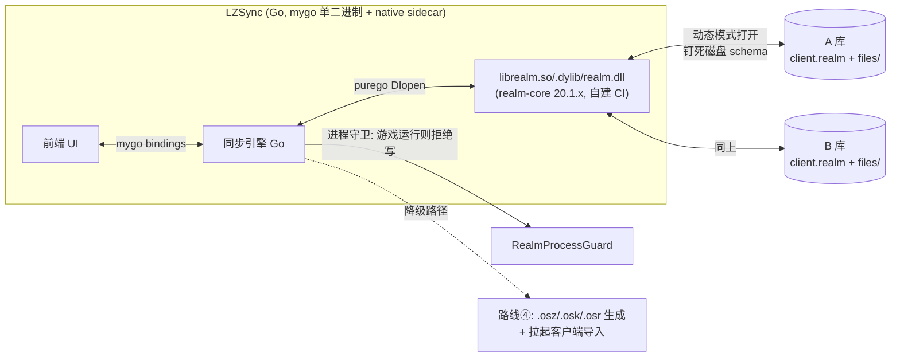

# 用 Go 读写 Realm (.realm) 文件——技术路线调研

> 调研日期：2026-10-24。调研人：调研员（LZSync 动态工作流）。
> 结论先行：**推荐「读+写都走 purego 绑定 realm-core C API（动态模式）」为主干，「不碰 .realm 的容器/旧格式导入」作为降级补充**。理由与逐路线评估见下文。
>
> 本文档自包含：`reference/` 目录将来会被整体删除，因此凡引用参照源码处均摘录关键事实原文（类名、字段、常量值），读者无需翻阅 reference/ 也能完整理解。无法确认的事实一律标注「未确认」。

---

## 0. 结论速览（TL;DR）

| 路线 | 读 | 写 | 单二进制分发 | 工作量 | 维护风险 | 结论 |
|------|----|----|------------|--------|---------|------|
| ① 纯 Go 解析 .realm 二进制 | 理论可行、代价超人级 | 基本不可行 | ✅ 完美 | 🔴 极大（≈重写 realm-core 的格式层） | 🔴 每代格式变更都要追 | **排除** |
| ② purego/CGO 绑定 realm-core | ✅ | ✅ | ⚠️ 单二进制 + 每平台 native sidecar | 🟡 中高（构建 CI + 绑定子集 + 动态引擎） | 🟢 realm-core 仍在维护、Apache 2.0 | **主推** |
| ③ .NET 子进程助手（AOT/self-contained） | ✅ | ✅ | ❌ 破坏（额外 exe + runtime，数十 MB） | 🟡 中（可直接移植参照工具逻辑） | 🔴 realm-dotnet 官方停摆 + NativeAOT 官方不支持 | **不推荐** |
| ④ 不碰 .realm（容器导入/旧格式中转） | 部分（游戏侧完成导入） | 部分 | ✅ 完美 | 🟢 小 | 🟢 低 | **降级/补充** |

**推荐组合**：读写主干走路线②（purego + realm-core C API 动态模式，复刻参照工具 EzRealmSync 已验证的「钉死磁盘 schema」手法），路线④作为无 native 库环境与用户抵触时的降级路径。

---

## 1. 现场事实基础

### 1.1 LZSync 自身形态

- `go.mod`：`go 1.27.1`，`require github.com/egoist/mygo v0.6.3`，且 **间接依赖 `github.com/ebitengine/purego v0.11.1`**（mygo 带入）。也就是说 **purego 已经在 LZSync 的依赖树里**，Go 侧经动态库调 C ABI 的基建是现成的。
- `mygo.config.ts`：`name: "LZSync"`、`frontendDist: "dist"`、`out: "build"`——前端经 Vite 构建后 embed 进 Go 二进制。
- 产物形态：`build/linux-amd64/` 目录 + 根目录一个动态链接 glibc 的 ELF（`file lzsync` → `ELF 64-bit LSB executable, x86-64 ... dynamically linked ... glibc-2.41`）。产物按平台目录组织，暗示**每个平台附带少量资源/共享库文件在工程上是可接受的**（未确认 mygo 是否有正式的 sidecar 资源机制——见「未确认事项」）。

### 1.2 lazer 系客户端的 Realm 使用事实（本仓库 reference/ 实证）

**官方 lazer**（`reference/lazer`，ppy/osu）：

- `osu.Game/osu.Game.csproj:40`：
  ```xml
  <PackageReference Include="Realm" Version="20.1.0"/>
  ```
- `osu.Game/OsuGameBase.cs:91`：
  ```csharp
  public const string CLIENT_DATABASE_FILENAME = @"client.realm";
  ```
- `osu.Game/Database/RealmAccess.cs:106`：
  ```csharp
  private const int schema_version = 52;
  ```
  其版本注释表显示演进节奏：`51  2025-07-22  Add ScoreInfo.Pauses.` / `52  2026-07-28  Add RealmOnlineAsset.`——**上游大约一年 bump 一次 schema**。
- 同文件 `:823-831`：打开时以 `SchemaVersion = schema_version, MigrationCallback = onMigration` 配置，`onMigration` 从 `lastSchemaVersion + 1` 逐版本跑到 `schema_version`——**客户端开库必然把旧文件迁到自己的 schema 版本**（除非外部工具抢先钉死 schema，见 1.3）。
- 同文件 `:390`：`private void cleanupPendingDeletions(Realm realm)`——**lazer 打开库时会兑现 `DeletePending` 软删标记**。外部工具写 `DeletePending = true` 即可让删除在「下一次客户端开库」时生效。

**Ez2Lazer**（`reference/Ez2Lazer`，ez 阵营 fork）：

- `osu.Game/osu.Game.csproj:44`：同样 `<PackageReference Include="Realm" Version="20.1.0"/>`。
- `osu.Game/Database/RealmAccess.cs:108`：`private const int schema_version = 52;`（与上游同步，另有别名 `public static int UpstreamSchemaVersion => schema_version;`，注释写明「Alias for tools (EzRealmSync)」）。
- 磁盘 schema 版本编码（同文件原文）：
  > `Ez2Lazer schema revision. Bump when adding Ez-persisted fields; do not change schema_version for Ez-only work.`
  > `Ez2Lazer-only revisions are tracked separately via EZ_REALM_SCHEMA_VERSION.`
  > `The on-disk Realm schema version is EzFileSchemaVersion (schema_version * 1000 + EZ_REALM_SCHEMA_VERSION, currently 52010).`
  
  代码常量：`public const int EZ_REALM_SCHEMA_VERSION = 11;`（当前实际磁盘版本 **52011**；引用文档里的 52010 是快照略旧）。Ez 修订史（摘录）：v1 ScoreInfo 判定/血量模式列、v2 `BeatmapInfo.HasVideo/HasStoryboard`、v3 `BeatmapInfo.XxyStarRating`、v4 `BeatmapInfo.PerformancePoints`、v5 上述两列改可空、v6 `RulesetInfo.LastAppliedXxySrVersion`、v7 外部托管路径规范化、v8~v10 mania 技能 RealmObject 系列（`EzBeatmapSkillValue`、`EzPlayerSkillValue`、`EzDanEstimate`、`EzPlayerSkillHistoryPoint`、`EzBeatmapChartSkillInfo`、`EzPlayerDanSkillsetValue`、`EzBeatmapChartDan`）、v11 `ScoreInfo.JudgeMode/HealthMode` 规范化列 + 枚举重排（`StableClassic = 1; Mania private modes at 31+`）。
- 同文件还有关键协作入口：`pinnedDiskSchemaVersion` 字段，注释原文——「为 true 时按当前 `RealmSchemaMode` 的磁盘 schema 迁移；**外部工具应设为 false 并指定 `pinnedDiskSchemaVersion`**」——fork 生态显式为外部同步工具预留了「钉死磁盘 schema」的打开方式。

**参照工具 EzRealmSync**（`reference/EZRealmSync`，C#/WPF 的同类工具，**本调研最重要的工程先例**）：

- `Directory.Packages.props:16`：`<PackageVersion Include="Realm" Version="20.1.0" />`。
- 其 `docs/DATA-OPERATIONS.zh.md` 的核心原则（原文摘录）：
  > **所有**读写都由 DynamicRealm 完成，产品进程**永不加载 `osu.Game.dll`**
  > | 探测文件头 | `RealmDiskSchemaReader`（只读文件头，不开库） |
  > | 同步写入 | `DynamicBaselineWriter`（只写目标库**已有**的官方列） |
  > - 打开一律**钉死磁盘 schema**：不迁移、不改文件头版本号。
  > - 版本号只用于**显示**与**选官方 schema 目标**。
- `Realm/RealmDiskSchemaReader.cs` 的打开配置（原文）：
  ```csharp
  var config = new RealmConfiguration(fullPath)
  {
      IsDynamic = true,
      IsReadOnly = true,
      Schema = Array.Empty<Type>(),
      FallbackPipePath = tempPathLocation,
  };
  ulong version = DynamicRealmSession.ReadSchemaVersionFromHandle(realm);
  ```
  注意 `FallbackPipePath`：**即使是只读探测，realm 运行时也需要一个可写的临时目录**（Realm 打开时要在库文件旁建锁/管道文件，见 1.4）。
- 官方库的写入手法（原文摘录）：
  > **官方库就地写**（数据 Tab 软删）：允许。谱面集 / 成绩写 `DeletePending = true`，收藏夹 `realm.Remove(row)`——两者都只落在官方 schema 本来就有的行列上。生效在「下一次有客户端打开该库」时（lazer 的 `cleanupPendingDeletions`），本工具只留标记。
- `Realm/RealmProcessGuard.cs`（进程守卫，原文）：
  ```csharp
  /// 检测 osu! / Ez2Lazer 是否正在运行（写入 Realm 前应关闭）。
  /// 也提供排他文件锁检测，防止并发写入冲突。
  private static readonly string[] process_names = { "osu!", "osu", "Ez2Lazer" };
  ```
  外加 `RetryCheckAsync`：500ms 间隔重试 3 次降低竞态窗口。
- 同步对象不止 .realm：其文档写明同步 Tab「A/B 按 GUID 复制官方基线（谱面 / 收藏夹 / 皮肤 / 成绩 / **File + files/**）」——**client.realm 必须与 `files/` 内容寻址目录成对搬运**。

**其他 fork**（`reference/delta` DeltaLazer、`reference/g0v0`）：同为 osu!lazer 代码库的 fork（delta 是社区玩法实验 fork；g0v0 是 GooGuTeam 的 fork + 自有服务端，README 称「keeps all gameplay, UI, and framework behaviour of osu!lazer intact and only changes the parts that talk to the server」）。**未逐一确认它们各自的 Realm 包版本与 schema 分叉**，但同源代码库决定了它们都走 client.realm 路线，只是 schema 分叉与 Ez2Lazer 的编码规则未必相同（见「未确认事项」）。

### 1.3 Realm 文件格式与生态事实（网络调研）

1. **.realm 无公开二进制格式规范**。realm-core issue [#3691](https://github.com/realm/realm-core/issues/3691)（2020-04 提出「像 SQLite 那样文档化 .realm 格式」，2020-05-01 关闭）：维护者明确回应——文件格式没有面向外部的文档，因为格式「**is not meant to be manipulated by external programs but only through realm-core**」；它是内存映射（mmap）文件、结构相当复杂，纯语言重写实现约等于重写 realm-core。
2. **文件格式版本**：lazer/Ez2Lazer/EzRealmSync 共同使用的 Realm .NET SDK 20.1.0（NuGet，2025-01-07 发布）内置 **realm-core 20.1.1**，生成/使用 **file format v24**，可从 v10+ 自动升级，且**升级不可逆**（无法被旧 SDK 打开）。官方 GUI 工具 Realm Studio 到 major-15（2024-09）才支持 v24 读写（[changelog](https://github.com/realm/realm-studio/blob/channel/major-15/CHANGELOG.md)）。
3. **公开的第三方纯解析器全部远远落后**：
   - [MaartenStaa/realm-db-reader](https://github.com/MaartenStaa/realm-db-reader)（Rust）：只支持 file format **v9.9**；
   - [realm_codec](https://docs.rs/realm-codec)（Rust crate）：读写 file format **v9**；
   - 2026-05 的取证博客（bebinary4n6）介绍用 crush 做 RealmDB 取证，可解析 .realm——但其面向取证场景，支持的格式版本未确认（博客被反爬拦截，未能核实）。
   - **没有任何可用的 Go 语言 .realm 解析库**。pkg.go.dev 上唯一的 `go.mongodb.org/realm/realm` 是 MongoDB Realm **管理 HTTP API** 客户端，与文件无关。Realm 官方 SDK 列表（Kotlin、Swift、JS、Dart/Flutter、.NET、C++）无 Go。
4. **realm-core 本体**（[github.com/realm/realm-core](https://github.com/realm/realm-core)）：
   - 许可证 **Apache 2.0**（仓库 README 明示；第三方依赖见 THIRD-PARTY-NOTICES）。
   - **仍在积极维护**：v14 线终于 14.14.0（2025-03-07），当前主线 v20 系列，最新 **v20.1.5**（约 2026-06）。v14→v20 的版本跳变对应移除 Atlas Device Sync（云同步）；**本地嵌入式数据库部分继续维护**。
   - 公开 **C API**（头文件 [`src/realm.h`](https://github.com/realm/realm-core/blob/master/src/realm.h)），这正是所有现代 SDK（Dart/Flutter、Kotlin、.NET 等）绑定的公共层。核心对象：`realm_config_t`（路径/加密/schema 设置）、`realm_t`（实例句柄）、`realm_class_info_t` / `realm_property_info_t`（运行时 schema 元数据）、`realm_open()`；**不设 schema 即以全动态模式打开**，运行时经 `realm_get_class_keys` 等发现 schema，用动态 `realm_get*` / `realm_set*` 属性访问器读写——这正是 EzRealmSync「DynamicRealm」手法在 C 层的对应物。
   - 构建（[how-to-build.md](https://github.com/realm/realm-core/blob/master/how-to-build.md)）：CMake ≥ 3.15 + C++17 工具链；产物 **`librealm.so`（macOS 为 .dylib）/ `librealm.a` 静态库**，头文件安装到 `/usr/local/include/realm/` 与 `realm.hpp`/`realm.h`；附工具 `realm-import`、`realm-config`、`realmd`；`tools/cross_compile.sh` 可交叉编译 Android/iOS/watchOS/tvOS（产物为静态库+头文件 tarball）。**无官方预编译二进制下载**，须自建构建；文档并警告安装使用的 API「is not stable or supported」（该警告指向直接安装使用，C API 本身是全部 SDK 的事实公共层，但官方未对第三方承诺向后兼容——边界见「未确认事项」）。
5. **realm-dotnet（路线③的关键上游）处于停摆状态**：
   - 2024-09 MongoDB 宣布弃用 Atlas Device Sync 与 Realm SDKs（云服务 2025-09 关闭）；本地数据库部分进入维护期。osu!lazer 只用本地嵌入式部分，不受云服务关闭影响（见 [ppy/osu discussion #22497](https://github.com/ppy/osu/discussions/22497)），Realm NuGet 仍在 2025-01 发了 20.1.0。
   - 但 [issue #3729](https://github.com/realm/realm-dotnet/issues/3729)（2026-09-27「Maintenance needed」）：**realm-dotnet 主仓库超过一年无提交，CI 长期损坏，关键修复 PR（如 #3723）无人理**；realm-core、realm-swift 等仓库仍正常维护，唯独 realm-dotnet 停滞。MongoDB 曾承诺「帮社区做 PR review 和 release」但未兑现。现存社区 fork：AlexeyBuryanov/realm-dotnet（维护者自称「don't expect a quick answer」且计划弃用 Realm）、Realm.Refurbished（charlesroddie）。
   - [issue #3417](https://github.com/realm/realm-dotnet/issues/3417)（**仍 open**）：**realm-dotnet 官方不支持 NativeAOT**。反射/Fody weaving 导致 trimmer 裁掉模型属性（报错 "No properties in Item, has linker stripped it?"），维护者 nirinchev 直言「I don't imagine we'll ever be able to get rid of all of them」，并建议避免 **Dynamic API**——而 Dynamic API 恰是工具类项目（如 EzRealmSync）的手法。社区 PR（#3727/#3728）把最小应用的 trim 警告从 34 条降到 3 条并修掉核心报错，但合入的是社区 fork 而非官方主线。
6. **realm-dart 是「FFI 绑 realm-core」的官方先例**（对路线②最有说服力的参照）：
   - [realm/realm-dart](https://github.com/realm/realm-dart) 用 Dart FFI 直接绑定 realm-core（[官方博客](https://dart.dev/blog/introducing-realm-for-dart-flutter)）。
   - 绑定层结构：生成式全量 FFI 声明 `packages/realm_dart/lib/src/handles/native/realm_bindings.dart`（GitHub contents API 报告文件大小 **522,043 字节**）+ 手写封装 `realm_core.dart`；native 库加载方式（源码原文）：
     ```dart
     String plugin = Platform.isWindows ? 'realm_plugin.dll'
         : Platform.isMacOS ? 'realm.framework/realm'
         : Platform.isLinux ? "librealm_plugin.so" : ...;
     final pluginLib = DynamicLibrary.open(plugin);
     ```
   - native 库**不是裸 librealm**，而是 realm-core + 平台胶水（`realm_dart.cpp` 等）合编的 wrapper（纯 Dart 应用经 `dart run realm_dart install` 下载二进制）。这证明：① FFI 消费 realm-core 是官方支持路线；② 各 SDK 的二进制都带自己的胶水层，**裸 C API 库须自建 CI**。
7. **Realm 的进程间锁与伴生文件**（[Realm Swift 文档](https://realm.netlify.app/docs/swift/latest)、[MongoDB Studio 文档](https://www.mongodb.com/docs/atlas/device-sdks/studio)）：
   - 打开 Realm 时在库文件旁创建：`<name>.lock`（资源锁文件）、`<name>.management/`（进程间锁目录）、`<name>.note`（通知命名管道）。
   - 跨进程共享同一库文件**要求同架构且 core 版本兼容**，否则报错 "Realm file is currently open in another process which cannot share access with this process"；Android 上多进程并发开同一库官方不支持。
   - 工程含义：**LZSync 的读写窗口 = 游戏进程关闭时**（EzRealmSync 的 RealmProcessGuard + 文档「导入 / 导出前请关闭游戏」是同一结论的实践证据）。

---

## 2. 路线①：纯 Go 解析 .realm 二进制格式

**思路**：不依赖任何 native 库，Go 直接读 .realm 文件的字节结构，解析出表/行/列，写则按格式回写。

### 可行性

- **读：理论可行，代价超人级**。无公开规范（§1.3-1），格式是 mmap 设计、B 树/数组缓冲区结构、大量位操作（issue #3691 讨论要点）；维护者直言外部程序不应直接操作该格式。逆向的唯一权威来源是 realm-core 的 C++ 源码本身——解析它等于用 Go 重写 realm-core 的存储层子集。
- **写：基本不可行**。事务日志、空闲页管理、历史版本（free space / versioning）、加密、以及与客户端 core 的 mmap 内存一致性，任何一个做错都会产出客户端打不开甚至损坏的库。现有第三方纯实现（realm_codec）也只做 v9 且以读写旧格式为目标，从未追到 v10+。
- **版本鸿沟**：lazer 系全部在 **file format v24**（Realm 20.1.0 / realm-core 20.1.1），公开纯解析器只到 **v9/v9.9**——中间隔着 15 个格式版本（含 Realm 11 的大改，如文件格式与加密重构），没有任何公开资料填补。

### 分发难度

完美：零依赖，真正的单二进制。这是该路线唯一的优势。

### 工作量估计

🔴 极大。realm-core 是数十万行 C++ 的引擎，格式层（Group/Array/Table/SlabAlloc 等）是其核心；Go 重实现一个「只读 v24 全功能」解析器是数月到年级别的人月，且无规范护栏、极易产出静默错误。写路径另算，且不建议任何人尝试。

### 维护风险

🔴 极高。lazer 上游每年 bump schema、Realm SDK 每次 major 都可能 bump 文件格式（v10→v24 的历史节奏即证据）；每次变更都要重新逆向。Realm Studio（官方 Electron 工具）自身都要等 SDK 更新才能支持新格式，第三方纯解析器的落后是常态。

### 结论

**排除**。仅保留一个微小可能性：**轻量探测**（读文件头 magic/格式版本号以判断「这是什么库」）或许能用极少量 Go 代码实现，但头布局细节未确认（见「未确认事项」），且 EZRealmSync 的探测也是开库读 handle 而非裸读文件头，说明该捷径并无先例背书。

---

## 3. 路线②：purego/CGO 绑定 realm-core C/C++ 库

**思路**：构建 realm-core 得到 `librealm.so/.dylib/.dll`（其 C API `src/realm.h` 导出 C 符号），Go 侧用 purego `Dlopen` 按需绑定函数（或 CGO 链接），以**动态模式**（不设 schema 打开、运行时发现 schema）读写 client.realm——即把 EzRealmSync 的 DynamicRealm 手法换到 C API 上做。

### 可行性

- **读写均可行，且有官方先例背书**：realm-core 的 C API 就是为语言绑定设计的公共层（realm-dart 全靠 Dart FFI 消费它，Kotlin/Swift/.NET 亦然）。动态模式（`realm_open` 不带 schema + `realm_class_info_t`/`realm_get*`/`realm_set*`）与 EzRealmSync 的 `IsDynamic = true` 打开方式一一对应，可直接复刻其全部手法：
  - 钉死磁盘 schema（不迁移、不改文件头版本号）；
  - 探测 schema 版本（对应 `ReadSchemaVersionFromHandle`）；
  - 「只写目标库已有列」的基线白名单写入（对应 `DynamicBaselineWriter`）；
  - 官方库软删（写 `DeletePending = true`，靠 lazer `cleanupPendingDeletions` 兑现）。
- **避开 C 回调**：动态读写字集不需要 sync 回调、migration 回调、change notifications——可以完全绕开「Go 函数指针传给 C」这一 purego 的相对薄冰区（purego v0.8+ 提供了 `NewCallback`，但不必依赖它）。
- **必须处理的事实约束**：打开库需要写 `.lock`/`.management/`/`.note` 伴生文件（§1.3-7）——即「只读」也只是逻辑只读，磁盘上仍需可写目录；跨进程并发开库要求同架构同版本兼容，**写窗口必须与游戏进程互斥**。
- **CGO 备选**：CGO 静态链接 `librealm.a` 理论上能保持单文件，但会引入各平台 C++17 工具链/交叉编译的构建负担（realm-core 还依赖 libc++ 组件），且与 Go 交叉编译体系冲突。**purego 优先**：LZSync 依赖树里已有 purego v0.11.1（§1.1），mygo 生态已验证此模式。

### 分发难度（单二进制桌面应用约束）

- **无法把 realm-core 链进 Go 二进制**（purego 只能 `Dlopen` 动态库）。分发形态变为：**每平台一个 native sidecar**（`librealm.so` / `librealm.dylib` / `realm.dll`）+ Go 主程序。
- native 库来源**必须自建 CI**：realm-core 无官方预编译产物（§1.3-4）；realm-dart/realm-dotnet 等带的二进制是各家胶水 wrapper，不适合 Go 直接用。三平台（linux-amd64、windows-x64、macos-universal）各出一个 release 构建，版本钉在与客户端对齐的 20.1.x（写路径下「库版本 vs 客户端版本」兼容性最稳的做法是同版本）。
- 体积：librealm 各平台精确体积**未确认**（realm-dart 的 wrapper 库在数 MB 量级，裸 core 应相近或更小）；相对 .NET self-contained（70MB+）小一个数量级。产物已是 `build/linux-amd64/` 目录形态（§1.1），sidecar 放置在工程上顺理成章。
- 许可：Apache 2.0，允许闭源分发与再分发，仅需随附 NOTICE 归属——无法律障碍。

### 工作量估计

🟡 中高，分三块：

1. **realm-core 三平台构建 CI**（一次性 + 低频维护）：CMake 构建 + 产物托管。中等。
2. **purego 绑定子集**：不必学 realm-dart 生成全量 522KB 绑定；动态读写核心约 30–60 个函数（`realm_config_*`、`realm_open`、`realm_get_class_keys`、`realm_find_class`、`realm_object_*`、`realm_get/set_property_value` 族、`realm_begin_write/commit/cancel`、`realm_get_last_error`、`realm_release`）+ 对应 struct（`realm_config_t`/`realm_class_info_t`/`realm_property_info_t`/`realm_error_t`）+ 句柄生命周期纪律（所有 `realm_*_new` 返回物都要 `realm_release`）。单人 1–2 周量级。
3. **动态读写引擎 + 领域模型层**：官方基线列白名单、A/B 差异对比、软删、Ez 扩展列保留、`files/` 目录成对搬运——**设计可直接从 EzRealmSync 移植**（其 `Realm/Dynamic/` 目录下 `DynamicBaselineReader/Writer`、`OfficialBaselineSchema`、`RealmDiffEngine` 等即成熟蓝图），用 Go 重表达。2–4 周量级，加上真实库回归测试。

### 维护风险

🟢 相对最低，但有结构性注意点：

- **realm-core 是全生态的事实基座且仍在维护**（v20.1.5，2026-06）——把宝押在它上面，比押在任何一个具体语言 SDK（如 realm-dotnet）上都稳。Realm 品牌动荡（MongoDB 弃用云服务）已由社区接管消化，本地引擎持续有 release。
- 风险点：① C API 无对第三方的稳定性承诺（官方警告「not stable or supported」；事实上所有 SDK 依赖它，但 major 变更时函数面会动）——钉死一个 20.1.x 版本可冻结此风险，代价是 lazer 未来换 file format 版本时要跟进构建；② lazer 上游每年 bump schema（52→53…），列白名单需同步演进——这是**数据模型层**的维护而非绑定层，各路线共有；③ 自建 CI 的构建链（CMake/工具链）低频维护。
- Go 侧无先例项目长期验证 purego 跑 realm C API（**未实测**，建议先做 PoC 再定案——见 §7）。

### 结论

**主推**。它是唯一同时满足「读写俱全 + 无格式逆向 + 上游活跃 + 许可干净」的路线，且 LZSync 已具备 purego 基建。

---

## 4. 路线③：子进程方案（.NET 助手，Go 经 stdin/stdout JSON 驱动）

**思路**：打包一个独立读写助手进程（如 .NET AOT / self-contained 的 realm CLI），Go 主进程以 JSON 协议驱动它完成 .realm 读写。

### 可行性

- **技术上完全可行且有最成熟的先例**：EzRealmSync 本身就是「C# + realm-dotnet 20.1.0 + DynamicRealm」的完整实现，其 C# 逻辑（`DynamicBaselineReader/Writer`、`OfficialExportPolicy`、`RealmProcessGuard` 等）几乎可以原样搬进助手进程。读写能力与路线②等价，且开发速度最快（语言层零翻译成本）。
- **但两个上游事实构成硬伤**：
  1. **realm-dotnet 官方停摆**（§1.3-5，issue #3729：一年多无提交、CI 损坏、修复无人合）。锁死 20.1.0 意味着：未来 lazer 升级 Realm SDK / file format（v24→v25）或 schema 出现需要 SDK 层支持的变化时，**无人提供修复**；社区 fork（Realm.Refurbished）可持续性存疑。
  2. **NativeAOT 官方不支持**（issue #3417 open）：realm-dotnet 的反射/Fody weaving 与 AOT/trimmer 冲突，报错 "No properties in Item, has linker stripped it?"；维护者建议避免的 **Dynamic API 恰恰是工具场景必需**。社区修复只存在于 fork。也就是说「.NET AOT 编译的 realm CLI」要么吃社区 fork 的未上游修复，要么放弃 AOT。
- **放弃 AOT 的退化形态**：self-contained 发布（带完整 .NET runtime），功能完整，代价是体积（数十 MB 量级）与多运行时的攻击面。

### 分发难度

🔴 最差：分发物 = Go 主程序 + 助手 exe + （AOT 不成则整套 .NET runtime）。双运行时、双崩溃面、进程间协议（JSON over stdin/stdout）的版本兼容自己背。对「单二进制优先」的桌面工具是明显逆势。

### 工作量估计

🟡 中：C# 逻辑从 EzRealmSync 移植 + JSON 协议 + 进程管理。若无既有 C# 资产可搬，则反而比路线②多一层协议设计。

### 维护风险

🔴 高：停摆上游 + AOT 不支持 + 社区 fork 三重叠加。任何 realm-dotnet 层的 bug（如历史上 MAUI/.NET 8 的 native 加载问题 #3711）都要自己扛。

### 结论

**不推荐作主干**。仅当 LZSync 决定直接复用/分叉 EzRealmSync 的 C# 代码资产、且接受体积与停摆风险时才考虑。

---

## 5. 路线④：不碰 .realm 的替代架构

**思路**：不直接读写 client.realm，借助客户端自身的导入导出与稳定中间格式完成同步。

### 可用的机制（实证）

1. **启动参数导入**：lazer 支持把文件路径作为启动参数传入，经文件关联触发导入。`osu.Desktop/Program.cs:190` 附近注释原文：
   > `// Arguments being present indicate the user is either starting the game in a special (aka tournament) mode,`
   > `// or is running with pending imports via file association or otherwise.`
   
   游戏侧入口：`osu.Game/OsuGame.cs:925`：
   ```csharp
   public override Task Import(ImportTask[] imports, ImportParameters parameters = default)
   ```
   `.osz`（谱面）、`.osr`（回放/成绩）、`.osk`（皮肤）等容器可由 Go 侧生成后拉起客户端导入——**Go 实现这些容器格式是完全成熟的做法**（均为公开文档的 ZIP 类格式）。
2. **stable 旧格式中转**：EzRealmSync 已实现 `collection.db`（收藏夹名单：名称 + 谱面 MD5）与 `scores.db`（按谱面 MD5 分组的成绩）的导出/导入（其 `IO/LegacyCollectionDb.cs`、`IO/LegacyScoresDb.cs`；格式规范见 ppy wiki「Legacy database file structure」）。这两种格式**简单且有公开文档**，Go 实现成本低，且 lazer 的 stable 数据导入向导认识它们所属的数据体系。
3. **files/ 目录直搬**：lazer 的谱面/皮肤文件以内容寻址方式存于 `files/`（见 osu! wiki「File storage in osu!(lazer)」），目录级复制与 .realm 解耦（但 .realm 里的行是这些文件的索引，纯搬目录不搬行，游戏看不到——**files/ 与 .realm 行必须成对出现**）。

### 可行性（能覆盖/不能覆盖什么）

- ✅ 谱面集分发（.osz 生成 + 拉起导入）、皮肤、回放类成绩的单向「推送给客户端」。
- ✅ 收藏夹名单经 collection.db 中转（粒度 = 名称+MD5，丢失排序等元数据，未确认 lazer 是否直接吃外部 collection.db——EzRealmSync 是自己把它合并进 Realm 的，说明**客户端并不直接导入 collection.db**，这条路仍需要一次 .realm 写入，或依赖 stable 向导的间接路径）。
- ❌ **读不了** client.realm 里的现状（收藏夹/成绩/统计的浏览、A/B 对比、差异同步）——客户端没有「导出我的收藏夹为 collection.db」的对外自动化入口（游戏内手动导出除外）。
- ❌ 软删（`DeletePending`）、列级同步、Ez 扩展列保留等细粒度操作无此通道。

### 分发难度 / 工作量 / 维护风险

✅ 完美单二进制；🟢 工作量小（容器格式 + 进程拉起）；🟢 维护风险低（容器格式由游戏生态长期稳定）。但**能力天花板低**：本质上是「推送导入」，不是「同步」。

### 结论

**作为降级/补充路径保留**：在用户环境无法部署 native 库、或同步对象仅限谱面/皮肤/回放推送时使用；不能独立支撑 LZSync 的核心目标（A/B 库差异同步）。

---

## 6. 对比总表与推荐

### 6.1 总表

| 维度 | ① 纯 Go 解析 | ② purego + realm-core | ③ .NET 子进程 | ④ 容器/旧格式 |
|------|--------------|----------------------|---------------|---------------|
| 读 client.realm | 🔴 需重写引擎 | ✅ 动态模式 | ✅ DynamicRealm | ❌ |
| 写 client.realm | 🔴 不可行 | ✅ 事务写入+软删 | ✅ | ❌（仅导入容器） |
| 格式跟进（v24→v25…） | 自行逆向 | 升级自建 core 构建 | **上游已停摆** | 不适用 |
| 单二进制 | ✅ | ⚠️ +每平台 sidecar | ❌ 双运行时 | ✅ |
| 许可 | — | Apache 2.0 ✅ | Apache 2.0 ✅ | — |
| 工作量 | 🔴 超人级 | 🟡 中高 | 🟡 中 | 🟢 小 |
| 上游健康度 | — | 🟢 core 活跃 | 🔴 dotnet 停摆 | 🟢 游戏生态稳定 |
| 能力天花板 | 全部（若做成） | 全部 | 全部 | 仅推送导入 |

### 6.2 推荐

**读走②、写也走②；④作为降级补充；①、③排除。**

推荐架构：



**理由**：

1. **唯一三全其美的路线**：读写俱全、无格式逆向、上游（realm-core）活跃且是全生态公共基座。
2. **realm-dotnet 的停摆是本调研最重要的负面信号**，它恰好反证路线②的正确性：绕过停摆的语言 SDK、直连仍在维护的引擎层，是此生态里最抗风险的姿势。
3. **工程先例密度最高**：EzRealmSync 已把「动态模式安全读写 lazer 系 .realm」的完整方法论（钉 schema、列白名单、软删、Ez 列保留、进程守卫、版本编码 `official*1000+ez`）跑通在生产工具里，LZSync 只需把这套方法论换到 Go+C API 实现，设计风险极低。
4. **purego 基建零新增**：依赖树里已有 purego v0.11.1。
5. **④保留为降级路径**成本极低（容器格式简单），且在「用户拒绝 native 库」「只推谱面不碰库」等场景真实有用。

---

## 7. 对 LZSync 架构的直接影响

采纳推荐方案后，对 LZSync 的直接架构决定如下：

1. **分发形态改变**：从「严格单二进制」变为「**每平台产物目录 = Go 二进制 + 1 个 realm-core 共享库 +（可选）探测资源**」。需要新建 realm-core 三平台构建 CI（CMake + C++17；Linux/Windows/macOS），产物版本钉 20.1.x 与客户端对齐，并在应用更新流程中把它当作受管资产。mygo 侧的 sidecar 挂载方式需验证（见「未确认事项」）。
2. **新增 native 访问层（Go 包，如 `internal/realm`）**：purego 手写绑定子集（约 30–60 函数 + struct + 错误处理），纪律：所有句柄 `realm_release`；事务一律 `begin_write → 操作 → commit/cancel`；打开必带只读/读写显式意图。
3. **数据模型层 = 官方基线列白名单 + 动态 schema 探测**（Go 包，如 `internal/baseline`）：
   - 打开钉死磁盘 schema（对应 realm-dotnet `pinnedDiskSchemaVersion` 语义 / C API 不设 schema 的动态打开）；
   - 版本探测理解 `official * 1000 + ez` 编码（<1000 即官方库；52011 = Ez2Lazer 当前值）；
   - 写入只落目标库已有列；Ez 扩展列（`XxyStarRating`、`PerformancePoints`、`HasVideo`/`HasStoryboard`、`JudgeMode`/`HealthMode`、`ExternalContentRoot`/`HostingKind`、`LastAppliedXxySrVersion` 等）在覆盖重建时保留原值——**列清单必须以本调研 §1.2 摘录为准并随 fork 演进维护**；
   - 官方库删除 = 写 `DeletePending = true`（BeatmapSet/Score）或 `realm.Remove`（收藏夹），由客户端 `cleanupPendingDeletions` 兑现。
4. **同步的原子单位 = client.realm 的行 + files/ 的内容寻址对象**：两者必须成对搬运（EzRealmSync 同步 Tab 的既有结论）。LZSync 的数据面因此是「库 + 目录」双通道。
5. **写入窗口约束**：写库前必须过进程守卫（参照 `process_names = { "osu!", "osu", "Ez2Lazer" }`，LZSync 需扩展 delta/g0v0 的进程名——各 fork 的可执行名需逐一确认），外加排他文件锁与短重试；UI 层要把「请关闭游戏」作为一等公民状态而非异常路径。
6. **上游演进流程**：lazer 每年约一次 schema bump（51→52 花了一年）+ 各 fork 的 ez 修订（Ez2Lazer 已到 v11）；LZSync 需要一个「schema 情报」维护流程（定期 diff 上游 RealmAccess.cs 与各 fork 的列变更），这是**所有碰库路线共有的长期成本**，唯有路线④能豁免（代价是能力阉割）。
7. **先做 PoC 再定案**：路线②的主要未验证点是 purego × realm C API 的实际工程摩擦（生命周期、错误结构体解析、动态属性值的 tagged union 表示）。建议以「打开本机一份真实 client.realm → 枚举 class → 读一行 BeatmapSetInfo → 只读事务安全关闭」为 PoC 验收线，通过后再铺开绑定与基线层。

---

## 8. 未确认事项

1. **librealm 各平台二进制的精确体积与符号导出面**——未下载构建产物实测（本调研不安装软件）。
2. **.realm 文件头裸读**（magic/格式版本号的字节布局）能否支撑一个零依赖的轻量探测——无公开规范佐证；EzRealmSync 的探测走开库读 handle，无裸读先例。
3. **mygo 对 sidecar 共享库的正式支持方式**（embed 与 Dlopen 路径解析在 mygo 打包流程中的安排）——需查 mygo 文档或实验。
4. **DeltaLazer / g0v0 的 Realm 包版本与 schema 分叉细节**（是否也用 20.1.0、ez 修订如何编码、进程名是什么）——reference/ 里有源码但本调研未逐一核对。
5. **realm-core C API 对第三方的兼容性政策边界**——官方警告「not stable or supported」具体执行到什么程度（major 之间是否保符号兼容）无公开承诺；缓解方式是钉死版本。
6. **purego 长跑 realm C API 的生产稳定性**——无已知先例项目，需 PoC 验证。
7. **lazer 官方对 Realm 停摆的长期态度**（是否迁库）——ppy 侧无公开迁移计划被检索到；若 lazer 未来换数据库，全部碰库路线作废，此为生态级风险。
8. **crush 取证工具支持的 .realm 格式版本**（博客被反爬拦截未能核实；不影响本调研结论）。
9. **lazer 是否提供 collection.db 的直接导入入口**——EzRealmSync 自行合并进 Realm 的做法暗示没有；未在 lazer 源码中检索验证。

## 9. 主要参考来源

本地实证（reference/，将来删除，关键事实已摘录进 §1.2）：
- `reference/EZRealmSync/Directory.Packages.props`、`docs/DATA-OPERATIONS.zh.md`、`docs/LEGACY-DB-EXPORT.zh.md`、`lib/README.md`、`osu.Game.EzRealmSync/Realm/RealmDiskSchemaReader.cs`、`RealmProcessGuard.cs`
- `reference/lazer/osu.Game/osu.Game.csproj`、`osu.Game/OsuGameBase.cs`、`osu.Game/Database/RealmAccess.cs`、`osu.Game/OsuGame.cs`、`osu.Desktop/Program.cs`
- `reference/Ez2Lazer/osu.Game/osu.Game.csproj`、`osu.Game/Database/RealmAccess.cs`
- `reference/delta/README.md`、`reference/g0v0/README.md`

网络文献（2026-10-24 检索）：
- realm-core：[仓库](https://github.com/realm/realm-core) · [how-to-build.md](https://github.com/realm/realm-core/blob/master/how-to-build.md) · [src/realm.h](https://github.com/realm/realm-core/blob/master/src/realm.h) · [releases](https://github.com/realm/realm-core/releases) · [issue #3691 格式无规范](https://github.com/realm/realm-core/issues/3691) · [DeepWiki C API 概览](https://deepwiki.com/realm/realm-core/5.1-c-api)
- realm-dotnet：[issue #3729 维护停摆](https://github.com/realm/realm-dotnet/issues/3729) · [issue #3417 NativeAOT](https://github.com/realm/realm-dotnet/issues/3417) · [releases](https://github.com/realm/realm-dotnet/releases) · [NuGet Realm](https://www.nuget.org/packages/Realm)
- 第三方解析器：[MaartenStaa/realm-db-reader](https://github.com/MaartenStaa/realm-db-reader)（v9.9）· [realm_codec crate](https://docs.rs/realm-codec)（v9）
- realm-dart：[仓库](https://github.com/realm/realm-dart)（FFI 绑定先例）· [官方博客](https://dart.dev/blog/introducing-realm-for-dart-flutter)
- Realm Studio：[changelog（v24 支持）](https://github.com/realm/realm-studio/blob/channel/major-15/CHANGELOG.md)
- 锁与并发：[Realm Swift 文档](https://realm.netlify.app/docs/swift/latest)（.lock/.management/.note）· [MongoDB Studio 文档](https://www.mongodb.com/docs/atlas/device-sdks/studio)（跨进程限制）· [realm-java #1091](https://github.com/realm/realm-java/issues)
- osu! 生态：[ppy/osu discussion #22497（为何用 Realm）](https://github.com/ppy/osu/discussions/22497) · [osu! wiki File storage](https://osu.ppy.sh/wiki/en/Client/Release_stream/Lazer/File_storage) · [osu! wiki Upgrading to lazer](https://osu.ppy.sh/wiki/en/Help_centre/Upgrading_to_lazer)
