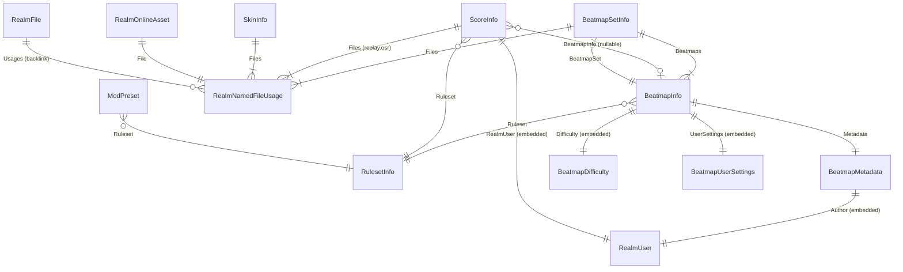

# osu!lazer 数据层基线（官方 Schema 字典）

> 用途：作为 LZSync 后续所有 fork（Ez2Lazer / EZRealmSync / g0v0 / delta 等）对比与同步设计的「官方 schema 字典」。
> 基线来源：`reference/lazer`（ppy/osu 本地镜像），git HEAD = `c752ffb2260abcf4dad0b7d8e298806ab9db5b24`（2026-10-24, "Minor naming changes"）。
> 本文自包含：`reference/` 目录将来会被整体删除，所有关键事实均已摘录原文（类名、字段名与类型、枚举值、默认值、路径常量）。
> 部分结论另在本机真实 lazer 数据目录 `~/.local/share/osu/` 做了实证（标注「本机实证」）。

---

## 1. 数据目录布局

### 1.1 游戏名与数据目录名

`osu.Desktop/Program.cs`：

```csharp
#if DEBUG
        private const string base_game_name = @"osu-development";
#else
        private const string base_game_name = @"osu";
#endif
```

- release 构建游戏名/数据目录名为 `osu`；debug 构建为 `osu-development`。
- 命令行参数 `--debug-client-id=<int>`（仅 debug 构建）会把目录名改为 `osu-<clientID>`（用于多开调试）。
- `--tournament` 启动锦标赛客户端（TournamentGame），数据目录仍由 gameName 决定。

`osu.Game/OsuGameBase.cs` 常量：

```csharp
public const string GAME_NAME = "osu!";            // 显示名（debug 为 "osu! (development)"）
public const string OSU_PROTOCOL = "osu://";
public const string CLIENT_DATABASE_FILENAME = @"client.realm";
```

默认数据目录由 osu-framework 的 `GameHost.GetDefaultGameStorage()` 决定：`UserStoragePaths[首个可写路径]/<gameName>`（framework `GameHost.cs:1080-1106`，逻辑为「优先找已存在目录，否则用第一个可创建的路径」）。各平台 UserStoragePaths：

- Linux：`$XDG_DATA_HOME`（默认 `~/.local/share`）→ 本机实证 `~/.local/share/osu/`
- Windows：`%APPDATA%`
- macOS：`~/Library/Application Support`

（平台路径细则来自 osu-framework 仓库 `osu.Framework/Platform/`，lazer 仓库内无此源码；Linux 路径已本机实证。）

### 1.2 数据目录内容清单（本机实证 `~/.local/share/osu/`）

| 条目 | 性质 | 说明 |
|---|---|---|
| `client.realm` | Realm 数据库主文件 | 全部游戏数据（谱面/成绩/皮肤元数据/键位/规则集设置/收藏） |
| `client.realm.lock` / `.management` / `.note` | Realm 伴随文件 | Realm 的锁与共享内存管理文件；`OsuStorage.IgnoreSuffixes` 在迁移时排除它们 |
| `files/` | 内容寻址文件仓 | 全部谱面音频/图像/回放等原始文件（见 1.4） |
| `framework.ini` | ini 配置 | framework 层设置（窗口/音频设备/渲染器等），见 §4.1 |
| `game.ini` | ini 配置 | osu.Game 层设置（OsuConfigManager，OsuSetting 全量），见 §4.2 |
| `storage.ini` | ini 配置 | 仅一条：用户自定义数据目录路径（StorageConfig.FullPath，默认空 = 未自定义）。本机未自定义故此文件不存在 |
| `rulesets/` | 目录 | 编译后的第三方规则集 dll |
| `online.db` | SQLite（下载缓存） | 服务器下发的谱面元数据镜像缓存（LocalCachedBeatmapMetadataSource，只读） |
| `cache/` | 目录 | 辅助缓存存储（framework `CacheStorage`，固定在默认目录，不随自定义存储迁移） |
| `exports/` / `screenshots/` / `logs/` | 目录 | 导出/截图/日志 |
| `input.json` | 文件 | framework 输入回放/记录相关（lazer 源码中无直接引用，未确认具体生成方） |
| `AuthNative.so/.dll/.dylib` | 原生库 | 登录组件；`OsuStorage.IgnoreFiles` 声明它们不可安全移动 |

### 1.3 OsuStorage 与自定义存储路径

`osu.Game/IO/OsuStorage.cs`（继承 framework `MigratableStorage`）：

```csharp
public string? CustomStoragePath => storageConfig.Get<string>(StorageConfig.FullPath);

public override string[] IgnoreDirectories => new[] { "cache" };

public override string[] IgnoreFiles => new[]
{
    "framework.ini",
    "storage.ini",
    // These may not be safe to move around.
    "AuthNative.dll", "AuthNative.so", "AuthNative.dylib"
};

public override string[] IgnoreSuffixes => new[]
{
    // Realm pipe files don't play well with copy operations
    ".note", ".lock", ".management",
};
```

要点：

- 用户可在设置里把数据目录整体迁到自定义路径；`storage.ini` 记录该路径。
- 迁移（`Migrate()`）会把数据搬到新位置并回写 `storage.ini`；`framework.ini`、`storage.ini`、原生库与 `cache/` 不参与迁移。
- `OsuStorageError` 枚举：`None` / `AccessibleButEmpty`（目标目录可访问但为空）/ `NotAccessible`。
- Realm 打开失败时（`RealmAccess` 初始化）客户端会把 `client.realm` 删掉重建（数据重置），这是官方「崩溃即重置」策略——同步工具必须意识到这一点（详见 §3.3）。

### 1.4 files/ 内容寻址文件仓

写入方 `osu.Game/Database/RealmFileStore.cs`：

```csharp
public RealmFileStore(RealmAccess realm, Storage storage)
{
    this.realm = realm;
    Storage = storage.GetStorageForDirectory(@"files");
    Store = new StorageBackedResourceStore(Storage);
}

public RealmFile Add(Stream data, Realm realm, bool addToRealm = true, bool preferHardLinks = false)
{
    string hash = data.ComputeSHA2Hash();
    var existing = realm.Find<RealmFile>(hash);
    var file = existing ?? new RealmFile { Hash = hash };
    if (!checkFileExistsAndMatchesHash(file))
        copyToStore(file, data, preferHardLinks);
    ...
}
```

- **哈希算法：SHA-256**，小写 hex，64 字符。实现来自 osu-framework `ExtensionMethods.cs`（经 GitHub API 读取 master 分支原文）：
  ```csharp
  /// <returns>A lower-case hex string representation of the hash (64 characters).</returns>
  public static string ComputeSHA2Hash(this Stream stream)
  {
      stream.Seek(0, SeekOrigin.Begin);
      string hash = Convert.ToHexStringLower(SHA256.HashData(stream));
      ...
  }
  ```
- **两级目录布局**，`osu.Game/Extensions/ModelExtensions.cs:23`：
  ```csharp
  public static string GetStoragePath(this IFileInfo fileInfo)
      => Path.Combine(fileInfo.Hash.Remove(1), fileInfo.Hash.Remove(2), fileInfo.Hash);
  ```
  即 `files/<hash第1字符>/<hash前2字符>/<完整hash>`。本机实证：`files/8/8e/8e445aedd0540083c553e1ce588da5ba72b9b6f23676d0d8ed285dc89965f495`。
- 导入时优先尝试硬链接（`preferHardLinks`，Windows/Linux），失败回退复制；重复内容按 hash 全局去重（`realm.Find<RealmFile>(hash)` 命中即复用）。
- 校验：即使文件已存在也重新读盘算哈希比对（`checkFileExistsAndMatchesHash`）。
- 清理：`Cleanup()` 删除所有 `Usages.@count = 0`（无任何模型引用）的 RealmFile 及其磁盘文件。**这是同步工具最危险的联动点：引用计数为零的文件会被物理删除。**

---

## 2. Realm Schema（12 个 RealmObject + 4 个 EmbeddedObject）

> 调研方法：`grep -rln ": RealmObject"` 与 `grep -rn "EmbeddedObject"` 全仓库扫描，命中 12 个 RealmObject 子类与 4 个 EmbeddedObject 子类（osu.Game 内，排除测试）。**任务提示中的 `DatabasedSetting`、`RealmSettingsStorage`、`SettingsStore`（作为表）在当前基线代码中不存在**（grep 零命中）——它们是旧版（EF Core 时代）概念，现已分别被 `RealmRulesetSetting` 取代 / 删除（SettingsStore 仅剩一个包装 RealmAccess 的空壳类，见 §4.3）。

### 2.1 RealmFile（表名 "File"）

`osu.Game/Models/RealmFile.cs`：

```csharp
[MapTo("File")]
public class RealmFile : RealmObject, IFileInfo
{
    [PrimaryKey]
    public string Hash { get; set; } = string.Empty;

    [Backlink(nameof(RealmNamedFileUsage.File))]
    public IQueryable<RealmNamedFileUsage> Usages { get; } = null!;
}
```

- 主键 = 文件内容 SHA-256（即 files/ 里的磁盘文件名）。
- `Usages` 反向链接所有引用它的命名文件记录。

### 2.2 RealmNamedFileUsage（EmbeddedObject，不独立成表）

`osu.Game/Models/RealmNamedFileUsage.cs`：

```csharp
public class RealmNamedFileUsage : EmbeddedObject, INamedFile, INamedFileUsage
{
    public RealmFile File { get; set; } = null!;
    public string Filename { get; set; } = null!;
}
```

- 「一个模型内的具名文件」：`File` 指向内容哈希，`Filename` 是该文件在归档内的原名（如 `audio.mp3`、`replay.osr`、`[Difficulty] osu file.osu`）。
- 谱面集、成绩、皮肤、在线资产都通过 `IList<RealmNamedFileUsage> Files` 挂接文件。

### 2.3 RealmUser（EmbeddedObject）

`osu.Game/Models/RealmUser.cs`：

```csharp
public class RealmUser : EmbeddedObject, IUser, IEquatable<RealmUser>, IDeepCloneable<RealmUser>
{
    public int OnlineID { get; set; } = 1;
    public string Username { get; set; } = string.Empty;
    [Ignored]
    public CountryCode CountryCode { get => ...; set => CountryString = value.ToString(); }
    [MapTo(nameof(CountryCode))]
    public string CountryString { get; set; } = default(CountryCode).ToString();
    public bool IsBot => false;
}
```

- 等值判定：`OnlineID == other.OnlineID && Username == other.Username`。
- `OnlineID` 默认 1（osu! 的系统/Guest 用户 id）。被嵌入 BeatmapMetadata.Author 与 ScoreInfo.RealmUser。

### 2.4 BeatmapSetInfo（表名 "BeatmapSet"）

`osu.Game/Beatmaps/BeatmapSetInfo.cs`：

| 字段 | 类型 | 索引/键 | 默认值 | 说明 |
|---|---|---|---|---|
| `ID` | `Guid` | **[PrimaryKey]** | 构造时 `Guid.NewGuid()` | |
| `OnlineID` | `int` | [Indexed] | `-1` | osu! 谱面集 id（beatmapset id） |
| `DateAdded` | `DateTimeOffset` | | | 本地导入时间 |
| `DateSubmitted` | `DateTimeOffset?` | | | 谱面集首次提交时间（在线） |
| `DateRanked` | `DateTimeOffset?` | | | 上架时间（在线） |
| `Beatmaps` | `IList<BeatmapInfo>` | | | 一对多关系（内嵌子表） |
| `Files` | `IList<RealmNamedFileUsage>` | | | 集内全部文件（.osz 解包） |
| `StatusInt`（MapTo "Status"） | `int` | | `(int)BeatmapOnlineStatus.None` | 通过 `[Ignored] Status` 属性以枚举读写（BeatmapOnlineStatus，见 §5） |
| `DeletePending` | `bool` | | | 软删除标记 |
| `Hash` | `string` | | `string.Empty` | 集哈希：所有 `.osu` 文件内容按文件名排序拼接后的 SHA-256（见 §6.1） |
| `Protected` | `bool` | | | 系统保护集（不可删） |
| `MaxStarDifficulty`/`MaxLength`/`MaxBPM` | `double` | | 计算属性 | 由 Beatmaps 聚合，不落库 |

- `Metadata` 是 `[Ignored]` 计算属性：`Beatmaps.FirstOrDefault()?.Metadata`。
- `AllBeatmapsUpToDate` => 所有难度 `MatchesOnlineVersion`。

### 2.5 BeatmapInfo（表名 "Beatmap"）

`osu.Game/Beatmaps/BeatmapInfo.cs`（单个难度）：

| 字段 | 类型 | 索引/键 | 默认值 | 说明 |
|---|---|---|---|---|
| `ID` | `Guid` | **[PrimaryKey]** | `Guid.NewGuid()` | |
| `DifficultyName` | `string` | | `""` | 难度名（如 Another） |
| `Ruleset` | `RulesetInfo` | | | 关系 → Ruleset 表 |
| `Difficulty` | `BeatmapDifficulty` | | | **EmbeddedObject**（见 2.5.1） |
| `Metadata` | `BeatmapMetadata` | | | 关系 → BeatmapMetadata 表（**注意：每个难度一份独立 metadata**） |
| `Scores` | `IQueryable<ScoreInfo>` | Backlink | | 反向链接（`ScoreInfo.BeatmapInfo`） |
| `UserSettings` | `BeatmapUserSettings` | | | **EmbeddedObject**（见 2.5.2） |
| `BeatmapSet` | `BeatmapSetInfo?` | | | 所属谱面集 |
| `StatusInt`（MapTo "Status"） | `int` | | `(int)BeatmapOnlineStatus.None` | 难度级在线状态 |
| `OnlineID` | `int` | [Indexed] | `-1` | osu! beatmap id |
| `Length` | `double` | | | 时长（毫秒） |
| `BPM` | `double` | | | |
| `Hash` | `string` | | `""` | 该难度 `.osu` **去重内容**的 SHA-256（等于对应 RealmFile.Hash；去重指经过 lazer 归一化再编码后的内容，见 BeatmapImporter） |
| `StarRating` | `double` | | `-1` | 本地计算难度星数（-1 = 未计算） |
| `MD5Hash` | `string` | [Indexed] | `""` | `.osu` **原始字节**的 MD5（`memoryStream.ComputeMD5Hash()`，BeatmapImporter.cs:444）——与 stable / 服务器对账用 |
| `OnlineMD5Hash` | `string` | | `""` | 在线版本的 MD5（对账用） |
| `LastLocalUpdate` | `DateTimeOffset?` | | | 编辑器本地修改时间 |
| `LastOnlineUpdate` | `DateTimeOffset?` | | | 在线元数据应用时间 |
| `Hidden` | `bool` | [JsonIgnore] | | 歌单中隐藏 |
| `EndTimeObjectCount` | `int` | | `-1` | 长物件数（-1 = 未计算） |
| `TotalObjectCount` | `int` | | `-1` | 物件总数 |
| `LastPlayed` | `DateTimeOffset?` | | | 本地用户上次游玩 |
| `BeatDivisor` | `int` | | `4` | 编辑器 snap |
| `EditorTimestamp` | `double?` | | | 编辑器退出时间点（毫秒） |
| `Path`、`OnlineInfo`、`MaxCombo`、`File` | — | [Ignored] | | 兼容计算属性，不落库 |

- `MatchesOnlineVersion` => `LastOnlineUpdate == null || MD5Hash == OnlineMD5Hash`。
- `UpdateLocalScores(realm)`：成绩与谱面的关联按 `ScoreInfo.BeatmapHash == BeatmapInfo.Hash` 重新挂接（谱面更新后哈希变化时先解绑再重绑）。
- `TransferCollectionReferences`：收藏夹按 MD5 追踪，谱面更新时把旧 MD5 换成新 MD5。

#### 2.5.1 BeatmapDifficulty（EmbeddedObject，MapTo "BeatmapDifficulty"）

```csharp
public float DrainRate { get; set; } = 5;      // IBeatmapDifficultyInfo.DEFAULT_DIFFICULTY
public float CircleSize { get; set; } = 5;
public float OverallDifficulty { get; set; } = 5;
public float ApproachRate { get; set; } = 5;
public double SliderMultiplier { get; set; } = 1.4;
public double SliderTickRate { get; set; } = 1;
```

#### 2.5.2 BeatmapUserSettings（EmbeddedObject）

```csharp
public class BeatmapUserSettings : EmbeddedObject
{
    public double Offset { get; set; }   // 该谱面的本地音频偏移
}
```

### 2.6 BeatmapMetadata（表名 "BeatmapMetadata"）

`osu.Game/Beatmaps/BeatmapMetadata.cs`：

| 字段 | 类型 | 默认值 | 说明 |
|---|---|---|---|
| `Title` | `string` | `""` | |
| `TitleUnicode` | `string` | `""` | |
| `Artist` | `string` | `""` | |
| `ArtistUnicode` | `string` | `""` | |
| `Author` | `RealmUser` | | **EmbeddedObject**（Mapper 时从 string 迁移为 RealmUser，schema v9） |
| `Source` | `string` | `""` | |
| `Tags` | `string` | `""` | 空格分隔 |
| `UserTags` | `IList<string>` | | 在线用户投票标签（schema v51 引入；来自在线源） |
| `PreviewTime` | `int` | `-1` | 试听起点（毫秒；-1 = 40% 处） |
| `AudioFile` | `string` | `""` | 音频文件名（集合 Files 内的 Filename） |
| `BackgroundFile` | `string` | `""` | 背景文件名 |

注意：难度名（DifficultyName）不存这里，存 `BeatmapInfo.DifficultyName`。

### 2.7 ScoreInfo（表名 "Score"）

`osu.Game/Scoring/ScoreInfo.cs`，成绩表（含本地成绩与导入的 stable 成绩）：

| 字段 | 类型 | 索引/键 | 默认值 | 说明 |
|---|---|---|---|---|
| `ID` | `Guid` | **[PrimaryKey]** | `Guid.NewGuid()` | |
| `BeatmapInfo` | `BeatmapInfo?` | | | 可为 null（谱面不在本地/版本不匹配时） |
| `ClientVersion` | `string` | | `""` | 打出该成绩的客户端版本（`OsuGameBase.Version`） |
| `BeatmapHash` | `string` | [Indexed] | `""` | **成绩与谱面的真正锚点**：打成绩时的 `BeatmapInfo.Hash`（SHA-256）；谱面可能事后变化，故冗余存此字段（schema v26 引入） |
| `Ruleset` | `RulesetInfo` | | | 关系 → Ruleset |
| `Files` | `IList<RealmNamedFileUsage>` | | | 回放文件（`replay.osr`）挂在这 |
| `Hash` | `string` | | `""` | 成绩内容哈希（全部 `.osr` 拼接 SHA-256，见 §6.2） |
| `DeletePending` | `bool` | | | 软删除 |
| `TotalScore` | `long` | | | 总分 |
| `TotalScoreWithoutMods` | `long` | | | 不含 mod 倍率的总分（schema v41，为将来 mod 倍率重平衡留无损迁移） |
| `TotalScoreVersion` | `int` | | `LegacyScoreEncoder.LATEST_VERSION`（= `30000019`，LegacyScoreEncoder.cs:69） | 总分计算版本号 |
| `LegacyTotalScore` | `long?` | | | stable 成绩原始总分（lazer 成绩为 null/0） |
| `BackgroundReprocessingFailed` | `bool` | | | 后台分数重算失败标记 |
| `MaxCombo` | `int` | | | 最大连击 |
| `Accuracy` | `double` | | | 准确率 0~1 |
| `Date` | `DateTimeOffset` | | | 成绩时间 |
| `PP` | `double?` | | | 表现分（在线填充） |
| `OnlineID` | `long` | [Indexed] | `-1` | osu-web `solo_scores` 表 id |
| `LegacyOnlineID` | `long` | [Indexed] | `-1` | stable 时代 `osu_scores_*_high` 表 id |
| `RealmUser`（MapTo "User"） | `RealmUser` | | | **EmbeddedObject**：成绩归属用户 |
| `ModsJson`（MapTo "Mods"） | `string` | | `""` | `APIMod[]` 的 JSON 序列化 |
| `StatisticsJson`（MapTo "Statistics"） | `string` | | `""` | `Dictionary<HitResult,int>` JSON |
| `MaximumStatisticsJson`（MapTo "MaximumStatistics"） | `string` | | `""` | 同上（基准统计） |
| `Pauses` | `IList<int>` | | | 暂停时间点列表（毫秒，schema v51 引入） |
| `RankInt`（MapTo "Rank"） | `int` | | | `ScoreRank` 枚举值 |
| `Combo` | `int` | | | 当前连击 |
| `IsLegacyScore` | `bool` | | | 是否 stable 导入成绩 |
| `HasOnlineReplay`/`Ranked`/`Passed`/`Position`/`HitEvents`/`Statistics`/`MaximumStatistics`/`Mods`/`APIMods`/`User` | — | [Ignored] | | 运行时/网关属性，不落库 |

- 便捷属性：`UserID => RealmUser.OnlineID`、`RulesetID => Ruleset.OnlineID`。
- `DeepClone()` 会重建 Statistics/Mods/RealmUser，是导入路径的标准复制手段。

### 2.8 BeatmapCollection

`osu.Game/Collections/BeatmapCollection.cs`：

```csharp
public class BeatmapCollection : RealmObject, IHasGuidPrimaryKey
{
    [PrimaryKey]
    public Guid ID { get; set; }
    public string Name { get; set; } = string.Empty;
    public IList<string> BeatmapMD5Hashes { get; } = null!;
    public DateTimeOffset LastModified { get; set; }
}
```

- **存 MD5 哈希列表而非 BeatmapInfo 引用**，官方注释明确动机：「允许收藏在谱面不存在时保留引用；先导收藏后导谱面；**在用户间共享收藏**」——即收藏天然设计为跨库/跨用户可移植。
- `LastModified` 构造默认 `DateTimeOffset.UtcNow`。

### 2.9 RulesetInfo（表名 "Ruleset"）

`osu.Game/Rulesets/RulesetInfo.cs`：

| 字段 | 类型 | 索引/键 | 默认值 |
|---|---|---|---|
| `ShortName` | `string` | **[PrimaryKey]** | `""`（osu/taiko/catch/mania） |
| `OnlineID` | `int` | [Indexed] | `-1`（osu=0, taiko=1, catch=2, mania=3） |
| `Name` | `string` | | `""` |
| `InstantiationInfo` | `string` | | `""`（.NET 类型全名，用于反射建实例） |
| `LastAppliedDifficultyVersion` | `int` | | 难度计算器版本 |
| `Available` | `bool` | | 规则集 dll 是否可加载 |

官方四规则集通过 `RulesetStore` 首次启动播种（osu!、osu!taiko、osu!catch、osu!mania）。

### 2.10 SkinInfo（表名 "Skin"）

`osu.Game/Skinning/SkinInfo.cs`：

| 字段 | 类型 | 键 | 默认值 | 说明 |
|---|---|---|---|---|
| `ID` | `Guid` | **[PrimaryKey]** | `Guid.NewGuid()` | |
| `Name` | `string` | | `""` | |
| `Creator` | `string` | | `""` | |
| `InstantiationInfo` | `string` | | `""` | 皮肤类类型全名（空则 LegacySkin） |
| `Hash` | `string` | | `""` | `.ini`+`.json` 拼接 SHA-256（SkinImporter.HashableFileTypes = `{".ini",".json"}`；.osk 导入） |
| `Protected` | `bool` | | | 内置皮肤保护 |
| `Files` | `IList<RealmNamedFileUsage>` | | | 皮肤文件 |
| `DeletePending` | `bool` | | | 软删除 |

**内置皮肤固定 Guid 常量**（同步时必须保留，不可随机化）：

```csharp
internal static readonly Guid TRIANGLES_SKIN  = new Guid("2991CFD8-2140-469A-BCB9-2EC23FBCE4AD");
internal static readonly Guid ARGON_SKIN      = new Guid("CFFA69DE-B3E3-4DEE-8563-3C4F425C05D0");
internal static readonly Guid ARGON_PRO_SKIN  = new Guid("9FC9CF5D-0F16-4C71-8256-98868321AC43");
internal static readonly Guid CLASSIC_SKIN    = new Guid("81F02CD3-EEC6-4865-AC23-FAE26A386187");
internal static readonly Guid RETRO_SKIN      = new Guid("0555C76A-CC6B-4BB4-9548-DF76BA72EF25");
internal static readonly Guid RANDOM_SKIN     = new Guid("D39DFEFB-477C-4372-B1EA-2BCEA5FB8908");
```

### 2.11 ModPreset

`osu.Game/Rulesets/Mods/ModPreset.cs`（模组预设）：

| 字段 | 类型 | 键 | 默认值 |
|---|---|---|---|
| `ID` | `Guid` | **[PrimaryKey]** | `Guid.NewGuid()` |
| `Ruleset` | `RulesetInfo` | | 关系 → Ruleset |
| `Name` | `string` | | `""` |
| `Description` | `string` | | `""` |
| `ModsJson`（MapTo "Mods"） | `string` | | `""`（APIMod[] JSON） |
| `DeletePending` | `bool` | | 软删除 |

### 2.12 RealmKeyBinding（表名 "KeyBinding"）

`osu.Game/Input/Bindings/RealmKeyBinding.cs`：

| 字段 | 类型 | 键 | 说明 |
|---|---|---|---|
| `ID` | `Guid` | **[PrimaryKey]** | |
| `RulesetName` | `string?` | | null = 全局键位；否则为规则集 ShortName |
| `Variant` | `int?` | | 规则集变体（如 mania 键数） |
| `ActionInt`（MapTo "Action"） | `int` | | 动作枚举整数值（全局为 GlobalAction） |
| `KeyCombinationString`（MapTo "KeyCombination"） | `string` | | 按键组合字符串（如 `Ctrl,Shift+Z`） |

### 2.13 RealmRulesetSetting（表名 "RulesetSetting"）

`osu.Game/Configuration/RealmRulesetSetting.cs`：

```csharp
[MapTo(@"RulesetSetting")]
public class RealmRulesetSetting : RealmObject
{
    [Indexed] public string RulesetName { get; set; } = string.Empty;
    [Indexed] public int Variant { get; set; }
    [Required] public string Key { get; set; } = string.Empty;
    [Required] public string Value { get; set; } = string.Empty;
}
```

- **无主键**，以 `(RulesetName, Variant, Key)` 三元组为逻辑键（查询即按此三者 First）。
- 承载 per-ruleset / per-variant 设置（旧 `DatabasedSetting` 的继任者）。

### 2.14 RealmOnlineAsset

`osu.Game/Models/RealmOnlineAsset.cs`（schema v52 新增，2026-07-28）：

```csharp
public class RealmOnlineAsset : RealmObject
{
    public RealmNamedFileUsage File { get; set; } = null!;  // 原始 URL 作 Filename
    [Indexed] public DateTimeOffset LastAccessed { get; set; } = DateTimeOffset.Now;
}
```

- 在线资源（头像/封面等）的本地磁盘缓存记录；`Filename` 存远程 URL。超过一个月未访问会被 `RealmAccess.cleanupPendingDeletions` 清除。

### 2.15 关系图



---

## 3. Schema 版本与迁移策略

### 3.1 版本常量

`osu.Game/Database/RealmAccess.cs:106`：

```csharp
private const int schema_version = 52;
```

版本历史（同文件注释，全文摘录）：

```
6    ~2021-10-18   First tracked version.
7    2021-10-18    Changed OnlineID fields to non-nullable to add indexing support.
8    2021-10-29    Rebind scroll adjust keys to not have control modifier.
9    2021-11-04    Converted BeatmapMetadata.Author from string to RealmUser.
10   2021-11-22    Use ShortName instead of RulesetID for ruleset settings.
11   2021-11-22    Use ShortName instead of RulesetID for ruleset key bindings.
12   2021-11-24    Add Status to RealmBeatmapSet.
13   2022-01-13    Final migration of beatmaps and scores to realm (multiple new storage fields).
14   2022-03-01    Added BeatmapUserSettings to BeatmapInfo.
15   2022-07-13    Added LastPlayed to BeatmapInfo.
16   2022-07-15    Removed HasReplay from ScoreInfo.
17   2022-07-16    Added CountryCode to RealmUser.
18   2022-07-19    Added OnlineMD5Hash and LastOnlineUpdate to BeatmapInfo.
19   2022-07-19    Added DateSubmitted and DateRanked to BeatmapSetInfo.
20   2022-07-21    Added LastAppliedDifficultyVersion to RulesetInfo, changed default value of BeatmapInfo.StarRating to -1.
21   2022-07-27    Migrate collections to realm (BeatmapCollection).
22   2022-07-31    Added ModPreset.
23   2022-08-01    Added LastLocalUpdate to BeatmapInfo.
24   2022-08-22    Added MaximumStatistics to ScoreInfo.
25   2022-09-18    Remove skins to add with new naming.
26   2023-02-05    Added BeatmapHash to ScoreInfo.
27   2023-06-06    Added EditorTimestamp to BeatmapInfo.
28   2023-06-08    Added IsLegacyScore to ScoreInfo, parsed from replay files.
29   2023-06-12    Run migration of old lazer scores to be best-effort in the new scoring number space. No actual realm changes.
30   2023-06-16    Run migration of old lazer scores again. This time with more correct rounding considerations.
31   2023-06-26    Add Version and LegacyTotalScore to ScoreInfo, set Version to 30000002 and copy TotalScore into LegacyTotalScore for legacy scores.
32   2023-07-09    Populate legacy scores with the ScoreV2 mod (and restore TotalScore to the legacy total for such scores) using replay files.
33   2023-08-16    Reset default chat toggle key binding to avoid conflict with newly added leaderboard toggle key binding.
34   2023-08-21    Add BackgroundReprocessingFailed flag to ScoreInfo to track upgrade failures.
35   2023-10-16    Clear key combinations of keybindings that are assigned to more than one action in a given settings section.
36   2023-10-26    Add LegacyOnlineID to ScoreInfo. Move osu_scores_*_high IDs stored in OnlineID to LegacyOnlineID. Reset anomalous OnlineIDs.
38   2023-12-10    Add EndTimeObjectCount and TotalObjectCount to BeatmapInfo.
39   2023-12-19    Migrate any EndTimeObjectCount and TotalObjectCount values of 0 to -1 to better identify non-calculated values.
40   2023-12-21    Add ScoreInfo.Version to keep track of which build scores were set on.
41   2024-04-17    Add ScoreInfo.TotalScoreWithoutMods for future mod multiplier rebalances.
42   2024-08-07    Update mania key bindings to reflect changes to ManiaAction
43   2024-10-14    Reset keybind for toggling FPS display to avoid conflict with "convert to stream" in the editor, if not already changed by user.
44   2024-11-22    Removed several properties from BeatmapInfo which did not need to be persisted to realm.
45   2024-12-23    Change beat snap divisor adjust defaults to be Ctrl+Scroll instead of Ctrl+Shift+Scroll, if not already changed by user.
46   2024-12-26    Change beat snap divisor bindings to match stable directionality ¯\_(ツ)_/¯.
47   2025-01-21    Remove right mouse button binding for absolute scroll. Never use mouse buttons (or scroll) for global actions.
48   2025-03-19    Clear online status for all qualified beatmaps (some were stuck in a qualified state due to local caching issues).
49   2025-06-10    Reset the LegacyOnlineID to -1 for all scores that have it set to 0 (which is semantically the same) for consistency of handling with OnlineID.
50   2025-07-11    Add UserTags to BeatmapMetadata.
51   2025-07-22    Add ScoreInfo.Pauses.
52   2026-07-28    Add RealmOnlineAsset.
```

（注意：版本号 37 被跳过，36 之后直接 38。）

### 3.2 迁移机制

`RealmAccess.cs:813-833`：

```csharp
private RealmConfiguration getConfiguration(string? filename = null)
{
    ...
    return new RealmConfiguration(storage.GetFullPath(filename ?? Filename, true))
    {
        SchemaVersion = schema_version,
        MigrationCallback = onMigration,
        FallbackPipePath = tempPathLocation,   // Path.GetTempPath()/lazer
    };
}

private void onMigration(Migration migration, ulong lastSchemaVersion)
{
    for (ulong i = lastSchemaVersion + 1; i <= schema_version; i++)
        applyMigrationsForVersion(migration, i);
}
```

- 逐版本 `switch (targetVersion)` 的手写迁移（`applyMigrationsForVersion`），官方 **不使用 realm 自动迁移**，新 schema 字段加默认值后由各版本 case 补数据修复。
- 打开时日志：`Opened realm "<路径>" at version <n>`。
- 无单独 "RealmUtils" 类（任务提示的名称不存在）；Realm 相关工具方法分散在 `RealmAccess` / `RealmObjectExtensions` / `RealmExtensions`。

### 3.3 对同步工具的关键含义

- fork 若改 schema（哪怕只加字段），必须 **提升 `schema_version` 常量**；否则官方客户端一旦打开该库会因 schema 不匹配拒开/重置。
- 官方客户端对无法打开/损坏的 `client.realm` 的处理是 **删除重建**（"reset to recovery"）：同步工具写库时保证可打开性是硬约束。
- 迁移只在客户端启动打开 Realm 时发生；外部同步进程若以只读方式打开不同 schema 版本的库，Realm 只允许「相同或更低 schema」读取（需逐 fork 验证其 Realm 版本策略）。

---

## 4. 设置存储双轨

lazer 的设置分四层：

### 4.1 framework.ini（framework 层）

- 由 osu-framework `GameHost` 的 `FrameworkConfigManager` 写入，**不随自定义存储迁移**（在 IgnoreFiles 里）。
- 键为 framework 枚举。本机实证条目示例：`WindowedSize = 1366x768`、`WindowMode = Fullscreen`、`FrameSync = Unlimited`、`Renderer = OpenGL`、`AudioDevice = sof-hda-dsp:`、`VolumeUniversal/VolumeMusic/VolumeEffect`、`CursorSensitivity = 3.2`、`Locale = zh`、`ConfineMouseMode`、`ExecutionMode = MultiThreaded`、`MapAbsoluteInputToWindow`、`IgnoredInputHandlers`、`HardwareVideoDecoder` 等。
- 性质：**机器/窗口/设备强绑定**（显示器分辨率、音频设备名、输入设备），跨客户端同步价值低且有害（设备名不同）。

### 4.2 game.ini（OsuConfigManager，osu.Game 层）

`osu.Game/Configuration/OsuConfigManager.cs`：`public class OsuConfigManager : IniConfigManager<OsuSetting>, IGameplaySettings`。framework `IniConfigManager` 默认文件名即 `game.ini`（framework 源码：`protected virtual string Filename => @"game.ini";`），格式为 `Key = Value` 逐行。

**OsuSetting 枚举全量清单**（`OsuConfigManager.cs:335` 起，共 122 个成员，按源码顺序；`MenuParallax` 带 `[Obsolete]`，注释标注可 2027-01-01 移除）：

```
Ruleset, Token, MenuCursorSize, GameplayCursorSize, AutoCursorSize, GameplayCursorDuringTouch,
DimLevel, BlurLevel, EditorDim, LightenDuringBreaks, ShowStoryboard, KeyOverlay,
GameplayLeaderboard, PositionalHitsoundsLevel, AlwaysPlayFirstComboBreak, FloatingComments,
HUDVisibilityMode, ShowHealthDisplayWhenCantFail, FadePlayfieldWhenHealthLow,
MouseDisableButtons, MouseDisableWheel, ConfineMouseMode, AudioOffset, VolumeInactive,
MenuMusic, MenuVoice, MenuTips, CursorRotation, MenuParallax[Obsolete], MenuParallaxScale,
Prefer24HourTime, BeatmapDetailTab, BeatmapLeaderboardSortMode, BeatmapDetailModsFilter,
Username, ReleaseStream, SavePassword, SaveUsername, DisplayStarsMinimum, DisplayStarsMaximum,
SongSelectGroupMode, SongSelectSortingMode, SongSelectCollectionFilter, RandomSelectAlgorithm,
ModSelectHotkeyStyle, ShowFpsDisplay, ChatDisplayHeight, BeatmapListingCardSize,
ToolbarClockDisplayMode, SongSelectBackgroundBlur, Version, ShowFirstRunSetup,
ShowConvertedBeatmaps, Skin, ScreenshotFormat, ScreenshotCaptureMenuCursor, BeatmapSkins,
BeatmapColours, BeatmapHitsounds, IncreaseFirstObjectVisibility, ScoreDisplayMode,
ExternalLinkWarning, PreferNoVideo, Scaling, ScalingPositionX, ScalingPositionY, ScalingSizeX,
ScalingSizeY, ScalingBackgroundDim, UIScale, IntroSequence, NotifyOnUsernameMentioned,
NotifyOnPrivateMessage, NotifyOnFriendPresenceChange, UIHoldActivationDelay, HitLighting,
StarFountains, MenuBackgroundSource, GameplayDisableWinKey, SeasonalBackgroundMode,
EditorWaveformOpacity, EditorShowHitMarkers, EditorAutoSeekOnPlacement, DiscordRichPresence,
ShowOnlineExplicitContent, LastProcessedMetadataId, SafeAreaConsiderations,
ComboColourNormalisationAmount, ProfileCoverExpanded, EditorLimitedDistanceSnap,
ReplaySettingsOverlay, ReplayPlaybackControlsExpanded, AutomaticallyDownloadMissingBeatmaps,
EditorShowSpeedChanges, TouchDisableGameplayTaps, ModSelectTextSearchStartsActive,
UserOnlineStatus, MultiplayerRoomFilter, HideCountryFlags, EditorTimelineShowTimingChanges,
EditorTimelineShowTicks, AlwaysShowHoldForMenuButton, EditorContractSidebars, EditorScaleOrigin,
EditorRotationOrigin, EditorTimelineShowBreaks, EditorAdjustExistingObjectsOnTimingChanges,
AlwaysRequireHoldingForPause, MultiplayerShowInProgressFilter, MultiplayerShowFullFilter,
BeatmapListingFeaturedArtistFilter, ShowMobileDisclaimer, EditorShowStoryboard,
EditorSubmissionNotifyOnDiscussionReplies, EditorSubmissionLoadInBrowserAfterSubmission,
WasSupporter, LastOnlineTagsPopulation, AutomaticallyAdjustBeatmapOffset, DashboardSortMode,
DashboardDisplayStyle, PMFriendsOnly, HitsoundVolume
```

（对枚举逐项 grep 与源码 sed 输出核对过；上面按源码顺序完整摘录，仅省略源码中的 XML doc 注释。）

重要键的语义：

- `Ruleset`：string（ShortName，默认空）。`Skin`：**皮肤 Guid**，默认 `SkinInfo.ARGON_SKIN`。
- `Username` / `Token`：登录名与 OAuth JWT（本机实证 game.ini 中 Token 为超长 JWT；**敏感，同步时必须排除或脱敏**）。
- `Version`：上次启动的版本（用于首启流程判断）。
- `LastProcessedMetadataId` / `LastOnlineTagsPopulation`：在线元数据处理的游标。

### 4.3 storage.ini（StorageConfigManager）

```csharp
public class StorageConfigManager : IniConfigManager<StorageConfig>
{
    protected override string Filename => "storage.ini";
    protected override void InitialiseDefaults()
    {
        base.InitialiseDefaults();
        SetDefault(StorageConfig.FullPath, string.Empty);
    }
}
public enum StorageConfig { FullPath }
```

仅一个键：自定义数据目录绝对路径（空 = 默认位置）。

### 4.4 进 Realm 的设置

| 表 | 承载内容 | 键 |
|---|---|---|
| `RealmKeyBinding` | 全局键位（RulesetName=null）+ 各规则集键位 + 变体键位 | `(RulesetName, Variant, ActionInt)` |
| `RealmRulesetSetting` | per-ruleset/per-variant 设置（各规则集自己的 ConfigManager） | `(RulesetName, Variant, Key)` |
| `BeatmapUserSettings` | per-谱面音频偏移（BeatmapInfo 内嵌） | 随 BeatmapInfo |

`SettingsStore` 现状（`osu.Game/Configuration/SettingsStore.cs`）：

```csharp
public class SettingsStore
{
    // this class mostly exists as a wrapper to avoid breaking the ruleset API (see usage in RulesetConfigManager).
    // it may cease to exist going forward, depending on how the structure of the config data layer changes.
    public readonly RealmAccess Realm;
    ...
}
```

——纯粹是 RealmAccess 的包装（历史 API 兼容壳），**不再有独立的 DatabasedSetting 表**。`RulesetConfigManager.PerformLoad/PerformSave` 直接读写 `RealmRulesetSetting` 行（逐键 First 查找，变更集合并写入）。

### 4.5 归纳：什么进 ini、什么进 Realm

- **game.ini**：全部全局 UI/游戏体验/账号/通知/编辑器偏好（OsuSetting 全量）。
- **framework.ini**：窗口/渲染/音频设备/输入设备/语言。
- **Realm**：键位（需要枚举动作与规则集绑定）、per-ruleset 设置、per-谱面偏移——即「结构化、带规则集维度、或需要随库整体迁移」的设置。
- 同步视角：game.ini 大部分键可跨机器同步（剔除 Token/Username/机器相关键）；framework.ini 基本不同步；键位与规则集设置随 Realm 同步即可。

---

## 5. BeatmapOnlineStatus（谱面在线状态）

`osu.Game/Beatmaps/BeatmapOnlineStatus.cs` 全量：

| 值 | 名称 | 语义 |
|---|---|---|
| `-4` | `LocallyModified` | 特殊状态：编辑器本地改动后进入；**进入此态后忽略一切在线状态变化**，除非回退或提交 |
| `-3` | `None` | 未知/无状态 |
| `-2` | `Graveyard` | 墓场（下架弃置） |
| `-1` | `WIP` | 制作中 |
| `0` | `Pending` | 待审核（pending） |
| `1` | `Ranked` | 已上架 |
| `2` | `Approved` | 已批准（社区认可） |
| `3` | `Qualified` | 已合格（qualified） |
| `4` | `Loved` | Loved |

配套扩展：

```csharp
public static class BeatmapSetOnlineStatusExtensions
{
    public static bool GrantsPerformancePoints(this BeatmapOnlineStatus status)
        => status == BeatmapOnlineStatus.Ranked || status == BeatmapOnlineStatus.Approved;
}
```

- **只有 Ranked / Approved 赋予 PP**（`GrantsPerformancePoints`）。客户端用它在结算界面/排行榜决定是否显示 PP（`PerformanceStatistic.cs:72`、`BeatmapLeaderboardScore.Tooltip.cs:312` 同时要求「无未入库 mod」）。
- **提交成绩本身不受本地状态约束**：`Screens/Play/Player.cs`、`SubmittingPlayer.cs` 中没有任何对 BeatmapOnlineStatus 的 gate。是否记录/计分完全由服务端裁决。客户端本地提交前条件只有（`SubmittingPlayer.submitScore`）：
  1. 音频播放速率有效（`masterClock?.PlaybackRateValid.Value == true`，防变速作弊）；
  2. 拿到 score token（`token != null`）；
  3. 至少有一次有效 hit（`score.ScoreInfo.Statistics.Any(s => s.Key.IsHit() && s.Value > 0)`）；
  4. 总分非零。
- 提交流程（solo）：开局 `CreateSoloScoreRequest`（`POST beatmaps/{OnlineID}/solo/scores`，参数 `version_hash`（客户端版本哈希）、`beatmap_hash`（=MD5Hash）、`ruleset_id`）换取 token；结算 `SubmitSoloScoreRequest`（`beatmaps/{beatmapId}/solo/scores/{scoreId}`）提交，成功后 `score.ScoreInfo.OnlineID = s.ID`。
- 服务端通过 token 阶段的 beatmap_hash/版本校验来约束客户端（谱面版本不对、客户端版本不对则拿不到 token →「No token, skipping score submission」）。
- 状态存储：`BeatmapSetInfo.StatusInt`（集级）与 `BeatmapInfo.StatusInt`（难度级）都存此枚举的 int 值；`BeatmapInfo.ResetOnlineInfo()` 会把状态重置为 `None`（除非 LocallyModified）。

---

## 6. 成绩与回放

### 6.1 各种 Hash 的语义（同步设计核心）

| 哈希 | 算法 | 对象 | 存于 |
|---|---|---|---|
| `RealmFile.Hash` | SHA-256（小写hex 64字符） | 任意导入文件的原始字节 | File 表主键 + files/ 路径 |
| `BeatmapSetInfo.Hash` | SHA-256 | 集内全部 `.osu` 文件内容按文件名排序拼接 | BeatmapSet |
| `BeatmapInfo.Hash` | SHA-256 | 该难度 `.osu` **归一化重编码后**的内容（= 对应 RealmFile.Hash） | Beatmap |
| `BeatmapInfo.MD5Hash` | MD5 | `.osu` 原始字节（stable 语义） | Beatmap（[Indexed]） |
| `BeatmapInfo.OnlineMD5Hash` | MD5 | 在线版本 .osu（对账） | Beatmap |
| `ScoreInfo.Hash` | SHA-256 | 该成绩全部 `.osr`（通常一个 replay.osr）内容拼接 | Score |
| `ScoreInfo.BeatmapHash` | —（冗余拷贝） | 打成绩瞬间的 `BeatmapInfo.Hash` | Score（[Indexed]） |
| `SkinInfo.Hash` | SHA-256 | 皮肤内 `.ini`+`.json` 拼接 | Skin |

`RealmArchiveModelImporter.ComputeHash`（默认实现）：

```csharp
foreach (RealmNamedFileUsage file in item.Files.Where(f => HashableFileTypes.Any(...)).OrderBy(f => f.Filename))
{ using (Stream? s = Files.Store.GetStream(file.File.GetStoragePath())) s?.CopyTo(hashable); }
if (hashable.Length > 0) return hashable.ComputeSHA2Hash();
return item.Hash;   // 无可哈希文件时退回旧值
```

各 importer：`BeatmapImporter.HashableFileTypes = {".osu"}`（导入扩展名 `.osz`/`.olz`）；`ScoreImporter = {".osr"}`；`SkinImporter = {".ini",".json"}`（导入扩展名 `.osk`）。

### 6.2 成绩生命周期

1. **打出**：`SubmittingPlayer.PrepareScoreForResultsAsync` → `score.ScoreInfo.Date = DateTimeOffset.Now` → 在线提交（§5）。
2. **本地导入**：`Player.ImportScore`（Player.cs:1244）——对 legacy 规则集把回放编码为 `.osr` 后包成 `ByteArrayArchiveReader(stream, "replay.osr")`，`scoreManager.Import(importableScore, replayReader)`；导入后回填 `Hash`/`ID`/`Files`。
3. **导入 .osr 文件**（拖拽/导入目录）：`ScoreImporter.CreateModel` 用 `DatabasedLegacyScoreDecoder` 解析；**找不到对应谱面（按回放内 beatmap hash）则拒绝导入**，并触发 `GetBeatmapRequest(new BeatmapInfo { MD5Hash = notFound.Hash })` 提示下载缺失谱面（`MissingBeatmapNotification`）。
4. **导入后**：`Populate` 补挂 BeatmapInfo/Ruleset 关系、序列化 Statistics；`PostImport.populateUserDetails` 在线补全用户 id/用户名/国家（本地无网则保留回放内数据）。
5. **导出**：`LegacyScoreExporter` → `exports/<显示名> (yyyy-MM-dd_HH-mm).osr`，直接拷贝 `model.Files.SingleOrDefault()` 的原始字节。

### 6.3 成绩↔谱面挂接规则

- 强锚点：`ScoreInfo.BeatmapHash`（Indexed）== `BeatmapInfo.Hash`（SHA-256）。
- 关系字段 `ScoreInfo.BeatmapInfo` 允许为 null（谱面缺失/版本变了）。
- 谱面更新/编辑后 `BeatmapInfo.UpdateLocalScores(realm)` 重新挂接：先解绑全部，再把 `BeatmapHash == Hash` 的成绩绑回来。
- **多客户端同步含义**：只要两台机器同一 .osu 文件（字节级一致）导入，`BeatmapInfo.Hash`/`MD5Hash`/RealmFile.Hash 必然一致（内容寻址）；成绩可直接凭 `BeatmapHash` 匹配，无需 Guid 对齐。但 `BeatmapInfo.ID`/`ScoreInfo.ID` 是 **随机 Guid，每台机器不同**。

---

## 7. 多客户端同步视角

### 7.1 天然可同步（内容寻址，跨机器稳定）

| 数据 | 天然键 | 说明 |
|---|---|---|
| files/ 文件仓 | SHA-256 内容哈希 | 全局去重、跨机器字节一致即同键。可直接按文件名同步（内容寻址 = 无冲突） |
| BeatmapSetInfo.Hash / BeatmapInfo.Hash / MD5Hash | 内容哈希 | 同一 .osz 导入结果一致（前提：客户端版本相近——lazer 归一化编码随版本可能变化，见 §7.3 未确认项） |
| ScoreInfo（本地成绩） | `Hash`（.osr 内容）+ `BeatmapHash` | .osr 字节一致即同成绩；含完整统计与用户 |
| BeatmapCollection | `BeatmapMD5Hashes` 列表 | 官方注释明言设计目标含「在用户间共享」 |
| RulesetInfo | `ShortName` 主键 | 四官方规则集固定 |
| 内置皮肤 | 固定 Guid 常量 | §2.10 六个 Guid 全客户端一致 |

### 7.2 与账号/机器绑定（同步需特殊处理或排除）

| 数据 | 绑定原因 |
|---|---|
| `ScoreInfo.RealmUser`（OnlineID/Username/Country） | 谁打的就归谁；但字段本身可复制（同步他人成绩无技术障碍，仅语义问题） |
| `ScoreInfo.OnlineID` / `LegacyOnlineID` | 服务器分配；两台机器同一成绩提交只有一台会得到 OnlineID |
| `game.ini` 的 `Token`/`Username` | OAuth 凭据，**绝不应同步** |
| `framework.ini` 全部 | 显示器/音频设备/输入设备名机器相关 |
| `BeatmapInfo.LastPlayed` / `EditorTimestamp` / `UserSettings.Offset` / `Hidden` | 本地用户行为，会互相覆盖（按 LastWrite-wins 或字段级合并） |
| `rulesets/` 目录 | 本机安装的规则集 dll |
| `client.realm.lock/.management/.note` | 进程级锁与共享内存，绝不可同步 |
| `online.db` | 服务器全量缓存，可重新下载 |

### 7.3 同步设计要点（从数据层事实直接推出）

1. **内容寻址是同步基石**：RealmFile 与 files/ 的 SHA-256 键让「文件层同步」天然幂等无冲突；模型层同步应尽量以内容哈希为对账键，而非 Guid。
2. **Guid 主键不同步对齐**：所有 `IHasGuidPrimaryKey` 表的 ID 是 `Guid.NewGuid()`，两库必然不同；按内容键匹配后需做 ID 映射或以一方为准。
3. **引用计数陷阱**：直接拷贝模型行而不落 RealmFile 行会导致 `Cleanup()` 物理删除文件；反之只写文件不写模型是孤儿文件同样被清理。同步必须保证 RealmFile 行与模型引用原子地一起写。
4. **软删除模型**：BeatmapSetInfo/ScoreInfo/SkinInfo/ModPreset 用 `DeletePending` 而非真删；同步需传播 DeletePending 语义（或明确忽略）。
5. **schema 版本对齐**：目标库 schema_version 必须 ≥ 写入方假设；fork 加字段需自增版本号并处理与官方版本的竞速（官方 52 → 53…）。
6. **成绩唯一性**：以 `(BeatmapHash, Hash(.osr), Date)` 组合可做跨库去重；`OnlineID > 0` 的成绩与服务器有对应关系，重复导入不会产生新 OnlineID。
7. **收藏夹**：直接同步 `BeatmapMD5Hashes`（字符串列表）+ Name 即可，官方语义支持。
8. **键位/规则集设置**：RealmKeyBinding/RealmRulesetSetting 结构简单（无 Guid 依赖的字符串键），可整体搬运，但注意 mania Variant 维度。

---

## 8. 与任务提示的冲突与勘误

1. 任务提示「Realm schema 在 osu.Game/Models/ 下（BeatmapSetInfo、BeatmapInfo、ScoreInfo…）」：实际 `Models/` 只有 RealmFile/RealmNamedFileUsage/RealmOnlineAsset/RealmUser 四个；其余分布在 `Beatmaps/`、`Scoring/`、`Skinning/`、`Rulesets/`、`Collections/`、`Input/Bindings/`、`Configuration/` 目录。本文已按实际位置记录。
2. 任务提示「DatabasedSetting / RealmSettingsStorage / SettingsStore」：当前基线代码中 **不存在** `DatabasedSetting` 与 `RealmSettingsStorage`（grep 零命中）；`SettingsStore` 存在但只是 RealmAccess 的空壳包装。per-ruleset 设置现由 `RealmRulesetSetting` 表承载。
3. 任务提示「找 RealmUtils / 迁移代码」：无 `RealmUtils` 类；迁移代码在 `osu.Game/Database/RealmAccess.cs`（`onMigration` / `applyMigrationsForVersion`）。
4. `File` 表：现名 `RealmFile`，`[MapTo("File")]`（Realm 内表名仍是 "File"，与 stable 时代的 EF 模型名对齐）。

## 9. 未确认事项

- `input.json` 的生成方与用途（本机数据目录中存在，lazer 源码 grep 无命中；推测属 osu-framework 输入记录，未确认）。
- framework `UserStoragePaths` 在 Windows/macOS 的确切列表顺序（framework 源码不在本仓库，仅 Linux 路径经本机实证）。
- lazer `.osu` 归一化编码是否随客户端版本变化（影响「不同版本客户端导入同一 .osz 是否得到相同 BeatmapInfo.Hash」；未做跨版本实验）。
- `LegacyScoreEncoder.LATEST_VERSION` 已补查确认：`30000019`（`osu.Game/Scoring/Legacy/LegacyScoreEncoder.cs:69`）。
