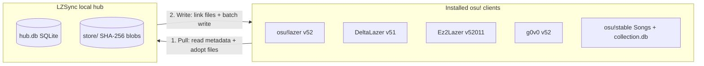

# LZSync technical guide

**English** | [简体中文](./technical.zh-CN.md)

This document covers LZSync's storage architecture, sync decision model, client compatibility rules, database safety guards, and build instructions. For the product overview and downloads, see the [main README](../README.md).

## Hub-and-spoke storage model

LZSync does not copy `client.realm` files between clients. Instead, it maintains a local SQLite database named `hub.db` as the single source of truth and a SHA-256 content-addressed directory named `store/` for raw files. Each osu! client acts as a projection target.



**Pull phase.** LZSync reads entities from each source client into `hub.db` on an insert-if-absent basis. The hub never overwrites existing canonical records and stores client-specific values as per-client variants. Raw audio, background, `.osu`, skin, and `.osr` files move into `store/` under their two-level SHA-256 prefix path, and LZSync places symlinks or hardlinks at the original game paths. For pull-only clients, LZSync reads metadata and copies files into the store without modifying the client's directory.

**Write phase.** When writing to target clients, LZSync links files from `store/` into each client's `files/` or `Songs/` directory and writes metadata rows in batches. Every connected client reads the same physical bytes on disk.

## Baseline three-way decision and global intersection

LZSync separates an item's sync identity from its current value and tracks a per-client baseline from the end of the previous sync run:

- **Beatmap sets** match by online ID on the same server, or by artist, title, and mapper metadata after user confirmation. Their value is the set content hash.
- **Collections** match by name. LZSync evaluates membership per beatmap MD5 hash, so beatmaps added to the same collection in different clients merge without conflict.
- **Skins and scores** are immutable and content-addressed. LZSync fills in missing items across target clients.
- **Key bindings** match by ruleset name, variant, and action integer. Their value is the set of key combinations.
- **Ruleset settings, mod presets, and `game.ini` keys** match by their respective keys and compare as whole values.

On each sync run, LZSync compares each client's current snapshot against its recorded baseline:

1. **Single-source change.** If only one source client changed an item relative to its baseline and the target client has not modified its own copy, LZSync propagates the new value.
2. **Conflict.** If multiple clients changed the same item to different values, or if a newly connected client holds a different value from an existing history, LZSync leaves all clients untouched and surfaces the item in the Pending list. You can pick one client's variant to apply everywhere or click Keep difference to advance all baselines to their current values.
3. **Deletion tracking.** Deleting an item inside a client records a per-client tombstone in `hub.db`. Deletions do not propagate to other clients, and future runs do not re-send deleted items unless you restore them from the Deleted filter in the Library view.
4. **Global intersection.** A sync run exports only data that every enabled target client accepts. LZSync intersects columns, `ActionInt` key binding ranges, `StatisticsJson` hit result keys, and `game.ini` keys across the target set so every target receives a valid record.

## Client compatibility rules

All client-specific behavior lives in declarative `ForkProfile` entries inside `internal/forks`:

| Client | Default directory | Storage files | Disk version | Compatibility rules |
|---|---|---|---|---|
| **osu!lazer** | `osu` | `client.realm`, `files/` | `52` | Official upstream baseline on Bancho. |
| **DeltaLazer** | `deltalazer` | `client.realm`, `files/` | `51` | Detects `[BeatmapSectionGimmicks]` and `[BeatmapHitObjectGimmicks]` in `.osu` files and warns before writing to clients whose editors drop gimmick sections on save. Filters key binding `ActionInt` values to `0..98` for global actions and `0..19` for ruleset actions. |
| **Ez2Lazer** | `osu-Ez2Lazer` | `client_52011.realm`, `files/` | `52011` | Decodes `52011` as upstream version `52` plus Ez revision `11`. Preserves 10 custom columns across `Beatmap`, `Score`, `BeatmapSet`, and `Ruleset` during in-place updates. Skips `bms` ruleset data, `ext:set:` external beatmap sets, and scores with non-zero `JudgeMode` or `HealthMode`. |
| **g0v0** | `g0v0` | `client.realm`, `files/` | `52` | Isolates `g0v0.top` `OnlineID` values from official Bancho `OnlineID` values so private server IDs never cross over. Skips custom market rulesets where `OnlineID >= 10` and their scores. |
| **osu!stable** | Custom install path | `osu!.db`, `collection.db`, `Songs/`, `Skins/` | Legacy binary | Syncs beatmap sets, collections, and skins. Scans `Songs/` directly and reads `osu!.db` for difficulty MD5 and star ratings. Writes linked `Songs/<setID> <artist> - <title>/` folders and rewrites `collection.db` via temp-file rename. Never writes to `osu!.db`; the game indexes new song folders on launch. |

LZSync never overwrites client-local fields such as `DateAdded`, `LastPlayed`, `StatusInt`, `StarRating`, `PP`, `Hidden`, and local audio offsets on existing rows. It also excludes credentials and machine-bound files including `Token`, `Username`, `ReleaseStream`, `framework.ini`, `storage.ini`, and `online.db` from sync.

## Database safety guards

Official osu!lazer deletes and recreates `client.realm` if it encounters an unrecognized schema version or structural corruption. LZSync enforces strict guards on every write path:

- **Zero schema migration.** LZSync opens `client.realm` through `realm-core 20.1.1` in dynamic mode, matching file format v24 used by the clients' Realm NuGet packages. It reads the disk schema version and never modifies it. If a client upgrades to a newer Realm file format in the future, LZSync refuses to open the file rather than upgrading its format.
- **Process and session lock detection.** Before writing, LZSync checks for running game processes including `osu!`, `osu!.exe`, `Ez2Lazer`, and `g0v0!`, and verifies exclusive write access through `realm-core` session locks.
- **Automatic backups before every write.** LZSync creates a timestamped copy of `client.realm` or `collection.db` in `backups/` before modifying any target client. You can restore any backup from the client menu on the Sync screen.
- **Batch transactions with DriftGuard.** Writes execute in explicit batches. Before committing each batch, DriftGuard compares before and after snapshots of the database's class and property schema and rolls back the entire batch if any structural change occurred.
- **Atomic configuration and legacy writes.** Modifications to `game.ini` and `collection.db` write to a temporary file, verify readability, and replace the target via atomic rename after backing up the original file.
- **Container export fallback.** You can export any beatmap set, skin, or score as a standard `.osz`, `.osk`, or `.osr` archive without writing to a target database.

## Building from source

LZSync uses a Go backend with `purego` bindings to the `realm-core` C API and a TypeScript + Vite desktop frontend built on [MyGo](https://github.com/egoist/mygo). The build does not require cgo.

### Prerequisites

- Go 1.24 or newer
- Bun
- GTK 3 and WebKitGTK 4.1 or 4.0 on Linux. The `manifest.scm` file declares the full toolchain for GNU Guix and `direnv`.
- CMake, Ninja, and GCC 13 on Linux, MSVC on Windows, or Xcode Command Line Tools on macOS to build `librealm-ffi`.

### Build and verify

```bash
# 1. Fetch and build the pinned realm-core 20.1.1 C API shared library
./scripts/fetch-librealm.sh

# 2. Run all verification gates: Go build/vet, integration tests, TypeScript check, and bundle
just gates

# 3. Launch the desktop app
just run
```

To run the UI in demo mode without `librealm-ffi` or installed game directories:

```bash
LZSYNC_MOCK=1 just dev
```

## Further reading

- [Product behavior model and system design](./design.md)
- [UI and interaction specification](./ui-spec.md)
- [Native `librealm-ffi` build notes](./dev-native.md)
- [Architecture Decision Records](./adr/)
- [Client fork research notes](./research/)
- [Domain glossary](../GLOSSARY.md)
