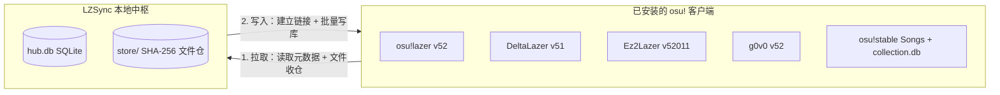

# LZSync 技术与构建说明

[English](./technical.md) | **简体中文**

本文档介绍 LZSync 的存储架构、同步判定模型、跨客户端兼容规则、数据库安全机制与源码构建方式。产品总览与安装包下载请见 [主 README](../README.zh-CN.md)。

## 中枢辐射存储架构

LZSync 不在客户端之间直接复制 `client.realm` 数据库文件，而是以本地 SQLite 数据库 `hub.db` 作为单一数据源，配合 SHA-256 内容寻址目录 `store/` 存放实体文件。各个 osu! 客户端仅作为数据的读取源与写入目标。



**拉取阶段。** LZSync 按只增不改原则将开启「拉取」的客户端数据读入 `hub.db`。中枢已有的规范记录不会被覆盖，各客户端在同一条目上的不同取值会作为端变体分别保存。音频、背景图、`.osu` 谱面、皮肤与 `.osr` 回放文件会按两级 SHA-256 前缀路径归入 `store/`，并在游戏原路径替换为符号链接或硬链接。仅开启「拉取」而未开启「写入」的客户端只做读取与复制入仓，不改动其原有磁盘文件。

**写入阶段。** 向目标客户端写入时，LZSync 将 `store/` 中的文件以链接方式挂载到目标端的 `files/` 或 `Songs/` 目录，并按批次写入数据库记录，使多个客户端共享同一份物理文件。

## 基线三方判定与全局交集

LZSync 将条目的「同步身份」与「当前取值」分离，并记录每个客户端在上一轮同步结束时的基线取值：

- **谱面集**在同一服务器下按 `OnlineID` 匹配，跨服或本地谱面按曲师、曲名与谱师元数据经用户确认后配对，取值为谱面集内容哈希。
- **收藏夹**按名称匹配，内部以单张谱面的 MD5 哈希为单位逐成员判定，不同客户端向同一收藏夹添加的不同谱面会自动合并。
- **皮肤与成绩**采用内容寻址且不可变，同步时直接向缺失该条目的目标客户端补齐。
- **键位绑定**按规则集、变体与动作编号匹配，取值为按键组合集合。
- **规则集设置、Mod 预设与 `game.ini` 配置**按各自键名匹配，按整值比较。

每轮同步时，LZSync 将各客户端的当前快照与基线进行三方比对：

1. **单方改动传播。** 若仅有一个来源客户端相对基线发生了改动，且目标客户端未自行修改该条目，LZSync 会将新值写入目标客户端。
2. **冲突保留。** 若多个客户端将同一条目改成了不同值，或新接入的客户端持有与既有同步历史不同的值，LZSync 不会覆盖任何一端，而是将该条目列入「待处理」。用户可以点选某一客户端的取值推向全部客户端，或点击「保留差异」将各端当前值确认为新基线。
3. **删除不复活。** 在任一客户端内删除条目会在 `hub.db` 中记录该客户端的删除标记。删除操作不会传染给其他客户端，后续同步也不会把已删条目重新写回，除非用户在资料库的「已删除」筛选下主动恢复。
4. **全局交集导出。** 一轮同步只导出当前开启「写入」的全部目标客户端都能接受的数据。写入列、键位 `ActionInt` 枚举域、`StatisticsJson` 判定键与 `game.ini` 键均取全部目标客户端的交集。

## 跨客户端兼容规则

所有客户端差异均以声明式 `ForkProfile` 数据定义在 `internal/forks` 包内，同步内核不包含硬编码的客户端分支：

| 客户端 | 默认数据目录 | 存储载体 | 磁盘版本 | 兼容与过滤规则 |
|---|---|---|---|---|
| **osu!lazer** | `osu` | `client.realm`、`files/` | `52` | 官方上游基线，连接 Bancho 服务器。 |
| **DeltaLazer** | `deltalazer` | `client.realm`、`files/` | `51` | 检测 `.osu` 中的 `[BeatmapSectionGimmicks]` 与 `[BeatmapHitObjectGimmicks]` 段落，流向非 Delta 客户端时发出提醒，避免其他客户端编辑器保存时丢失 Gimmick 数据。按全局 `0..98` 与规则集 `0..19` 的范围过滤键位枚举。 |
| **Ez2Lazer** | `osu-Ez2Lazer` | `client_52011.realm`、`files/` | `52011` | 将版本号 `52011` 解码为官方版本 `52` 加 Ez 修订号 `11`。原位更新时保留 `Beatmap`、`Score`、`BeatmapSet`、`Ruleset` 上的 10 个扩展列；向其他客户端导出时跳过 `bms` 规则集、`ext:set:` 外部托管谱面集以及非零 `JudgeMode`/`HealthMode` 成绩。 |
| **g0v0** | `g0v0` | `client.realm`、`files/` | `52` | 保留官方谱面 `OnlineID`：g0v0-server 使用 Bancho 的谱面 id，客户端缺少该 id 时不会加载排行榜，也不会提交成绩。成绩 id 与账号 id 仍与 `g0v0.top` 隔离。跳过 `OnlineID >= 10` 的市场规则集及其成绩。 |
| **osu!stable** | 自定义安装目录 | `osu!.db`、`collection.db`、`Songs/`、`Skins/` | 旧版二进制 | 支持谱面集、收藏夹与皮肤双向同步。直接扫描 `Songs/` 目录并从 `osu!.db` 补充难度 MD5 与星级；以链接方式生成 `Songs/<setID> <artist> - <title>/` 目录并原子重写 `collection.db`。永不写入 `osu!.db`，新增曲目由游戏启动时自动索引。 |

加入日期、最后游玩时间、在线状态、本地星级、PP 与音频偏移等端本地字段绝不覆盖目标端已有记录。账号凭据与设备绑定文件，包含 `Token`、`Username`、`ReleaseStream`、`framework.ini`、`storage.ini` 与 `online.db`，全部硬性排除在同步范围之外。

## 数据库安全机制

官方 osu!lazer 一旦检测到 `client.realm` 版本号无法识别或表结构异常，会直接清空并重建数据库。LZSync 在所有写入路径上执行严格校验：

- **零版本迁移。** 通过 `purego` 绑定 `realm-core 20.1.1` 动态模式读写 `client.realm`，与各客户端使用的 Realm NuGet 文件格式 v24 对齐，只读不改磁盘 schema 版本号。遇到更高格式版本的数据库时直接拒绝读写，绝不自动升级文件格式。
- **进程与写会话双重守卫。** 写入前扫描运行中的游戏进程，并通过 `realm-core` 写会话锁确认目标库未被其他进程持有。
- **写前自动备份。** 每次写入前在 `backups/` 目录生成带时间戳的 `client.realm` 或 `collection.db` 备份文件，可在同步台客户端菜单中随时还原。
- **批次事务与 DriftGuard。** 写入按批次开启显式事务，提交前比对写前与写后的表结构及属性快照，一旦出现任何结构漂移立即整批回滚。
- **配置文件原子替换。** `game.ini` 与 `collection.db` 采用「写前备份、写入临时文件、回读校验、原子重命名」流程，避免异常退出留下半份文件。
- **标准容器导出兜底。** 支持将谱面集、皮肤或成绩直接打包导出为 `.osz`、`.osk` 或 `.osr` 文件，无需直接写入目标数据库。

## 从源码构建

LZSync 后端使用 Go 编写并通过 `purego` 调用 `realm-core` C API，无需 cgo；桌面前端基于 [MyGo](https://github.com/egoist/mygo) 采用原生 TypeScript 与 Vite 构建。

### 环境要求

- Go 1.24 及以上
- Bun
- Linux 下需安装 GTK 3 与 WebKitGTK 4.1 或 4.0，使用 GNU Guix 与 `direnv` 时可通过仓库根目录的 `manifest.scm` 自动加载完整环境
- 构建 `librealm-ffi` 所需的 CMake、Ninja，以及 Linux 下的 GCC 13、Windows 下的 MSVC 或 macOS 下的 Xcode Command Line Tools

### 构建与运行

```bash
# 1. 拉取源码并构建 realm-core 20.1.1 动态库
./scripts/fetch-librealm.sh

# 2. 运行四道门禁：Go 编译与静态检查、全量集成测试、TypeScript 类型检查、应用打包
just gates

# 3. 启动桌面应用
just run
```

若当前环境未准备游戏数据目录或 `librealm-ffi` 动态库，可启用演示模式启动界面：

```bash
LZSYNC_MOCK=1 just dev
```

## 延伸阅读

- [产品行为模型与同步体系设计](./design.md)
- [界面与交互设计准则](./ui-spec.md)
- [Native 动态库构建手册](./dev-native.md)
- [架构决策记录](./adr/)
- [各客户端差异调研笔记](./research/)
- [领域术语表](../GLOSSARY.md)
